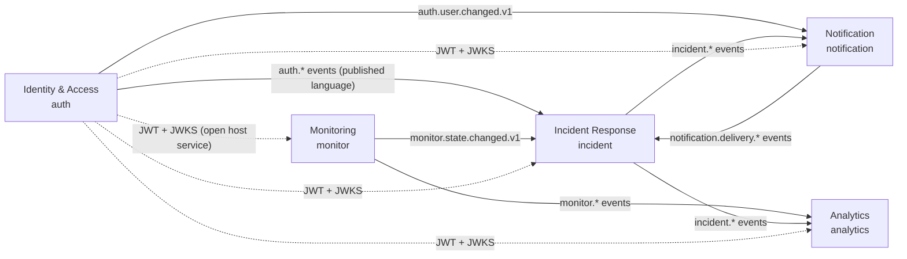
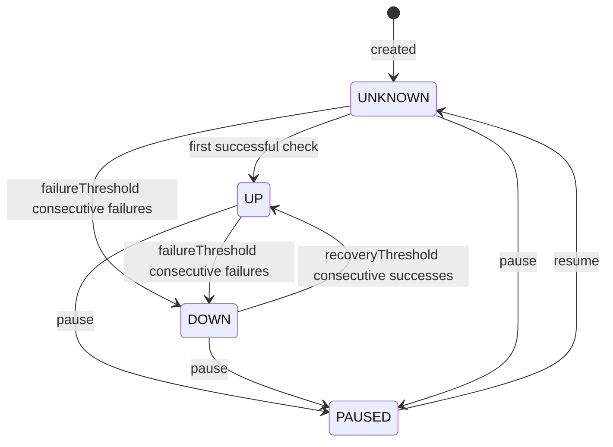
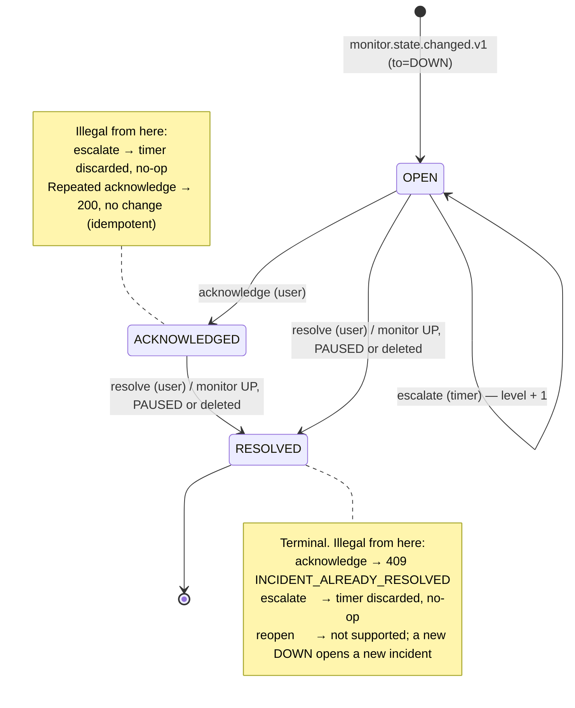

# Domain model

This document splits the problem into **bounded contexts**, shows how they relate, and lists the **aggregates** and **invariants** each one protects. If these terms are new, read [bounded contexts and DDD basics](learning/concepts/bounded-contexts-and-ddd.md) first. Names come from the [glossary](03-glossary.md).

## Bounded contexts

A bounded context is a part of the system where each word has exactly one meaning and one team (here: one service) owns the model.

| Context | Service | Core question it answers | Type |
|---------|---------|--------------------------|------|
| **Identity & Access** | [auth](services/auth-org.md) | Who is this, and which organization and role do they have? | Generic (a real team would buy or reuse this) |
| **Monitoring** | [monitor](services/monitor.md) | Is this URL up right now? | Core |
| **Incident Response** | [incident](services/incident.md) | Something is down: who must act, and have they? | Core |
| **Notification** | [notification](services/notification.md) | How do we reach this person or channel, and did the message get through? | Supporting |
| **Analytics** | [analytics](services/analytics.md) | How reliable has this been over time? | Supporting (read-only) |

Two components are **not** bounded contexts because they own no domain model: the [gateway](services/gateway.md) (edge routing) and [realtime](services/realtime.md) (pushes change hints to browsers).

### Why "user" means different things

The same person appears in four contexts with four different shapes. This is the point of bounded contexts: each keeps only what it needs.

| Context | Its view of a user |
|---------|--------------------|
| Identity & Access | Credentials, email, display name, role in an organization |
| Incident Response | A **responder**: an ID that can be on call or an escalation target |
| Notification | A **recipient**: an ID with contact methods, plus a copied email and name |
| Analytics | Not modelled at all |

## Context map

Arrows point **downstream**: the context at the arrowhead depends on the one at the tail.

| Relationship | Pattern | What it means here |
|--------------|---------|--------------------|
| Every context → its consumers | **Published language** | Events in the [event catalog](contracts/event-catalog.md) are the only shared vocabulary. No context sees another's tables or classes. |
| Identity & Access → everyone | **Open host service** | A stable public protocol (JWT claims + JWKS endpoint) that any service can use without coordinating with auth. |
| Each consumer | **Anti-corruption layer (ACL)** | A small translation step at the edge of the consumer that maps the incoming event into the consumer's own model. Example: Incident turns `auth.membership.changed.v1` into a row in its own `responders` table and never uses the word "membership" internally. |
| Monitoring → Incident Response | **Customer/supplier** | Incident's needs shape what `monitor.state.changed.v1` carries (monitor name and URL are included so Incident never has to call back). |
| Incident Response ↔ Notification | **Partnership** (two-way, async) | Incident says *who* to page; Notification reports *whether it worked*. Both directions are events, so neither blocks on the other. |
| Analytics | **Conformist** | It accepts upstream events as they are and reshapes them only for querying. |

There are **no synchronous calls between contexts** at runtime. The reasons are in [ADR-0014](adr/0014-on-call-in-incident-and-local-replicas.md) and [communication.md](architecture/communication.md).

## Aggregates and invariants

An **aggregate** is a cluster of objects that is loaded and saved as one unit, inside one transaction, through one root entity. An **invariant** is a rule that must hold after every transaction.

### Identity & Access

| Aggregate | Root | Contains | Invariants |
|-----------|------|----------|-----------|
| Organization | `Organization` | Memberships | Exactly one `OWNER`. The owner's membership cannot be removed or demoted. |
| User | `User` | Refresh token families | Email is unique (case-insensitive). A reused refresh token revokes its whole family. |
| API key | `ApiKey` | — | Only the hash is stored. A revoked key never yields a token. |

### Monitoring

| Aggregate | Root | Contains | Invariants |
|-----------|------|----------|-----------|
| Monitor | `Monitor` | Definition, confirmed status, counters, schedule/lease | Status changes only through the confirmation rules below. `stateVersion` increases by exactly 1 per status change. A check result is applied only by the worker holding the current lease token. |

Each arrow publishes one `monitor.state.changed.v1`. Individual failed checks that do not reach the threshold change counters only, and publish only `monitor.check.completed.v1`.

### Incident Response

| Aggregate | Root | Contains | Invariants |
|-----------|------|----------|-----------|
| Incident | `Incident` | Timeline entries, current escalation level, escalation timer | At most one unresolved incident per monitor. Status follows the lifecycle below. Every status change appends exactly one timeline entry and increments `version` in the same transaction. `RESOLVED` is terminal. |
| Escalation policy | `EscalationPolicy` | Levels and their targets | One policy per organization. Levels are numbered 1..n without gaps. Each level has at least one target. |
| On-call schedule | `OnCallSchedule` | Ordered members | At least one member. Exactly one member is on call at any instant. |
| Responder (replica) | `Responder` | — | Read-only copy of organization members, updated only by `auth.*` events. |

#### Incident lifecycle

What happens when an illegal or repeated transition is attempted:

| Attempt | Current status | Result | Why |
|---------|----------------|--------|-----|
| Acknowledge | `ACKNOWLEDGED` | `200` with the unchanged incident; no timeline entry, no event | The command is **idempotent**: a double-click or a retried request must not fail or duplicate. |
| Acknowledge | `RESOLVED` | `409 Conflict`, error code `INCIDENT_ALREADY_RESOLVED` | The user's intent cannot be satisfied; tell them. |
| Resolve | `RESOLVED` | `200` with the unchanged incident | Idempotent. |
| Escalation timer fires | `ACKNOWLEDGED` or `RESOLVED` | Timer row cleared, nothing published | Timers and user actions race; the state check inside the transaction decides. |
| `monitor.state.changed.v1` (to=`DOWN`) | An unresolved incident exists for the monitor | Event recorded as processed, nothing else | Duplicate or replayed signal. |
| `monitor.state.changed.v1` (to=`UP`) | No unresolved incident | Event recorded as processed, nothing else | The incident was resolved manually, or the DOWN event was stale. |
| Any `monitor.state.changed.v1` with `stateVersion` ≤ last seen for that monitor | any | Ignored | Out-of-order or duplicate delivery ([ADR-0017](adr/0017-ordering-and-replay.md)). |
| Two users acknowledge at the same moment | `OPEN` | One wins; the other gets `200` with the already-acknowledged incident | Optimistic locking on `version`, retried once. |

Known limitation, on purpose: if a user manually resolves an incident while the monitor is still `DOWN`, no new incident opens until the monitor goes `UP` and then `DOWN` again. See [open questions](open-questions.md).

### Notification

| Aggregate | Root | Contains | Invariants |
|-----------|------|----------|-----------|
| Delivery | `Delivery` | Attempts counter, last error | `dedupeKey` is unique. Status moves `PENDING → SENT` or `PENDING → DEAD`; `DEAD → PENDING` only by manual retry. `attempts` never exceeds 5 without a manual retry. |
| Contact method | `ContactMethod` | — | Belongs to one user. SMS targets are E.164 numbers. |
| Organization channel | `OrgChannel` | — | URL passes the SSRF guard when saved and again when used. |
| Recipient (replica) | `Recipient` | — | Read-only copy of user email and name from `auth.user.changed.v1`. |

### Analytics

Analytics has **no aggregates and no invariants of its own**. It holds a read model: tables derived entirely from events, safe to delete and rebuild ([CQRS guide](learning/concepts/cqrs.md)).

## Domain events

The full list with payloads is the [event catalog](contracts/event-catalog.md). Summary by context:

| Context | Events it publishes |
|---------|--------------------|
| Identity & Access | `auth.org.created.v1`, `auth.user.changed.v1`, `auth.membership.changed.v1` |
| Monitoring | `monitor.definition.changed.v1`, `monitor.check.completed.v1`, `monitor.state.changed.v1` |
| Incident Response | `incident.opened.v1`, `incident.acknowledged.v1`, `incident.escalated.v1`, `incident.resolved.v1`, `incident.page.requested.v1` |
| Notification | `notification.delivery.succeeded.v1`, `notification.delivery.failed.v1` |

## Decisions that shaped this model

- On-call schedules and escalation policies live in Incident Response, not Identity & Access: [ADR-0014](adr/0014-on-call-in-incident-and-local-replicas.md).
- Failure confirmation lives in Monitoring; Incident Response trusts a confirmed status change: [ADR-0009](adr/0009-check-results-and-state-changes.md).
- Incident is a state machine plus an append-only timeline, not event-sourced: [ADR-0011](adr/0011-incident-state-machine-not-event-sourcing.md).
- Notification is stateful: [ADR-0013](adr/0013-notification-owns-delivery-state.md).
