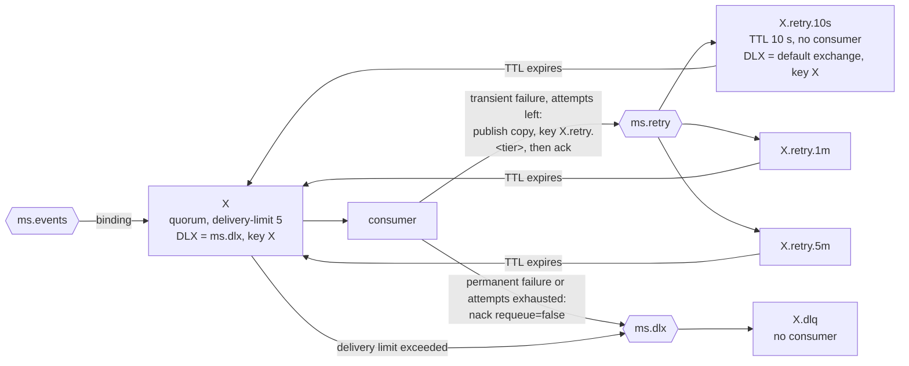

# ADR-0023: Retry with TTL wait queues and dead-letter exchanges, and park failures in a DLQ

- Status: Accepted
- Date: 2026-11-15
- Phase: 2 (dead-letter queues), 3 (delayed retries)

## Context

Handlers fail. The database is briefly unavailable, an SMTP server times out, a payload is malformed. Three questions for every consumer:

1. What happens to a message whose handler fails?
2. How is a retry **delayed** so that it does not hammer a struggling dependency?
3. When do we stop, and where does the message go?

Terms:

- **Transient failure**: likely to succeed later (timeout, connection refused, `503`).
- **Permanent failure**: will never succeed (invalid payload, `400` from a webhook, unknown event version).
- **Poison message**: one that fails every time; in the worst case it crashes the consumer process before any error handling runs.
- **Dead-letter exchange (DLX)**: a queue setting. When a message is rejected without requeue, expires (TTL), or exceeds the queue's delivery limit, RabbitMQ republishes it to that exchange.
- **Dead-letter queue (DLQ)**: a queue bound to a DLX where failed messages are parked for inspection.

What does *not* work: `nack(requeue = true)`. The message goes straight back to the head of the queue and is redelivered immediately, in a tight loop, at full speed, blocking everything behind it.

## Decision drivers

- Transient failures recover without human action; permanent ones do not retry pointlessly.
- A single bad message must never block a queue (NFR-R5).
- Delays must be visible and configurable.
- No third-party broker plugins.
- The mechanics should be explicit: this is a learning goal.

## Options considered

### How to delay a retry

| Option | Pros | Cons |
|--------|------|------|
| A. Sleep in the consumer, then retry in process | Trivial | Holds a prefetch slot and blocks the channel while sleeping; lost on restart; no backpressure |
| B. `nack` with requeue | Built in | Immediate redelivery: a hot loop, no delay |
| C. **Wait queues**: queues with a message TTL and no consumer, whose DLX routes expired messages back to the work queue (chosen) | Core RabbitMQ features only; delays are durable (survive restarts); visible as queue depth in the management UI | One queue per delay tier per work queue; delays are fixed tiers, not arbitrary; a message's TTL is only evaluated at the head of a queue, so tiers must use **per-queue** TTL (all messages in a queue share one delay), not per-message TTL |
| D. Delayed-message exchange plugin (`x-delayed-message`) | Arbitrary per-message delay; one exchange | A community plugin that is not in the official image (custom image to build and track across broker upgrades); its documentation warns it is not designed for large backlogs of delayed messages; one more thing that can differ between environments |
| E. Retry schedule in the database (`next_attempt_at` column + poller) | Arbitrary delays; cancellable; queryable | A poller per retrying table; duplicates what the broker can do; chosen only where a timer must be cancellable (escalation, [ADR-0013](0013-notification-owns-delivery-state.md)) |

### How a failed message leaves the work queue

| Option | Pros | Cons |
|--------|------|------|
| F. `nack(requeue=false)` and let the queue's DLX route it to a wait queue; count attempts from the `x-death` header | Purely broker-driven | One delay tier unless routing is elaborate; `x-death` handling is fiddly; the attempt check runs only if the consumer gets far enough to read headers |
| G. **Consumer republishes a copy to a retry exchange with an attempt header, then acks the original** (chosen for retries) | The consumer chooses the tier (backoff) and can attach the error; explicit | Two operations (publish, ack): a crash between them duplicates the message, which the inbox absorbs |
| H. **Quorum-queue delivery limit** (chosen as the safety net) | The broker counts redeliveries and dead-letters automatically; protects against messages that crash the process | Counts only broker redeliveries, not our republished copies |

## Decision

**C + G + H**, as one standard topology applied to every work queue by `@microsentinel/messaging`.

### Topology for a work queue `X`

- `X` arguments: `x-queue-type=quorum`, `x-dead-letter-exchange=ms.dlx`, `x-dead-letter-routing-key=X`, `x-delivery-limit=5`.
- `X.retry.<tier>` arguments: `x-message-ttl=<tier in ms>`, `x-dead-letter-exchange=""` (the default exchange, which routes by queue name), `x-dead-letter-routing-key=X`.
- `X.dlq`: a durable queue bound to `ms.dlx` with key `X`. Nothing consumes it automatically.

### Consumer outcomes

| Handler result | Action |
|----------------|--------|
| Success | broker-ack |
| Duplicate (inbox hit) | broker-ack |
| Throws `RetryableError` (or an unknown error) and `x-ms-attempt` < max | Publish a copy to `ms.retry` with routing key `X.retry.<tier>`, header `x-ms-attempt` + 1 and `x-ms-last-error`; wait for the confirm; broker-ack the original |
| Throws `PermanentError`, payload fails validation, or attempts are exhausted | `nack(requeue=false)` → `ms.dlx` → `X.dlq` |
| Process crashes or the connection drops mid-handling | Broker redelivers; after 5 such redeliveries the delivery limit dead-letters the message to `X.dlq` |

An unknown error is treated as **retryable**: failing closed into the DLQ on the first unexpected exception would lose transient-failure recovery.

### Tiers

| Queue kind | Attempts | Delays | Note |
|------------|----------|--------|------|
| Event consumers (`incident.*`, `notification.incident-events`, `notification.auth-events`) | 4 | 5 s, 30 s, 2 min | Failures here are almost always the service's own database |
| `notification.delivery-jobs` | 5 | 10 s, 1 min, 5 min, 15 min | External receivers; longer tail. On the final failure the delivery is marked `DEAD` and `notification.delivery.failed.v1` is published before the message is dead-lettered |

Fixed tiers approximate **exponential backoff**. **Jitter** (randomising delays so retries do not arrive in synchronised waves) is not applied inside the broker because per-queue TTL is fixed; the spread comes naturally from messages failing at different times. In-process retries (JWKS fetch, broker reconnect) do use jitter ([resilience](../cross-cutting/resilience.md)).

### Operating the DLQ

- DLQ depth > 0 is an alert condition and a dashboard panel ([observability](../cross-cutting/observability.md)).
- Messages keep their headers (`x-ms-last-error`, `x-death`) so the cause is visible in the management UI.
- **Redrive** is deliberate and manual: a small CLI (`pnpm dlq:redrive <queue>`) moves messages from `X.dlq` back to `X` after the cause is fixed. For deliveries there is also a UI button, which resets the delivery row and enqueues a fresh job.
- Retrying breaks ordering. That is acceptable because no consumer depends on arrival order ([ADR-0017](0017-ordering-and-replay.md)).

### Streams

Stream consumers (analytics) cannot nack-to-DLX. A message that fails validation is logged, counted, written to a small `quarantined_events` table with its offset, and **skipped**; a transient database error stops the consumer, which restarts from the stored offset.

## Consequences

- Positive: uses only built-in RabbitMQ features; every waiting retry and every dead message is visible as a queue with a count.
- Positive: three independent protections against a poison message: validation → DLQ, attempt cap → DLQ, delivery limit → DLQ.
- Negative: several queues per work queue (up to four wait queues plus a DLQ). Declared by code, but they clutter the management UI.
- Negative: publish-then-ack is not atomic; duplicates are possible and rely on the inbox.
- Negative: fixed delay tiers; changing a tier means declaring a new queue (queue arguments are immutable).
- Harder later: none; the pattern is portable to any broker with TTL and dead-lettering, and maps onto Kafka's "retry topics".

## Revisit when

- Arbitrary per-message delays are needed (for example "retry at the time the provider told us"): use a database schedule (option E) for that flow.
- The number of work queues makes the queue count unmanageable: share wait queues per service with a header-based return route.

## Learning choice?

No. TTL + DLX wait queues are the standard RabbitMQ approach when the delayed-message plugin is not wanted. Building it by hand instead of using a library's retry feature is the learning part.

## How to explain it in an interview

> "If a handler fails I never requeue directly, because that redelivers immediately in a hot loop. For a transient error the consumer republishes the message to a wait queue that has a TTL and no consumers; when the TTL expires, the queue's dead-letter exchange routes it back to the work queue. I have a few tiers, like ten seconds, one minute, five minutes, which gives backoff. After the last attempt, or for a permanent error like an invalid payload, the message is rejected to a dead-letter queue where it's parked for a human, with the error in a header. And as a safety net the quorum queue has a delivery limit, so even a message that crashes the process gets dead-lettered after five redeliveries instead of blocking the queue forever."
