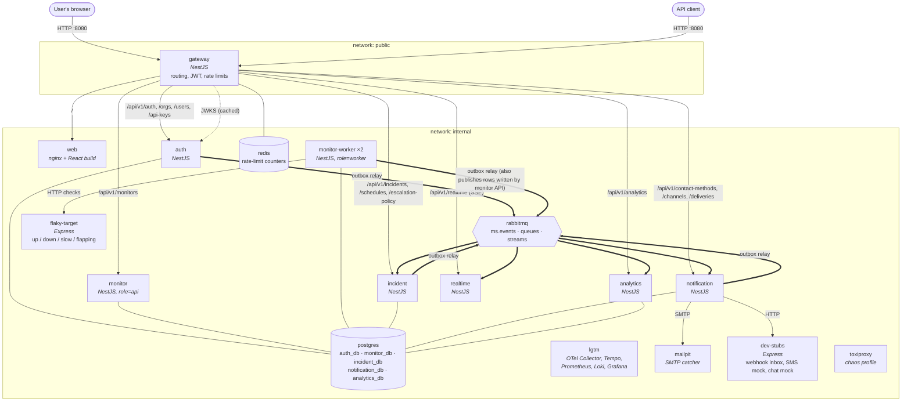

# C4 level 2: containers

A "container" in C4 is anything that runs or stores data on its own: a process, a database, a broker. (It usually, but not necessarily, maps to a Docker container.) Here the mapping is one-to-one with Compose services.

Legend: thin arrows are synchronous HTTP; thick arrows (`==>`) are AMQP; dotted is a cached, occasional fetch. Every NestJS container also sends OTLP to `lgtm` (not drawn, to keep the diagram readable), and every service fetches the JWKS from `auth` at startup and on key rotation.

## Container inventory

| Container | Tech | Image | Stateful? | Replicas (local) | Phase | Profile |
|-----------|------|-------|-----------|------------------|-------|---------|
| `gateway` | NestJS 12 | built from `apps/gateway` | No | 1 | 0 | core |
| `web` | React 19 + Vite 8, served by nginx | built from `apps/web` | No | 1 | 0 | core |
| `auth` | NestJS 12 | built from `apps/auth` | DB | 1 | 1 | core |
| `monitor` | NestJS 12 (`MONITOR_ROLE=api`) | built from `apps/monitor` | DB | 1 | 1 | core |
| `monitor-worker` | same image (`MONITOR_ROLE=worker`) | built from `apps/monitor` | DB | 1 → 2+ in Phase 3 | 1 | core |
| `incident` | NestJS 12 | built from `apps/incident` | DB | 1 | 1 | core |
| `notification` | NestJS 12 | built from `apps/notification` | DB | 1 | 2 | core |
| `realtime` | NestJS 12 | built from `apps/realtime` | No (in-memory connections) | 1 | 2 | core |
| `analytics` | NestJS 12 | built from `apps/analytics` | DB | 1 | 4 | `analytics` |
| `postgres` | PostgreSQL 18 | `postgres:18.7` | Yes (volume) | 1 | 0 | core |
| `redis` | Redis 8 | `redis:8.8.4-alpine` | Ephemeral | 1 | 1 | core |
| `rabbitmq` | RabbitMQ 4.3 | `rabbitmq:4.3.7-management-alpine` | Yes (volume) | 1 | 2 | core |
| `mailpit` | Mailpit | `axllent/mailpit:v1.33.1` | Ephemeral | 1 | 2 | core |
| `dev-stubs` | Express 5 | built from `tools/dev-stubs` | Ephemeral | 1 | 2 | core |
| `flaky-target` | Express 5 | built from `tools/flaky-target` | Ephemeral | 1 | 1 | core |
| `lgtm` | Grafana OTel LGTM | `grafana/otel-lgtm:0.41.0` | Ephemeral | 1 | 4 | `obs` |
| `toxiproxy` | Toxiproxy | `ghcr.io/shopify/toxiproxy:2.13.0` | No | 1 | 3 | `chaos` |
| `*-migrate` | one-shot, same image as its service | — | — | runs once | 1 | core |

"Phase" is when the container first appears. Details, ports, memory limits and health checks: [deployment-local](deployment-local.md). Exact versions and reasons: [tech-stack](tech-stack.md).

## Things to notice

- **Only `gateway` is on the `public` network** and publishes a port for application traffic. Everything else is reachable only by container DNS name on `internal`. Tool UIs (RabbitMQ management, Mailpit, Grafana, dev-stubs) publish ports for the developer, not for the application.
- **`monitor` and `monitor-worker` are one service in two process types**, built from one codebase and sharing `monitor_db`. They scale independently: the API by request load, the workers by number of monitors. This is one service, not two, because they share a model and a database ([monitor](../services/monitor.md)).
- **One Postgres server, five databases.** Each service connects with its own role that can only reach its own database. What this does and does not sacrifice is in [ADR-0018](../adr/0018-single-postgres-and-ram-budget.md).
- **`realtime` is not a domain service.** It exists so that no domain service has to hold browser connections ([ADR-0019](../adr/0019-sse-realtime-service.md)).
- **No service registry.** Services find each other by Compose DNS name (`http://incident:3000`, `amqp://rabbitmq:5672`). See [service discovery](../learning/concepts/service-discovery.md).

## Level 3 (components)

Component-level structure (Nest modules and providers) is in each [service doc](../services/), under "Internal components" and "Nest structure".
