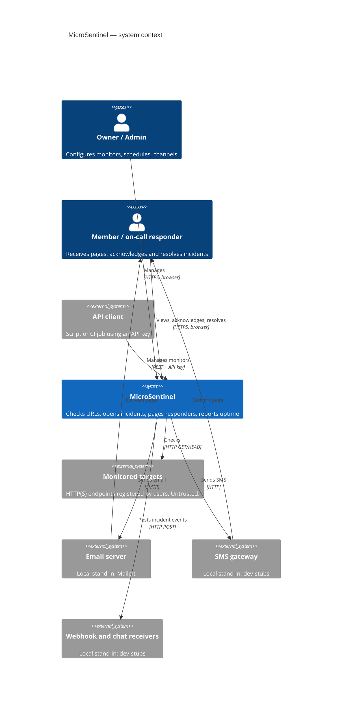
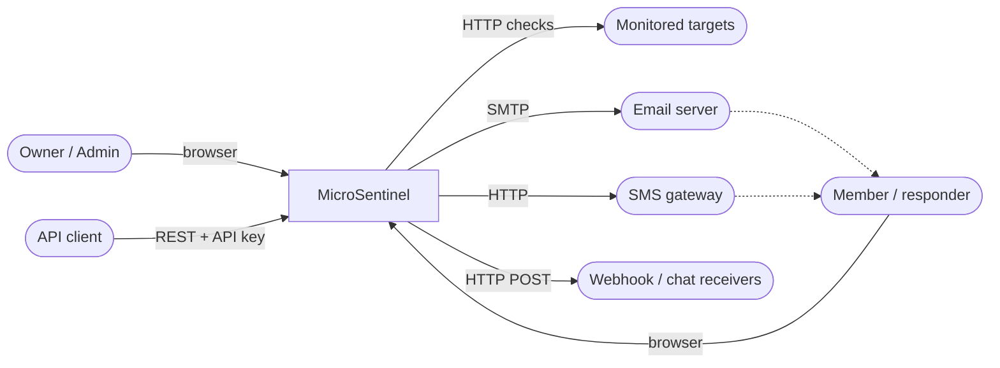

# C4 level 1: system context

The C4 model (Simon Brown) describes a system at four zoom levels: Context, Containers, Components, Code. Level 1 shows the system as one box, the people who use it, and the outside systems it touches. Nothing inside the box is shown yet.

If your Markdown viewer does not render `C4Context` (it is a newer Mermaid diagram type), this plain flowchart shows the same thing:

## What crosses the boundary

| Boundary crossing | Direction | Trust | Notes |
|-------------------|-----------|-------|-------|
| Browser ↔ MicroSentinel | in | Authenticated user | One origin; see [auth in the browser](../frontend/auth-in-the-browser.md) |
| API client → MicroSentinel | in | API key exchanged for a token | [auth-org](../services/auth-org.md) |
| MicroSentinel → targets | out | **Untrusted** | We call URLs that users typed. This is the main SSRF risk: [security](../cross-cutting/security.md) |
| MicroSentinel → email / SMS / webhooks | out | Webhook URLs are **untrusted** user input | Same SSRF guard; all three are local stand-ins by default ([ADR-0028](../adr/0028-local-stand-ins.md)) |

## Things deliberately outside the system

- **Real email, SMS and chat providers.** The system speaks SMTP and plain HTTP, so a real provider is a configuration change, but none is required and none is on by default.
- **An identity provider.** auth is our own. A real product would probably use Keycloak or a hosted IdP; building it is a [learning choice](../adr/0015-jwt-rs256-jwks-validate-everywhere.md).
- **The flaky target.** `flaky-target` is a lab tool that plays the role of a monitored target. It is part of the repository but not part of the system.

Next: [C4 level 2: containers](c4-containers.md).
