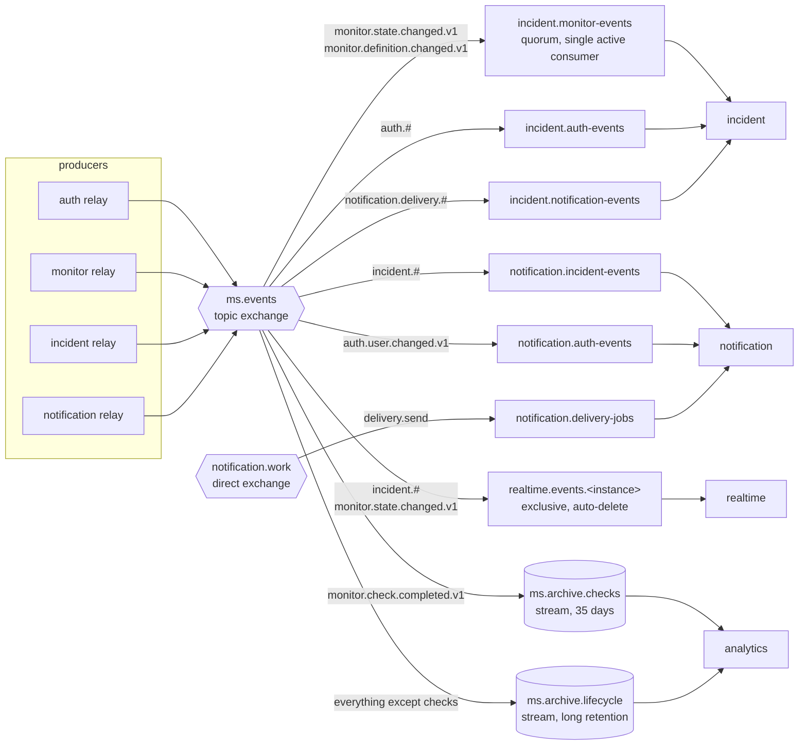

# Communication: which interactions are sync, which are async, and why

**Synchronous** means the caller waits for the answer (HTTP request/response). **Asynchronous** means the sender hands a message to the broker and moves on; the receiver handles it whenever it can. Background: [sync vs async communication](../learning/concepts/sync-vs-async-communication.md).

## The rule

> A user waiting for an answer gets a synchronous call into **one** service. Anything one service needs to tell another is an event.

Why so strict? A synchronous call between two services creates **temporal coupling**: A only works while B is up. Chain three such calls and the availability of the whole request is the product of all three. Events remove that: if the consumer is down, the message waits.

The cost is real and should be said out loud: the system is **eventually consistent** between services (a new incident appears in the timeline a few hundred milliseconds before the email is sent, and in analytics a moment later), and debugging needs tracing because there is no single call stack.

## Every edge

### Synchronous (HTTP)

| # | From → To | What | Why sync | Timeout | On failure |
|---|-----------|------|----------|---------|-----------|
| S1 | Browser → gateway | All REST calls | A person is waiting | Browser default; UI shows error after 15 s | UI error state with retry |
| S2 | gateway → auth, monitor, incident, notification, analytics | Proxied REST | Same request | 10 s | `504 Gateway Timeout` or `502 Bad Gateway` as problem+json |
| S3 | gateway → realtime | SSE stream | Long-lived response | none (heartbeat every 15 s) | Browser reconnects with backoff |
| S4 | gateway → web | Static files | Page load | 10 s | `502` |
| S5 | Every service → auth | `GET /.well-known/jwks.json` | Needs public keys to verify tokens | 3 s | Use cached keys; cache lasts 10 min and is refreshed on unknown `kid` |
| S6 | monitor-worker → target | The check itself | The point of the product | per monitor, 1–30 s | Recorded as a `FAILURE` check |
| S7 | notification → Mailpit / dev-stubs / user webhooks | Sending a delivery | External side effect | 5 s | Retry with delay, then DLQ |
| S8 | Service → PostgreSQL, gateway → Redis | Data access | — | statement timeout 5 s; Redis 200 ms | See each [service doc](../services/) |

S5 is the only service-to-service HTTP call, and it is not on any request path: keys are cached, so auth being down does not stop other services from verifying tokens ([ADR-0015](../adr/0015-jwt-rs256-jwks-validate-everywhere.md)).

**Phase 1 exception, removed in Phase 2:** before the broker exists, `monitor-worker` calls `POST http://incident:3000/internal/v1/monitor-signals` synchronously. This is a deliberate shortcut so that you feel the problem (kill incident, lose signals) before fixing it. See [phases](../roadmap/phases.md).

### Asynchronous (events through RabbitMQ)

All events go to the topic exchange `ms.events` with routing key = event type. Full payloads: [event catalog](../contracts/event-catalog.md).

| # | Event | Producer | Consumers (queue) | Why async |
|---|-------|----------|-------------------|-----------|
| A1 | `monitor.state.changed.v1` | monitor | incident (`incident.monitor-events`), realtime, analytics | Incident must not be required for checks to continue; signals must survive incident being down |
| A2 | `monitor.check.completed.v1` | monitor | analytics (stream) | High volume, nobody is waiting |
| A3 | `monitor.definition.changed.v1` | monitor | incident (`incident.monitor-events`), analytics | Replicas and cleanup |
| A4 | `incident.opened.v1`, `incident.acknowledged.v1`, `incident.escalated.v1`, `incident.resolved.v1` | incident | notification (`notification.incident-events`), realtime, analytics | Several independent reactions to one fact (pub/sub) |
| A5 | `incident.page.requested.v1` | incident | notification (`notification.incident-events`) | Sending is slow and failure-prone; incident must not wait for SMTP |
| A6 | `notification.delivery.succeeded.v1`, `notification.delivery.failed.v1` | notification | incident (`incident.notification-events`) | Timeline entry; not urgent |
| A7 | `auth.org.created.v1` | auth | incident (`incident.auth-events`) | Creates the default escalation policy |
| A8 | `auth.user.changed.v1` | auth | incident (`incident.auth-events`), notification (`notification.auth-events`) | Keeps local replicas current |
| A9 | `auth.membership.changed.v1` | auth | incident (`incident.auth-events`) | Keeps the responder replica current |
| A10 | `notification.delivery.send.v1` (command) | notification | notification (`notification.delivery-jobs`) | A work queue inside one service: separates deciding from sending and gives retry/DLQ |

### Choreography, not orchestration

No component directs the outage flow. Each service reacts to events and publishes its own. That is **choreography**. The trade-off (no single place shows the whole flow) is why the [flows](../flows/) and tracing exist. See [choreography vs orchestration](../learning/concepts/choreography-vs-orchestration.md).

## Broker topology

Each work queue `X` also has wait queues `X.retry.<delay>` and a dead-letter queue `X.dlq` (not drawn). The mechanics are in [ADR-0023](../adr/0023-retry-topology-ttl-dlx.md) and [notification-retry-and-dlq](../flows/notification-retry-and-dlq.md).

| Element | Type | Durable | Declared by | Why this type |
|---------|------|---------|-------------|---------------|
| `ms.events` | topic exchange | yes | broker definitions file | One place to publish; consumers choose by pattern |
| `ms.retry` | direct exchange | yes | definitions file | Routes a failed message to a named wait queue |
| `ms.dlx` | direct exchange | yes | definitions file | Routes dead-lettered messages to `X.dlq` |
| `notification.work` | direct exchange | yes | notification | Commands are private to one service |
| Work queues | quorum queue | yes | the consuming service at startup | Durable, has a delivery limit for poison messages |
| `realtime.events.<instance>` | classic, exclusive, auto-delete | no | each realtime instance | Hints for currently connected browsers; nothing to keep when the instance dies |
| `ms.archive.*` | stream | yes | definitions file | Non-destructive read and replay ([ADR-0017](../adr/0017-ordering-and-replay.md)) |

**Who owns a queue?** The consumer. A queue is the consumer's inbox, so the consumer declares it and its bindings. Producers know only the exchange and the event type; they never know who is listening. That is what keeps producers and consumers decoupled.

## Delivery guarantees per edge

| Edge | Guarantee | Achieved by |
|------|-----------|-------------|
| Service DB → broker | At-least-once | Outbox + publisher confirms |
| Broker → consumer | At-least-once | Durable queues, persistent messages, manual broker acks |
| Consumer effect | Effectively once | Inbox table + version checks + unique constraints ([ADR-0012](../adr/0012-idempotent-consumers.md)) |
| Broker → realtime → browser | At-most-once (best effort) | Acceptable: the browser refetches on reconnect ([realtime](../frontend/realtime.md)) |
| notification → outside world | At-least-once | A crash between "sent" and "recorded" can resend; receivers get an idempotency key |

## Ordering per edge

| Flow | Ordering needed? | How |
|------|------------------|-----|
| State changes of one monitor | Yes, per monitor | `stateVersion` check in incident; single active consumer + prefetch 1 as the first line of defence |
| Events of one incident (in notification, analytics, realtime) | No | Each event is self-contained; analytics upserts fields; realtime sends hints |
| Check results | No | Each is an independent fact keyed by its ID |
| User / membership snapshots | Latest wins | `version` field; replicas ignore older versions |

Detail and the "why not Kafka" discussion: [ADR-0017](../adr/0017-ordering-and-replay.md), [partitioning and ordering](../learning/concepts/partitioning-and-ordering.md).

## Why no gRPC

The brief proposed a gRPC call from incident to auth for the on-call lookup. After [ADR-0014](../adr/0014-on-call-in-incident-and-local-replicas.md) that call does not exist, and no other internal request/response call remains, so there are no `.proto` files ([contracts/proto](../contracts/proto/README.md)). gRPC is still explained in the [sync vs async guide](../learning/concepts/sync-vs-async-communication.md) because interviewers ask about it.
