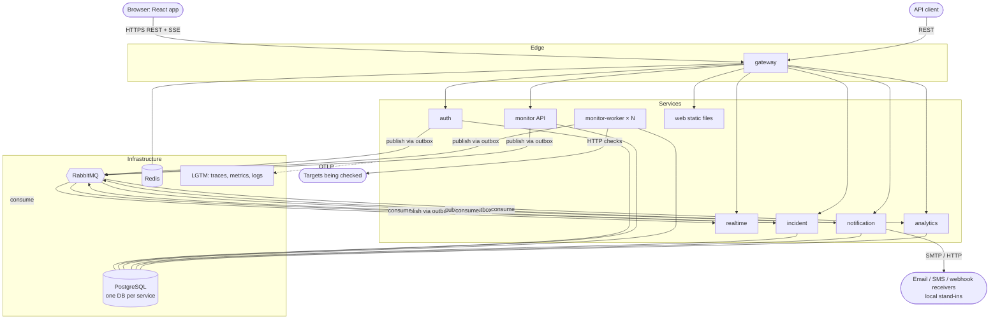

# Architecture overview

One page. Everything here is expanded in the linked documents.

## The picture

Solid arrows into the gateway are **synchronous** HTTP. Everything between services goes through RabbitMQ and is **asynchronous**. There is no service-to-service HTTP or gRPC at runtime.

## The components in one line each

| Component | Job | Doc |
|-----------|-----|-----|
| **gateway** | The only public entry point: routing, JWT check, rate limiting | [gateway](../services/gateway.md) |
| **auth** | Users, organizations, roles, API keys; issues JWTs and serves the JWKS | [auth-org](../services/auth-org.md) |
| **monitor** (API + workers) | Monitor CRUD; workers claim leases, run checks, confirm status changes | [monitor](../services/monitor.md) |
| **incident** | Incident lifecycle, timeline, on-call schedules, escalation | [incident](../services/incident.md) |
| **notification** | Turns pages and incident events into deliveries; retries; DLQ | [notification](../services/notification.md) |
| **analytics** | Read model for uptime, latency, MTTA, MTTR | [analytics](../services/analytics.md) |
| **realtime** | Pushes change hints to browsers over SSE | [realtime](../services/realtime.md) |
| **web** | The React single-page app | [web-app](../frontend/web-app.md) |
| **PostgreSQL** | One server, one database and one role per service | [data-ownership](data-ownership.md) |
| **RabbitMQ** | Topic exchange for events, quorum queues for work, streams for replay | [communication](communication.md) |
| **Redis** | Rate-limit counters for the gateway only | [gateway](../services/gateway.md) |
| **LGTM** | Grafana + Tempo + Prometheus + Loki + OTel Collector in one container | [observability](../cross-cutting/observability.md) |

## The five ideas that hold it together

1. **Each service owns its data.** Nobody reads another service's tables. If a service needs someone else's data, it keeps a **local replica** built from events. → [data-ownership](data-ownership.md)
2. **Writes and events are atomic.** A service writes its data and its outgoing events in one database transaction (the **outbox**); a relay publishes them later. No event is lost, some are published twice. → [ADR-0008](../adr/0008-transactional-outbox.md)
3. **Consumers are idempotent.** Because events can arrive twice or out of order, every consumer records what it has processed and checks version numbers. → [ADR-0012](../adr/0012-idempotent-consumers.md), [ADR-0017](../adr/0017-ordering-and-replay.md)
4. **Failure is routed, not hidden.** A failed message goes to a wait queue, comes back, and after a fixed number of attempts is parked in a dead-letter queue where a human can see it. → [ADR-0023](../adr/0023-retry-topology-ttl-dlx.md)
5. **The token is the trust boundary.** Every service verifies the same RS256 JWT with public keys from auth. No service trusts a header just because it came from the gateway. → [ADR-0015](../adr/0015-jwt-rs256-jwks-validate-everywhere.md)

## What happens during an outage (the core flow)

1. A **worker** claims the lease on a monitor and requests the target. It times out.
2. The worker records the failure and schedules a retry in 10 s. After the third consecutive failure the monitor is confirmed `DOWN`. In **one transaction** the worker updates the monitor and inserts two outbox rows: `monitor.check.completed.v1` and `monitor.state.changed.v1`.
3. The **relay** publishes both to RabbitMQ.
4. **incident** consumes the state change, opens an incident, looks up escalation level 1 in its own database, and (in one transaction) writes the incident, a timeline entry, and outbox rows for `incident.opened.v1` and `incident.page.requested.v1`.
5. **notification** consumes the page request, creates one delivery per contact method, and sends an email. It publishes `notification.delivery.succeeded.v1`, which incident appends to the timeline.
6. **realtime** consumes `incident.opened.v1` and pushes a hint to every connected browser of that organization; the React app refetches the incident list.
7. A user clicks **Acknowledge**: browser → gateway → incident. Escalation stops.
8. The target recovers; after two successful checks the worker publishes `monitor.state.changed.v1` (to `UP`), and incident resolves the incident.
9. **analytics** has been reading everything from a stream the whole time and now shows the downtime, MTTA and MTTR.

Full sequence diagrams: [outage-to-resolution](../flows/outage-to-resolution.md).

## The 2-minute verbal explanation

> MicroSentinel is a small self-hosted PagerDuty plus UptimeRobot that I built to learn distributed systems. Users register URLs; workers check them; when one is confirmed down the system opens an incident, pages whoever is on call, escalates if nobody acknowledges, and tracks uptime and time-to-resolve. There's a React dashboard that updates live.
>
> It's seven NestJS services behind a gateway, each with its own PostgreSQL database, talking to each other only through RabbitMQ events. I want to be upfront that at this scale a modular monolith would be the pragmatic choice; I split it deliberately so I'd have to solve the real problems.
>
> The first real problem is the dual write: a service has to update its database and publish an event, and one of those can fail. I use a transactional outbox, so the event is a row in the same transaction and a relay publishes it afterwards. That gives at-least-once delivery, so every consumer is idempotent: it records processed message IDs and checks a per-aggregate version number, which also handles out-of-order delivery.
>
> The second is coordination: several worker replicas must not all check the same URL. I use leases in Postgres with `SELECT … FOR UPDATE SKIP LOCKED` and a fencing token, so a worker that was paused past its lease can't overwrite newer results. A double check is harmless; a double incident is not, and that's prevented separately by a unique index and the idempotent consumer.
>
> The third is failure handling in notifications: retries with increasing delays using TTL wait queues, then a dead-letter queue, with a delivery table so nobody is paged twice.
>
> For reads, an analytics service consumes everything from a RabbitMQ stream into its own tables. That's CQRS. Because a stream keeps messages, I can delete the read model and rebuild it by replaying.
>
> Everything is traced with OpenTelemetry, including across the broker, so one outage is one trace from the failed check to the delivered email.

Longer versions (10-minute, system-design) are in [interview prep](../learning/interview-prep.md).

## Where to go next

- Diagrams: [C4 context](c4-context.md), [C4 containers](c4-containers.md)
- Every edge explained: [communication](communication.md)
- Who owns which data: [data-ownership](data-ownership.md)
- Running it: [deployment-local](deployment-local.md)
- Every tool and version: [tech-stack](tech-stack.md)
- Why it is this way: [ADR index](../adr/README.md)
