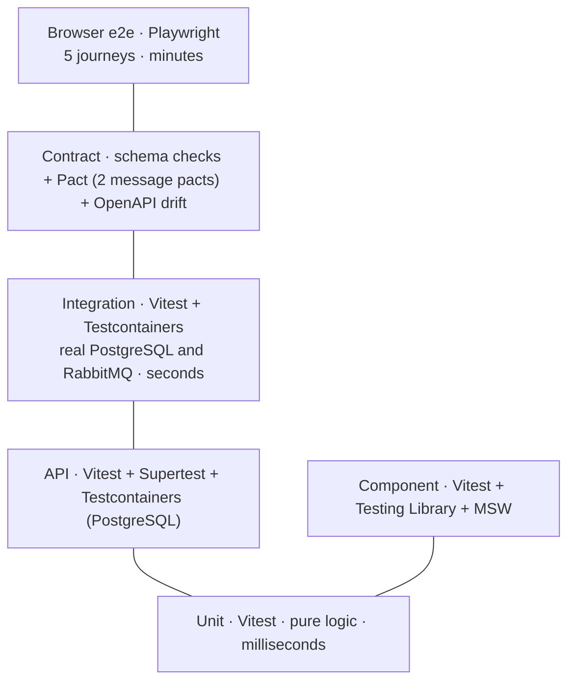

# Testing strategy

What is tested at which level, with which tool, and what counts as done. Tool decision: [ADR-0027](../adr/0027-testing-stack.md). Concept: [contract testing](../learning/concepts/contract-testing.md).

## The shape

Not a strict pyramid. For this system the most valuable layer is **integration**, because the bugs that matter live in the seams: SQL locking, constraint behaviour, broker acks, dead-lettering. Mocks cannot reproduce those.

## Commands

| Command | Runs | Needs |
|---------|------|-------|
| `pnpm test` | Unit + component tests in all workspaces | Node |
| `pnpm test:int` | API + integration + contract tests | Docker |
| `pnpm ci:local` | format check → lint (oxlint) → typecheck → dependency-rule check → secret scan → `test` → `test:int` → build | Docker |
| `pnpm e2e` | Builds images, `docker compose up --wait`, runs Playwright, tears down | Docker, ~4 GB free |
| `pnpm --filter @microsentinel/incident test:int` | One service | Docker |

`pnpm ci:local` is the CI. An optional `.github/workflows/ci.yml` runs the same script on a hosted runner; nothing in the project depends on it.

## Unit tests

Pure functions with no I/O. The design deliberately pushes decisions into such functions so they can be tested exhaustively.

| Unit | Cases worth writing |
|------|--------------------|
| `ConfirmationPolicy` (monitor) | Every row of the state table; threshold 1; counters reset on opposite outcome; `UNKNOWN` → `UP` on first success; next-check interval (retry vs normal) |
| `acceptedStatusCodes` parser | `200-299,301`; overlapping ranges; invalid input |
| SSRF address classifier | The bypass list in [security](security.md#ssrf-checking-user-supplied-urls) |
| `IncidentStateMachine` | Every (status, action) pair: legal, idempotent no-op, rejected with code |
| `OnCallCalculator` | Rotation boundaries; before `rotation_start`; one member; DST-independent (UTC arithmetic) |
| `PageResolver` | Users + schedules; inactive skipped; de-duplication; empty level |
| Retry tier selection | Attempt → tier; last attempt → dead |
| `ErrorClassifier` (notification) | Timeouts, `429`, `5xx`, `4xx`, DNS errors, SSRF block |
| Envelope builder / parser | Required fields; unknown fields ignored |
| Frontend utilities | Backoff with jitter bounds; hint → query keys; problem → form errors |

Time-dependent units take a `Clock` parameter; tests pass a fixed clock. No `sleep`.

## API tests (per service)

Boot the real Nest application (`Test.createTestingModule` with the real `AppModule`) against a Testcontainers PostgreSQL with migrations applied. Tokens are minted by a test helper using a test key pair whose JWKS the guard is configured to trust.

Every service suite covers:

- **Auth:** no token → `401`; wrong audience or expired → `401`; wrong role → `403`.
- **Tenancy:** create data in org A, call as org B → `404` for every route (generated from the route list, so new routes are covered automatically).
- **Validation:** missing, out-of-range and unknown fields → `400 VALIDATION_FAILED` with field errors.
- **Problem format:** every error body matches the `Problem` schema and has a `code`.
- **Happy paths** and the documented conflicts (`409`, `422`).
- **OpenAPI drift:** the document generated by `@nestjs/swagger` from the running app is compared with the committed spec in [`contracts/openapi/`](../contracts/openapi/); differences fail the test.

Supertest drives requests against the in-process HTTP server; no network ports needed.

## Integration tests (messaging and coordination)

Real PostgreSQL **and** RabbitMQ containers, real topology declared by the code under test.

| Test | Asserts |
|------|---------|
| Outbox relay publishes | Insert 3 outbox rows → messages arrive on a test queue bound to `ms.events` → rows have `published_at` |
| Relay survives broker outage | Stop the broker container, insert rows, start it → all rows published once recovered |
| Relay concurrency | Two relays on one table → every row published, none published by both in the same tick |
| Consumer dedupe | Deliver the same envelope twice → one effect, `consumer.duplicates` = 1 |
| Crash between commit and ack | Handler commits, consumer channel closed before ack → redelivery → no second effect |
| Retry path | Handler throws retryable → message appears in `X.retry.5s`, returns after TTL (tiers scaled down in tests), succeeds |
| DLQ path | Handler throws permanent → message in `X.dlq` with `x-ms-last-error` |
| Delivery limit | Consumer that `process.exit`s on a message (run in a child process) → after 5 redeliveries the message is in `X.dlq` |
| Lease claim | Two workers claim concurrently → disjoint sets |
| Fencing | Claim, expire the lease manually, second claim, first completes → 0 rows, nothing written |
| Incident open idempotency | Same `DOWN` twice (same and different IDs) → one incident |
| Ordering | Deliver v13 then v12 → no incident; v12 then v13 → opened then resolved |
| Notification dedupe | Same page request twice → one delivery row, one send job |
| Analytics batch + offset | Kill consumer mid-batch → restart → counts exact |

Tests that need time (TTL, lease expiry) shorten it via configuration (`RETRY_TIERS_SCALE`, `LEASE_SECONDS`), not by mocking time inside the broker.

**Container reuse:** one PostgreSQL and one RabbitMQ container per test *file*, a fresh database (`CREATE DATABASE test_<random>`) and vhost per test. Keeps suites isolated without paying container startup per test.

## Contract tests

| Check | How | Catches |
|-------|-----|---------|
| Catalog ↔ AsyncAPI ↔ `contracts` | A test parses every JSON example in [event-catalog.md](../contracts/event-catalog.md), validates it against the schema in [asyncapi.yaml](../contracts/asyncapi.yaml) and against the class in `@microsentinel/contracts` | The three sources drifting apart |
| Event-type coverage | Every constant in `contracts` has a catalog entry and an AsyncAPI channel, and vice versa | Undocumented events |
| Pact message pact: `monitor.state.changed.v1` | **Consumer** (incident) test declares the fields it uses (`monitorId`, `to`, `stateVersion`, `changedAt`, `monitorName`, `url`, `cause.failureReason`) and feeds the example to the real handler → writes `pacts/incident-monitor.json`. **Provider** (monitor) test builds the event the production code would publish and verifies it against the pact | Monitor removing or renaming a field incident depends on |
| Pact message pact: `incident.page.requested.v1` | Consumer notification, provider incident | Same |
| OpenAPI drift | See API tests | Implementation ≠ spec |
| Web client types | `openapi-typescript` regenerates types in `pnpm ci:local`; the web app's typecheck fails on mismatches | Frontend calling the API wrongly |

Pact files live in the repository; there is no Pact Broker ([ADR-0027](../adr/0027-testing-stack.md)). What Pact adds over the schema check is the **consumer's** view: the schema says what the producer may send; the pact says what each consumer actually needs.

## Component tests (React)

Vitest with jsdom, Testing Library, MSW for HTTP.

| Screen | Cases |
|--------|-------|
| Every data screen | Loading skeleton; error state shows `requestId` and retries; empty state shows primary action; data renders |
| Monitor form | Field validation; server `400` errors mapped to fields; `422 BLOCKED_TARGET` message |
| Incident detail | Acknowledge optimistic update; rollback on `409`; buttons hidden when resolved |
| Session | `401` → refresh → replay; refresh failure → redirect to login; single-flight with 3 parallel requests |
| Realtime | MSW streams an SSE body: `ready` triggers refetch; `incident.changed` invalidates; stream end shows paused indicator and enables polling |

Query by role and label (`getByRole('button', { name: 'Acknowledge' })`), not by class names or test IDs, so tests reflect what a user can perceive.

## Browser end-to-end (Playwright)

Against the full Compose stack, Chromium only, `RETRY_TIERS_SCALE=0.05` and `ALLOW_FAST_INTERVALS=true` so the journeys complete in seconds.

| Journey | Steps |
|---------|-------|
| J1 Register and log in | Register → dashboard → reload stays logged in → logout → protected route redirects |
| J2 Create monitor | Create `flaky-target` monitor → status `UP` |
| J3 Outage | Switch target `down` via its control API → incident appears **without reload** → email in Mailpit (via its API) → acknowledge → switch `up` → incident resolved |
| J4 Failed delivery and redrive | dev-stubs SMS `fail` → delivery `DEAD` → switch `ok` → Retry → SMS in dev-stubs inbox |
| J5 Analytics | After J3, dashboard shows downtime and non-null MTTR |

Each journey uses a fresh organization, so journeys can run in parallel. Traces and videos are kept on failure.

## Chaos tests

Manual, scripted experiments in the [break-it lab](../roadmap/break-it-lab.md). Two of them are automated in Phase 4 as integration tests (notification offline during an outage; duplicate delivery).

## Test data

- `pnpm seed` (dev only) creates an organization `Acme Ops`, an owner `owner@acme.test`, a member, three monitors on `flaky-target`, a schedule and a two-level policy. Credentials for seeded users live in `tools/seed/README.md` (development values only).
- Tests never use the seed; each builds its own data with builders from `@microsentinel/testing`.

## What "tested" means per phase

| Phase | Minimum before the phase is done |
|-------|-------------------------------|
| 0 | Runner works in every workspace; one unit test per app; `pnpm ci:local` green |
| 1 | Unit tests for confirmation policy, state machine, SSRF classifier; API tests incl. tenancy for auth, monitor, incident; lease claim + fencing integration tests; component tests for login and monitor list |
| 2 | All messaging integration tests above except delivery limit; catalog/AsyncAPI/contracts check |
| 3 | Retry, DLQ, delivery-limit, notification dedupe, escalation timer tests |
| 4 | Pact pacts; OpenAPI drift tests; analytics batch tests; Playwright J1–J5 |

## Coverage

No coverage percentage target. Coverage is reported (`vitest --coverage`) and read: a confirmation policy at 100 % branch coverage matters; a controller at 60 % may be fine. The question in review is "which failure would this test catch?".
