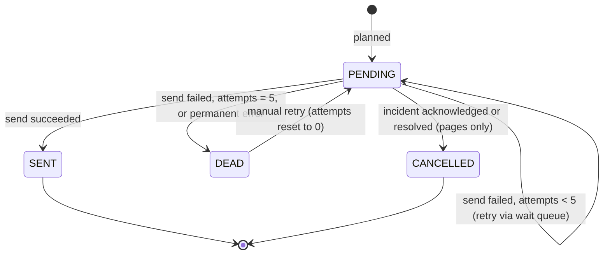

# notification_db schema

Owner: [notification](../services/notification.md). Role: `notification_svc`.

Also contains `outbox` and `processed_messages` ([messaging tables](messaging-tables.md)). Why Notification has a database at all: [ADR-0013](../adr/0013-notification-owns-delivery-state.md).

## Tables

```sql
CREATE TABLE recipients (                       -- replica of auth users (email + name only)
  user_id       uuid    PRIMARY KEY,
  email         text    NOT NULL,
  display_name  text    NOT NULL,
  active        boolean NOT NULL DEFAULT true,
  version       integer NOT NULL                -- from auth.user.changed.v1
);

CREATE TABLE contact_methods (                  -- how to reach one user when paged
  id          uuid        PRIMARY KEY DEFAULT uuidv7(),
  org_id      uuid        NOT NULL,
  user_id     uuid        NOT NULL,
  type        text        NOT NULL CHECK (type IN ('EMAIL', 'SMS')),
  target      text        NOT NULL,             -- email address or E.164 phone number
  enabled     boolean     NOT NULL DEFAULT true,
  is_default  boolean     NOT NULL DEFAULT false,  -- auto-created from the account email
  created_at  timestamptz NOT NULL DEFAULT now(),
  UNIQUE (user_id, type, target),
  CONSTRAINT sms_is_e164 CHECK (type <> 'SMS' OR target ~ '^\+[1-9][0-9]{6,14}$')
);

CREATE INDEX contact_methods_user_idx ON contact_methods (user_id) WHERE enabled;

CREATE TABLE org_channels (                     -- shared destinations for incident events
  id             uuid        PRIMARY KEY DEFAULT uuidv7(),
  org_id         uuid        NOT NULL,
  type           text        NOT NULL CHECK (type IN ('WEBHOOK', 'CHAT_WEBHOOK')),
  name           text        NOT NULL CHECK (length(name) BETWEEN 1 AND 100),
  url            text        NOT NULL CHECK (length(url) <= 2048),
  signing_secret text,                          -- WEBHOOK only: HMAC-SHA256 key for X-MS-Signature
  event_types    text[]      NOT NULL DEFAULT ARRAY[
                   'incident.opened.v1', 'incident.acknowledged.v1',
                   'incident.escalated.v1', 'incident.resolved.v1'],
  enabled        boolean     NOT NULL DEFAULT true,
  created_at     timestamptz NOT NULL DEFAULT now(),
  UNIQUE (org_id, name)
);

CREATE INDEX org_channels_org_idx ON org_channels (org_id) WHERE enabled;

CREATE TABLE deliveries (
  id                 uuid        PRIMARY KEY DEFAULT uuidv7(),
  org_id             uuid        NOT NULL,
  incident_id        uuid        NOT NULL,
  page_id            uuid,                       -- set for pages; NULL for org-channel deliveries
  recipient_user_id  uuid,                       -- set for pages
  source_event_id    uuid        NOT NULL,       -- envelope id of the event that caused this
  source_event_type  text        NOT NULL,
  channel_type       text        NOT NULL CHECK (channel_type IN
                       ('EMAIL', 'SMS', 'WEBHOOK', 'CHAT_WEBHOOK')),
  target_id          uuid        NOT NULL,       -- contact_methods.id or org_channels.id
  target             text        NOT NULL,       -- address / number / URL at the time of planning
  payload            jsonb       NOT NULL,       -- what to render and send
  dedupe_key         text        NOT NULL UNIQUE,-- '<source_event_id>:<channel_type>:<target_id>'
  status             text        NOT NULL DEFAULT 'PENDING'
                                 CHECK (status IN ('PENDING', 'SENT', 'DEAD', 'CANCELLED')),
  attempts           smallint    NOT NULL DEFAULT 0,
  last_error         text,
  last_attempt_at    timestamptz,
  sent_at            timestamptz,
  created_at         timestamptz NOT NULL DEFAULT now()
);

CREATE INDEX deliveries_incident_idx ON deliveries (incident_id, created_at);
CREATE INDEX deliveries_org_status_idx ON deliveries (org_id, status, created_at DESC);
CREATE INDEX deliveries_pending_pages_idx
  ON deliveries (incident_id) WHERE status = 'PENDING' AND page_id IS NOT NULL;
```

## Design notes

**The dedupe key is the idempotency mechanism for the outside world.** One incoming event, one channel type and one target always produce the same string. Planning inserts with:

```sql
INSERT INTO deliveries (…, dedupe_key) VALUES (…, $key)
ON CONFLICT (dedupe_key) DO NOTHING
RETURNING id;
-- a row came back → new delivery: also insert the send command into the outbox
-- no row          → it already exists: do nothing
```

Together with the inbox this gives two independent layers: the inbox stops a redelivered *message*; the dedupe key stops a duplicate *delivery* even if the same logical event somehow arrived under a different message.

**`target` and `payload` are frozen at planning time.** If a user changes their phone number a minute later, in-flight retries still go to the number that was valid when the page was requested, and the delivery log shows what was actually used.

**Sending locks the row:**

```sql
BEGIN;
SELECT * FROM deliveries WHERE id = $1 FOR UPDATE;
-- status <> 'PENDING' → COMMIT; broker-ack (already handled or cancelled)
UPDATE deliveries SET attempts = attempts + 1, last_attempt_at = now() WHERE id = $1;
COMMIT;
-- perform the send (5 s timeout), outside any transaction
BEGIN;
UPDATE deliveries SET status = 'SENT', sent_at = now() WHERE id = $1 AND status = 'PENDING';
INSERT INTO outbox … 'notification.delivery.succeeded.v1' …;
COMMIT;
```

The attempt counter is committed **before** the send, so a process that crashes mid-send still counts that attempt. The transaction is **not** held open during the network call: a slow SMTP server must not hold a database connection ([resilience](../cross-cutting/resilience.md)).

**Cancelling pages.** When `incident.acknowledged.v1` or `incident.resolved.v1` is consumed:

```sql
UPDATE deliveries SET status = 'CANCELLED'
 WHERE incident_id = $1 AND status = 'PENDING' AND page_id IS NOT NULL;
```

Retries of a page nobody needs any more then stop at the status check. Organization-channel deliveries are not cancelled: a "resolved" message to a chat channel is still wanted.

**Default contact method.** When `auth.user.changed.v1` creates or updates a recipient, the consumer upserts an `EMAIL` contact method with `is_default = true` and the account email, so a new user is reachable without configuring anything.

**Secrets.** `signing_secret` is stored in clear because it must be used to compute HMACs. It is returned by the API only once, when the channel is created. A real system would encrypt it at rest; noted in [security](../cross-cutting/security.md).

**SSRF.** `org_channels.url` passes the guard when saved and again on every send ([ADR-0026](../adr/0026-pinger-safety.md)).

## Delivery status



## Indexes and the queries they serve

| Index | Query |
|-------|-------|
| `deliveries.dedupe_key` (unique) | Duplicate suppression at planning |
| `deliveries_incident_idx` | "Show deliveries for this incident" |
| `deliveries_org_status_idx` | Delivery log filtered by status (`GET /v1/deliveries?status=DEAD`) |
| `deliveries_pending_pages_idx` (partial) | Cancel pending pages for an incident |
| `contact_methods_user_idx` (partial) | Planning a page: enabled methods for a user |
| `org_channels_org_idx` (partial) | Planning a lifecycle event: enabled channels for an organization |

## Events and commands written to the outbox

| Row | Exchange | Routing key |
|-----|----------|-------------|
| Send command, one per new delivery | `notification.work` | `delivery.send` |
| Delivery succeeded | `ms.events` | `notification.delivery.succeeded.v1` |
| Delivery finally failed | `ms.events` | `notification.delivery.failed.v1` |

## Retention

Deliveries are kept indefinitely in v1 (a few per incident). `outbox` 24 h; `processed_messages` 7 days. Partitioning `deliveries` by month is the first step if it grows ([ADR-0013](../adr/0013-notification-owns-delivery-state.md)).

## Migrations

`apps/notification/src/migrations/`, run by `notification-migrate`. Approach: [messaging tables](messaging-tables.md#migration-approach-all-services).
