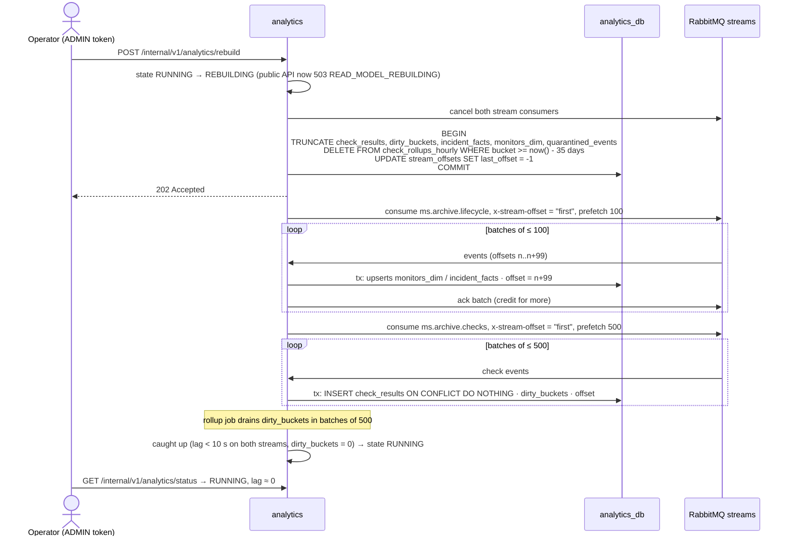

# Flow: rebuild the analytics read model

Delete the read model and rebuild it from the event history. This is the practical proof that analytics is a **read model** (derived and disposable) and that the streams are a usable history ([ADR-0017](../adr/0017-ordering-and-replay.md)). Service: [analytics](../services/analytics.md). Schema: [analytics-schema](../data/analytics-schema.md). Concepts: [CQRS](../learning/concepts/cqrs.md), [event sourcing](../learning/concepts/event-sourcing.md).

## When you would do this

- A projection bug wrote wrong numbers (for example MTTR counted from the wrong timestamp). Fix the code, rebuild, and the history is corrected.
- A new column or table is added to the read model and should be filled for the past.
- The read model was lost or corrupted.

## What can and cannot be rebuilt

| Data | Rebuildable? | Why |
|------|--------------|-----|
| `check_results` for the last 30 days | Yes | `ms.archive.checks` keeps 35 days |
| `check_rollups_hourly` for the last 35 days | Yes, recomputed from raw rows | |
| `check_rollups_hourly` older than 35 days | **No** | The raw events are gone. These rows are **preserved** during a rebuild |
| `incident_facts`, `monitors_dim` | Yes, all of history | `ms.archive.lifecycle` keeps 5 years |

The rebuild therefore truncates everything except rollup rows older than the checks stream's horizon.

## Sequence



Lifecycle first, so monitor names exist when check results arrive (the API joins on `monitors_dim`). Live events keep arriving on the streams during the rebuild; they are simply processed when the consumer reaches them. There is no separate "catch-up" path: **replay and live consumption are the same code**, which is the main reason streams were chosen.

Partitions: before replaying checks, the rebuild creates daily partitions for the full 35-day range of the stream (otherwise old rows would land in `check_results_default`).

## Duration estimate

| Quantity (local) | Value |
|------------------|-------|
| Monitors × interval | 20 × 10 s → 2 checks/s → ~170 000/day |
| 30 days of checks | ~5 M events |
| Insert rate, batched 500/tx | ~10 000–20 000 rows/s on a laptop |
| Replay time | ~5–8 minutes, plus rollup recompute (~1 min) |
| At design scale (1.44 M/day × 30) | ~43 M rows: 40–70 minutes. Worth knowing; this is where ClickHouse or parallel partitions would start to matter ([ADR-0021](../adr/0021-postgres-analytics-store.md)) |

## Why the result is correct

| Property | Mechanism |
|----------|-----------|
| Every check counted exactly once | PK `(monitor_id, checked_at, check_id)` + `ON CONFLICT DO NOTHING` |
| Incident facts independent of order | Each event upserts its own columns |
| Monitor names end at the latest version | Versioned upsert (`definition_version`) |
| Rollups match raw data | Recomputed from raw rows, never incremented |
| A crash mid-rebuild loses nothing | Offset is committed with each batch; restart continues from `last_offset + 1`; state stays `REBUILDING` (persisted in a one-row `analytics_state` table, alongside `stream_offsets`) |
| A malformed old event does not stop the rebuild | Quarantined with its offset, skipped |

Verification after a rebuild (part of the Phase 4 Definition of Done):

```sql
-- Before the rebuild, save these numbers; after, compare.
SELECT count(*) FROM check_results WHERE checked_at >= now() - interval '7 days';
SELECT monitor_id, sum(checks_success)::float / sum(checks_total)
  FROM check_rollups_hourly WHERE bucket >= now() - interval '7 days' GROUP BY 1 ORDER BY 1;
SELECT count(*), avg(resolved_at - opened_at) FROM incident_facts;
```

They must match (the current hour may differ by the checks that arrived in between).

## Failure variants

| # | What goes wrong | Result |
|---|-----------------|--------|
| F1 | analytics crashes during replay | Restarts in `REBUILDING`, resumes from the stored offset |
| F2 | Database runs out of disk during replay | Batch fails; consumer backs off and retries; state stays `REBUILDING`; `/internal/v1/analytics/status` shows the error. Free space, it resumes |
| F3 | A projection bug throws on every event of one type | All such events quarantined; rebuild completes with `quarantined` > 0. Do not declare success: fix, rebuild again |
| F4 | Rebuild triggered twice | Second call: `409 REBUILD_IN_PROGRESS` |
| F5 | Someone expects data older than the stream horizon to reappear | It will not (rollups are preserved, raw rows are not). This is the stated limit |
| F6 | Event schema changed since old events were written (a `v2` exists) | Projector must still handle `v1` (upcast on read) ([versioning](../contracts/versioning.md)) |
| F7 | The checks stream's size limit (2 GB) was hit before 35 days | Oldest segments already gone; rebuild restores less than 30 days. Watch the stream's first offset timestamp; alert if it is younger than 31 days |

## The alternative designs, as they would play out here

| Design ([ADR-0017](../adr/0017-ordering-and-replay.md)) | This rebuild would… |
|---------|---------------------|
| No replay | Not be possible; a projection bug would be permanent |
| Rebuild from source services | Need bulk-export endpoints in incident; be impossible for checks (monitor keeps only 24 h) |
| Retained outbox + re-publish | Re-send history to **every** consumer of those events (incident, notification) unless routed to a special queue |
| Kafka | Look the same as this flow, with consumer-group offsets reset instead of a stored offset |

## Expected trace

A rebuild is not one trace. Each batch produces a `ms.archive.checks process` span with attributes `batch.size`, `offset.from`, `offset.to`, `rebuild=true`, and up to 128 span links to the original producer contexts (the cap avoids enormous spans). The rebuild itself has a root span `analytics.rebuild` covering the truncate step; its duration metric (`analytics.rebuild.duration`) is the useful number.

## Demo script

1. Open the dashboard; note the 7-day uptime and MTTR for one monitor.
2. Run the three verification queries; keep the output.
3. `curl -X POST localhost:3006/internal/v1/analytics/rebuild -H "authorization: Bearer $ADMIN_TOKEN"` (port published by `compose.dev.yaml`).
4. Dashboard panels show "Analytics is rebuilding". The rest of the app works.
5. Watch `/internal/v1/analytics/status`: offsets climb, lag falls.
6. When `RUNNING`, rerun the queries. Same numbers. Say: "the read model is a cache of the event history".
