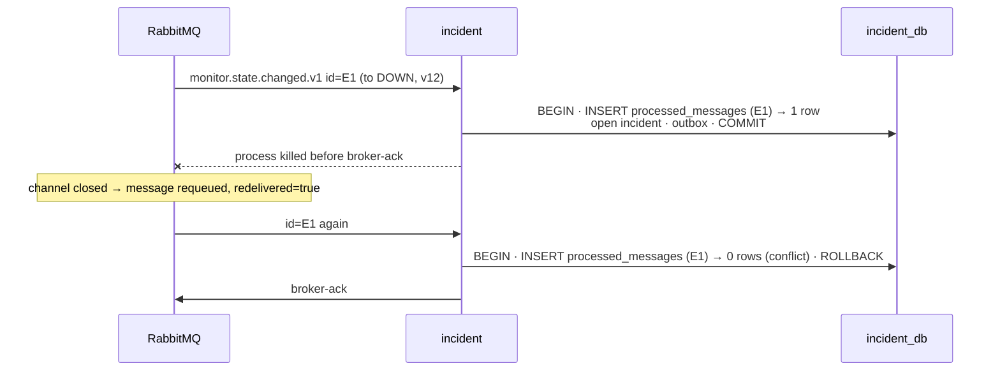
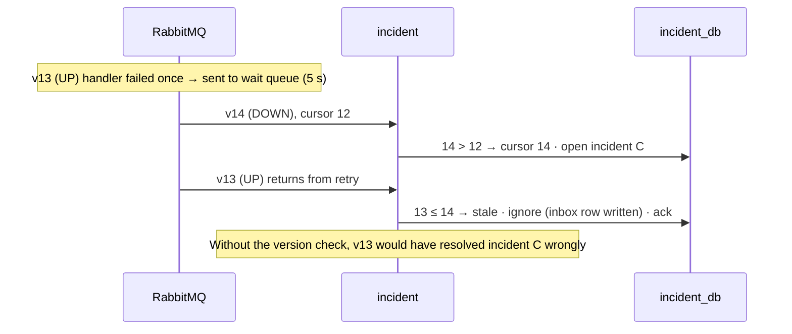

# Flow: flapping and duplicates

Two kinds of noise every monitoring system must absorb: a target that keeps changing its mind (**flapping**), and the same message arriving more than once (**duplicates**), plus their cousin, messages arriving out of order. Decisions: [ADR-0009](../adr/0009-check-results-and-state-changes.md) (hysteresis), [ADR-0010](../adr/0010-postgres-leases-for-scheduling.md) (no double application), [ADR-0012](../adr/0012-idempotent-consumers.md) (inbox, versions, constraints), [ADR-0013](../adr/0013-notification-owns-delivery-state.md) (dedupe key), [ADR-0017](../adr/0017-ordering-and-replay.md) (ordering).

## Part 1: flapping

### Fast flapping is absorbed

`flaky-target` mode `flapping` with `periodSeconds: 15`; monitor interval 30 s, `failureThreshold 3`, `recoveryThreshold 2`.

```mermaid
sequenceDiagram
  participant T as flaky-target (flapping 15 s)
  participant W as monitor-worker
  participant DB as monitor_db

  Note over W,DB: status UP
  W->>T: check → 503
  W->>DB: failures=1 (suspected; retry in 10 s)
  W->>T: check → 503
  W->>DB: failures=2
  W->>T: check → 200
  W->>DB: failures=0, successes=1 (status still UP, no event)
  W->>T: check (30 s later) → 503
  W->>DB: failures=1 …
```

Three failures in a row (spanning 20 s with retries) rarely line up with a 15 s flap period, so the monitor mostly stays `UP`; only `monitor.check.completed.v1` events are published. Analytics still records every failed check, so uptime % reflects the instability honestly while nobody is paged.

### Slow flapping produces separate incidents

Mode `flapping` with `periodSeconds: 120`. Each down phase lasts long enough for three failures and each up phase for two successes:

| Cycle | Result |
|-------|--------|
| 1 | `DOWN` (v12) → incident A opened, page → `UP` (v13) → A resolved `RECOVERED` |
| 2 | `DOWN` (v14) → incident B opened, page → `UP` (v15) → B resolved |

Every cycle is a new incident and a new page. This is the accepted cost of option G in [ADR-0009](../adr/0009-check-results-and-state-changes.md); flap suppression is in [open questions](../open-questions.md). In the demo, say so before the interviewer does.

### Tuning knobs and their trade-off

| Raise | Effect | Cost |
|-------|--------|------|
| `failureThreshold` | Fewer false `DOWN`s | Slower detection: each extra failure adds `retryIntervalSeconds` (10 s) |
| `recoveryThreshold` | Fewer premature resolves → fewer reopen cycles | Incidents stay open longer after a real recovery; MTTR inflates |

## Part 2: duplicates and reordering, layer by layer

Each row is a way a duplicate can arise, and the layer that stops it.

| # | Source of the duplicate | Example | Stopped by | Observable as |
|---|-------------------------|---------|-----------|---------------|
| D1 | Two workers check the same monitor (lease expired during a pause) | Worker A paused 70 s, B claims and checks, A resumes | Fencing: A's `UPDATE … WHERE lease_token = 5` matches 0 rows | `monitor.lease.fenced` +1; one extra GET in flaky-target's log |
| D2 | Outbox relay republishes after a crash before marking | Same envelope `id` published twice | Consumer inbox (`processed_messages` PK) | `consumer.duplicates` +1 |
| D3 | Broker redelivers an unacked message (consumer crashed after commit) | Same delivery tag redelivered, `redelivered: true` | Inbox | Same |
| D4 | Retry republish (publish copy, crash before acking original) | Original and copy both delivered | Inbox (same envelope `id`) | Same |
| D5 | Same fact, different message ID (a bug, or a replayed producer) | `DOWN` v12 sent twice with different `id`s | `stateVersion` ≤ cursor → ignored; unique partial index on unresolved incidents; `trigger_event_id` unique | `incident.stale_events_ignored` +1 |
| D6 | Two page requests for the same user and incident | Re-planning the same `page.requested` | `deliveries.dedupe_key` unique | `notification.duplicates_suppressed` +1 |
| D7 | Crash after SMTP accepted, before `SENT` recorded | Job redelivered, email sent again | **Not fully stoppable.** Narrowed by attempt counting and `Message-ID`; webhooks get `Idempotency-Key` | Duplicate email in Mailpit (rare) |
| D8 | Same check ingested twice by analytics (replay after crash) | Batch re-read from the last stored offset | `ON CONFLICT DO NOTHING` on `check_results` PK; rollups recomputed, not incremented | No change in numbers |
| D9 | Double-click Acknowledge / retried HTTP request | Two `POST …/acknowledge` | Idempotent command: second returns `200` unchanged; no second event | One timeline entry |

### Sequence: duplicate delivery to incident (D2/D3)



### Sequence: reordering (stale UP after DOWN)



With single active consumer and prefetch 1 on `incident.monitor-events`, this reordering only happens through retries, which is exactly why relying on queue order alone is not enough.

## Expected traces

- **D1 (fenced):** a `monitor.check` trace from the paused worker whose `monitor.apply_result` span has attribute `fenced=true` and no outbox insert, next to the other worker's normal trace for the same monitor.
- **D2–D4:** a `… process` consumer span with attribute `duplicate=true` and only the inbox `INSERT` beneath it (followed by `ROLLBACK`).
- **D5:** a consumer span with `stale=true`, `state_version=13`, `cursor=14`.

## How to provoke each (see [break-it lab](../roadmap/break-it-lab.md))

| Case | Command |
|------|---------|
| Fast and slow flapping | `PUT /control/checkout {"mode":"flapping","periodSeconds":15}` then `120` |
| D1 | `docker pause` a worker mid-check for 70 s with a `timeout`-mode target |
| D2/D3 | Republish a message from the RabbitMQ UI with the same `message_id`, or `docker kill` incident between commit and ack using the debug delay `CONSUMER_ACK_DELAY_MS` |
| D6 | Redrive a `page.requested` message from a DLQ that was already processed |
| D9 | Send the acknowledge `curl` twice |

## What this flow teaches

Duplicates are not one problem with one fix. They arise at every hop, and each hop needs its own defence: fencing at the scheduler, an inbox at the consumer, versions for order, unique constraints for invariants, and a dedupe key at the edge of the system, where the last gap (D7) can only be narrowed. Saying "we use idempotency keys" is the start of the answer, not the answer.
