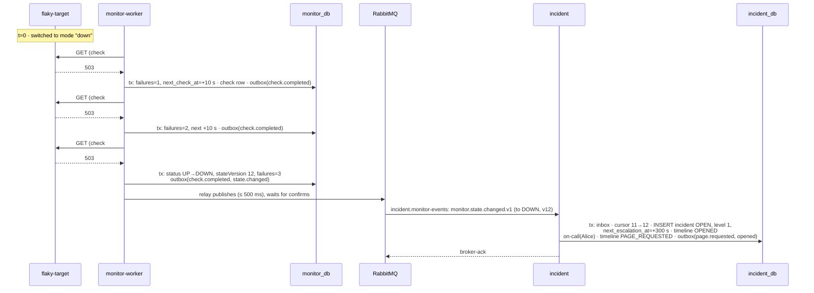
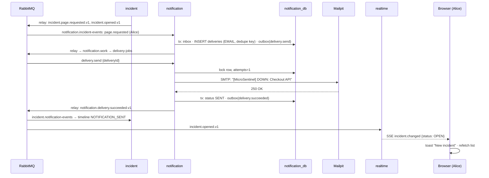
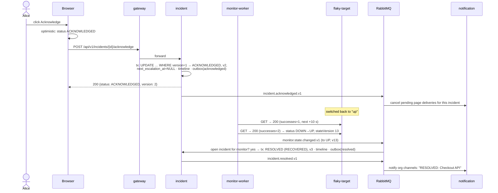

# Flow: outage to resolution

The core flow. A target fails → failure confirmed → monitor `DOWN` → incident opened → on-call user paged → user acknowledges → target recovers → monitor `UP` → incident resolved → metrics updated. Described as in **Phase 3** (broker, outbox, escalation, notification); Phase 1 differences are at the end.

Services: [monitor](../services/monitor.md), [incident](../services/incident.md), [notification](../services/notification.md), [realtime](../services/realtime.md), [analytics](../services/analytics.md). Events: `monitor.check.completed.v1`, `monitor.state.changed.v1`, `incident.opened.v1`, `incident.page.requested.v1`, `notification.delivery.succeeded.v1`, `incident.acknowledged.v1`, `incident.resolved.v1` ([catalog](../contracts/event-catalog.md)).

Setup for the timings: `intervalSeconds 30`, `failureThreshold 3`, `recoveryThreshold 2`, `timeoutMs 10000`, escalation level 1 = the on-call schedule (Alice), delay 300 s; level 2 = Bob.

## Part 1: detection and opening



## Part 2: paging and live update



## Part 3: acknowledge, recover, resolve



Part 4, analytics: `ms.archive.checks` and `ms.archive.lifecycle` deliver everything above; the rollup job recomputes the affected hours; `/v1/analytics/overview` shows the downtime, MTTA (ack − open) and MTTR (resolve − open) within ~60 s.

## Timeline of one run

| t | Event |
|---|-------|
| 0 | Target goes down |
| ≤ 30 s | Check #1 fails |
| +10 s, +20 s | Checks #2, #3 fail; monitor `DOWN` |
| +0.5 s | Relay publishes; incident opened (≤ 2 s after `DOWN`) |
| +1–3 s | Email in Mailpit; incident visible in the browser |
| a few minutes | Alice acknowledges; escalation timer cleared |
| recovery + ≤ 30 s + 10 s | Two successes; monitor `UP`; incident `RESOLVED` |

## Failure variants

| # | What goes wrong | What happens | Guarantee relied on |
|---|-----------------|--------------|---------------------|
| F1 | Worker crashes after the HTTP check, before its transaction | Nothing written; lease expires in 60 s; another worker re-checks | Leases ([ADR-0010](../adr/0010-postgres-leases-for-scheduling.md)) |
| F2 | Worker commits `DOWN`, crashes before the relay publishes | Rows stay in `outbox`; the next relay tick (any worker) publishes them | Outbox ([ADR-0008](../adr/0008-transactional-outbox.md)) |
| F3 | Relay publishes, crashes before `published_at` is set | Republished; incident's inbox discards the duplicate | Inbox ([ADR-0012](../adr/0012-idempotent-consumers.md)) |
| F4 | Same `DOWN` arrives under a different message ID (bug, replay) | `stateVersion` 12 ≤ cursor 12 → ignored; also blocked by the unique partial index | Version check, constraint |
| F5 | `UP` (v13) arrives before `DOWN` (v12) after a retry | v13 processed: no open incident → no-op, cursor = 13. Then v12 ≤ 13 → ignored. No false incident | Version check ([ADR-0017](../adr/0017-ordering-and-replay.md)) |
| F6 | Nobody acknowledges for 300 s | Timer fires: level 2, `incident.escalated.v1`, page for Bob | [incident](../services/incident.md#escalation) |
| F7 | Alice acknowledges at the same moment the timer fires | Both run `applyTransition`; one wins on `version`. If ack wins, the timer's reload sees `ACKNOWLEDGED` → no-op. If escalation wins, ack retries once and succeeds; Bob may get one page, then it is cancelled if still pending | Optimistic locking |
| F8 | Two users acknowledge simultaneously | One `UPDATE` matches; the other reloads, sees `ACKNOWLEDGED`, returns `200` unchanged | Idempotent command |
| F9 | Acknowledge after the incident auto-resolved | `409 INCIDENT_ALREADY_RESOLVED`; UI rolls back the optimistic update and shows "Already resolved" | State machine |
| F10 | Mailpit rejects (SMTP failure) | Delivery retried 10 s, 1 min, 5 min, 15 min, then `DEAD` | [notification-retry-and-dlq](notification-retry-and-dlq.md) |
| F11 | Alice has no contact methods | Page creates zero deliveries; timeline shows `PAGE_REQUESTED` only; escalation still runs | Escalation as the backstop |
| F12 | Nobody is on call (empty or inactive schedule) | Timeline `NO_RESPONDER_AVAILABLE`; immediate escalation to level 2 | [ADR-0014](../adr/0014-on-call-in-incident-and-local-replicas.md) |
| F13 | notification down during the outage | Pages wait in the queue | [service-down-recovery](service-down-recovery.md) |
| F14 | User manually resolves while the target is still down | Incident `RESOLVED (MANUAL)`. The monitor stays `DOWN`; no new incident until it recovers and fails again (known limitation, [open questions](../open-questions.md)) | — |
| F15 | Target flaps around the threshold | See [flapping-and-duplicates](flapping-and-duplicates.md) | Hysteresis |

## Expected trace (Phase 4)

One trace from the third failed check to the delivered email. The outbox and the broker add gaps, shown as `…`.

```
monitor-worker  monitor.check                         (root)       ~15 ms
├─ HTTP GET flaky-target /site/checkout → 503         (client)
└─ monitor.apply_result
   ├─ pg UPDATE monitors / INSERT monitor_checks / INSERT outbox ×2
   … ≤ 500 ms (outbox wait)
   ├─ monitor-worker  ms.events publish monitor.check.completed.v1   (producer)
   └─ monitor-worker  ms.events publish monitor.state.changed.v1     (producer)
      ├─ incident  incident.monitor-events process                   (consumer)
      │  └─ incident.open
      │     ├─ pg INSERT processed_messages / UPDATE monitor_cursors
      │     ├─ pg INSERT incidents / incident_events
      │     ├─ oncall.resolve
      │     └─ pg INSERT outbox ×2
      │        … ≤ 500 ms
      │        ├─ incident  ms.events publish incident.page.requested.v1
      │        │  └─ notification  notification.incident-events process
      │        │     └─ notification.plan → pg INSERT deliveries / outbox
      │        │        … ≤ 500 ms
      │        │        └─ notification  notification.work publish delivery.send
      │        │           └─ notification  notification.delivery-jobs process
      │        │              └─ notification.send
      │        │                 └─ smtp mailpit:1025                  (client)
      │        │                 └─ … ms.events publish notification.delivery.succeeded.v1
      │        │                    └─ incident  incident.notification-events process
      │        └─ incident  ms.events publish incident.opened.v1
      │           ├─ realtime  realtime.events process
      │           └─ notification  notification.incident-events process (org channels)
      └─ realtime  realtime.events process
```

Analytics batches appear as separate traces with **links** to these publish spans.

What to verify: the `monitor.check` span is the root; the SMTP span is a descendant; total wall time ≲ 2–3 s. Break the chain (for example, forget to inject `traceparent` in the relay) and the incident spans become a separate trace: a useful deliberate mistake.

The acknowledge and the recovery are separate traces (they start from a user click and a later check).

## Phase 1 version

No broker, no notification, no realtime: the worker, on a confirmed change, calls `POST http://incident:3000/internal/v1/monitor-signals` with a 5 s timeout and 3 retries (1 s, 2 s, 4 s). Incident opens or resolves the incident; the browser sees it on its next 5 s poll. Kill incident during an outage and the signal is lost after the retries: the motivating failure for Phase 2 ([break-it lab](../roadmap/break-it-lab.md)).

## Demo script

1. Dashboard and Mailpit side by side. `curl -X PUT localhost:8091/control/checkout -H 'content-type: application/json' -d '{"mode":"down"}'`.
2. Narrate the 3 failures (monitor page, recent checks), the incident toast, the email in Mailpit.
3. Acknowledge. Show the timeline.
4. Set mode `up`. Watch auto-resolve.
5. Open the trace in Grafana from the incident's request ID and walk the span tree.
