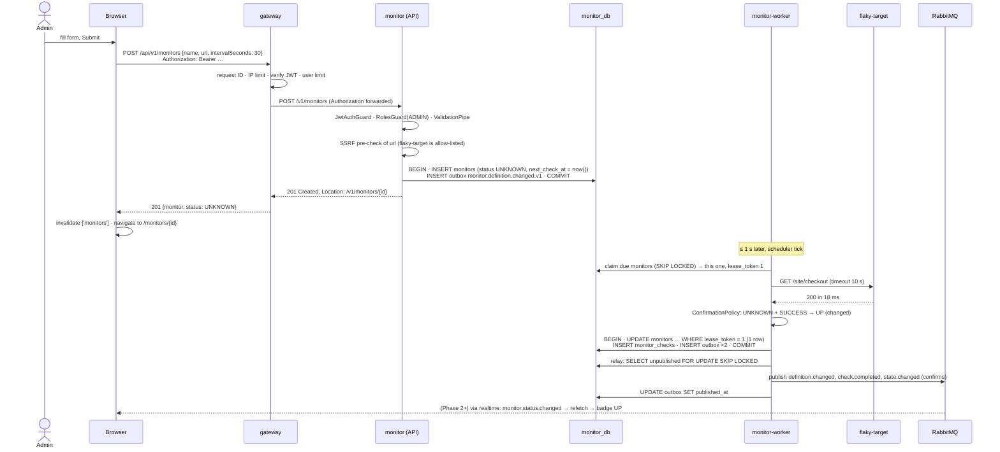

# Flow: register a monitor

A logged-in admin creates a monitor; the first check runs within a couple of seconds. This is the simplest flow in the system and the one to build first: it crosses the browser, the gateway, one service, its database, the outbox and a worker.

Services: [gateway](../services/gateway.md), [monitor](../services/monitor.md). Contract: `POST /v1/monitors` in [monitor.yaml](../contracts/openapi/monitor.yaml). Events: `monitor.definition.changed.v1`, `monitor.check.completed.v1`, `monitor.state.changed.v1` ([catalog](../contracts/event-catalog.md)).

## Happy path



In **Phase 1** there is no broker: the outbox does not exist yet, and the UI learns about `UP` from its 5 s poll.

## Failure variants

| # | What goes wrong | Where it is caught | Result |
|---|-----------------|--------------------|--------|
| F1 | No or expired token | gateway `JwtMiddleware` | `401`; the web client refreshes once and replays ([auth in the browser](../frontend/auth-in-the-browser.md)) |
| F2 | Caller is `MEMBER` | monitor `RolesGuard` | `403 FORBIDDEN`. (The UI hides the button; this is the real check) |
| F3 | `intervalSeconds: 5`, missing `url`, unknown field `foo` | monitor `ValidationPipe` | `400 VALIDATION_FAILED` with `errors[]`; form shows field errors |
| F4 | URL is `http://postgres:5432/` or resolves to `10.0.0.5` | monitor SSRF pre-check | `422 BLOCKED_TARGET` |
| F5 | Name already used in the organization | unique index `monitors_org_name_idx` | `409 MONITOR_NAME_TAKEN` |
| F6 | Double-click on Submit | button disabled while pending; second request (if any) hits F5 | One monitor |
| F7 | `monitor` API is down | gateway proxy | `502`; UI error state with retry. Nothing was written |
| F8 | API commits, then the connection drops before the response | — | The monitor exists but the browser saw an error. Retrying gives `409` (F5), which tells the user it already exists. A client-supplied idempotency key would make this cleaner; see [open questions](../open-questions.md) |
| F9 | Broker down after commit (Phase 2+) | outbox | `201` returned normally; event published when the broker returns |
| F10 | Target is down from the start | worker | `UNKNOWN` → 3 failures → `DOWN` → an incident opens. Same as [outage-to-resolution](outage-to-resolution.md) from step 2 |
| F11 | Target hostname is DNS-rebound to a private IP between save and check | worker `safe-fetch` lookup hook | Check recorded as `FAILURE` / `BLOCKED_TARGET`; monitor eventually `DOWN` |

## Data written

| Step | Table | Rows |
|------|-------|------|
| Create | `monitors` | 1 |
| Create | `outbox` | 1 (`monitor.definition.changed.v1`) |
| First check | `monitors` (update), `monitor_checks` | 1 + 1 |
| First check | `outbox` | 2 (`check.completed`, `state.changed` to `UP`) |

## Expected trace (Phase 4)

Two traces, because the browser request and the first check are separate operations.

```
Trace A — POST /api/v1/monitors                                ~25 ms
└─ gateway  POST /api/v1/monitors                   (server)
   └─ gateway  POST http://monitor:3000/v1/monitors (client)
      └─ monitor  POST /v1/monitors                 (server)
         ├─ monitor  safe-fetch.precheck             (internal: DNS lookup)
         ├─ pg  INSERT monitors
         └─ pg  INSERT outbox

Trace A continues later (outbox relay uses the stored traceparent):
         └─ monitor-worker  ms.events publish       (producer; parent = stored context)

Trace B — first check                                          ~30 ms
└─ monitor-worker  monitor.check                   (internal, root)
   ├─ HTTP GET http://flaky-target:3000/site/checkout (client)
   └─ monitor-worker  monitor.apply_result
      ├─ pg  UPDATE monitors
      ├─ pg  INSERT monitor_checks
      └─ pg  INSERT outbox ×2
         └─ (later) ms.events publish ×2           (producer)
            └─ realtime.events process              (consumer, Phase 2+)
```

What to check in Grafana Tempo: in trace A, the `publish` span appears up to ~500 ms after the HTTP response, as a child of the original request. If it shows up as a separate root trace, trace context is not being stored in the outbox ([observability](../cross-cutting/observability.md)).

## Demo

1. Log in, open **Monitors → New**, enter `Checkout API`, `http://flaky-target:3000/site/checkout`, 30 s. Save.
2. The page shows `UNKNOWN`, then `UP` within ~1 s (Phase 2+) or ≤ 5 s (Phase 1).
3. Try `http://postgres:5432/` → "This address is not allowed" (F4). Explain SSRF.
4. Phase 2+: open the RabbitMQ UI and show `monitor.definition.changed.v1` reached `ms.archive.lifecycle`.
