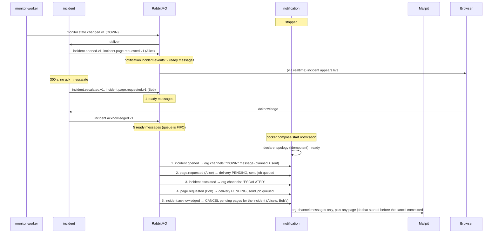

# Flow: a service is down, then recovers

The resilience claim of the architecture: **if a service is down, the work destined for it waits in the broker, and nothing is lost** (NFR-R3). This flow walks three cases: notification offline during an outage (the main case), incident offline, and auth offline. Each is also a [break-it lab](../roadmap/break-it-lab.md) experiment.

Related: [communication](../architecture/communication.md), [ADR-0008](../adr/0008-transactional-outbox.md), [ADR-0014](../adr/0014-on-call-in-incident-and-local-replicas.md), [resilience](../cross-cutting/resilience.md).

## Case 1: notification offline during an outage

`docker compose stop notification`, then put a target down, wait, acknowledge, start notification again.



### What the user sees

- Incidents opened, escalated and were acknowledged normally. The incident system never waited for notification.
- The timeline shows `PAGE_REQUESTED` for Alice and Bob but no `NOTIFICATION_SENT` until notification returns.
- On recovery, organization channels receive the history (DOWN, ESCALATED, ACKNOWLEDGED) a few minutes late.
- Pages to people are **mostly cancelled**, because the acknowledgement is already in the backlog. Whether a page slips through depends on timing: send jobs are a second queue, so the job for Alice's page may be consumed before message 5 commits the cancellation. Possible outcome: Alice gets one late email for an incident she already acknowledged.

That last point is the honest answer to "what happens if notification is down?": *nothing is lost, but some things arrive late and one may be stale*. Stating it is better than claiming perfection.

### Guarantees exercised

| Guarantee | Mechanism |
|-----------|-----------|
| No message lost | Durable quorum queue, persistent messages, outbox upstream |
| No duplicate page on redelivery | Inbox + `dedupe_key` |
| Stale pages suppressed | Cancel-on-ack ([ADR-0013](../adr/0013-notification-owns-delivery-state.md)) |
| Incident unaffected | No synchronous dependency on notification |

### What to observe

- RabbitMQ UI: `notification.incident-events` "Ready" climbs while stopped, drains in seconds on start.
- Metric `rabbitmq_queue_messages_ready{queue="notification.incident-events"}` and consumer count 0 → 1.
- `notification.cancelled` counter after recovery.
- Trace: the consumer spans for messages 1–5 start minutes after their publish spans; the gap is the outage.

### Variants

| Variant | Effect |
|---------|--------|
| notification is down **longer than the outage** (incident resolved before restart) | Backlog includes `incident.resolved.v1`; all pending pages cancelled; channels get the full story in order |
| notification **crashes mid-backlog** | Unacked messages return to the queue; inbox absorbs the ones that had committed |
| Backlog is huge (hours) | Prefetch 10 bounds memory; it drains at the speed of the database. Queue length is the measure of lag |

## Case 2: incident offline during an outage

`docker compose stop incident`; put a target down.

| Step | Behaviour |
|------|-----------|
| Monitor confirms `DOWN`, publishes | `monitor.state.changed.v1` waits in `incident.monitor-events` |
| UI | Incident list shows a `502` error state; monitor list still shows `DOWN` live (realtime consumes `monitor.state.changed.v1` directly) |
| Nobody is paged | **This is the real cost**: paging stops while incident is down. The message is safe, the human is not told |
| Target recovers while incident is still down | `UP` (v13) queued behind `DOWN` (v12) |
| Incident starts | Processes v12 → opens incident, pages; then v13 → resolves it immediately (`RECOVERED`). Pages planned for an already-resolved incident are cancelled by `incident.resolved.v1` if they are still pending |

Outcome: the history is correct. The incident's `opened_at` is the monitor's `changedAt` from the event, **not** the moment incident processed it, and `resolved_at` is likewise the `changedAt` of the `UP` event. So MTTR reflects the real outage, not the time incident spent offline. The delay inside the system is recorded separately as the metric `incident.time_to_open_seconds`. (This is a deliberate choice; the alternative is listed in [open questions](../open-questions.md).) Manual acknowledgements and resolutions use the time of the user's request.

Single active consumer: with two incident replicas, stopping the active one makes the broker promote the standby within seconds; the backlog is not even noticeable. With one replica, it waits.

## Case 3: auth offline while incidents are opened

`docker compose stop auth`; put a target down.

| Behaviour | Why |
|-----------|-----|
| Incident opens; on-call computed; pages sent | Incident uses its own `responders` replica and schedules; no call to auth ([ADR-0014](../adr/0014-on-call-in-incident-and-local-replicas.md)) |
| Logged-in users can view and acknowledge | Services verify JWTs with cached JWKS ([ADR-0015](../adr/0015-jwt-rs256-jwks-validate-everywhere.md)) |
| After ≤ 15 min, sessions end | Refresh needs auth; the UI shows "Sign-in temporarily unavailable" |
| Login impossible | Expected |
| A service restarted during the auth outage stays not-ready | It cannot fetch the JWKS. Mitigation listed in [open questions](../open-questions.md): persist the last JWKS to disk |

This is the experiment that justifies the local-replica design. In the brief's original design (synchronous gRPC on-call lookup), step 1 would fail and nobody would be paged.

## Case 4: the broker restarts mid-flow

Covered in the [break-it lab](../roadmap/break-it-lab.md#2-broker-restarted-mid-flow). In short: publishers' outboxes accumulate; consumers' connections drop and amqplib recovers them with backoff and re-declares topology; unacked messages are redelivered and deduplicated; the realtime queues (non-durable, exclusive) are recreated empty, and browsers catch up by refetching.

## Expected trace (case 1)

```
incident  ms.events publish incident.page.requested.v1     t = 10:42:08
… 6 min (notification stopped)
notification  notification.incident-events process          t = 10:48:15
└─ notification.plan → INSERT deliveries
… 
notification  notification.incident-events process (incident.acknowledged.v1)
└─ notification.cancel_pages → UPDATE deliveries SET status='CANCELLED' (2 rows)
notification  notification.delivery-jobs process
└─ notification.send → status CANCELLED → skip
```

The six-minute gap between producer and consumer spans in one trace is the visual proof that "messages wait in the broker".

## Recovery checklist (what "recovered" means)

- [ ] Consumer count on the service's queues back to ≥ 1.
- [ ] Queue depth back to ~0 within a minute.
- [ ] No growth in DLQs.
- [ ] Outbox `pending` back to ~0 in the recovered service.
- [ ] `/health/ready` green.
