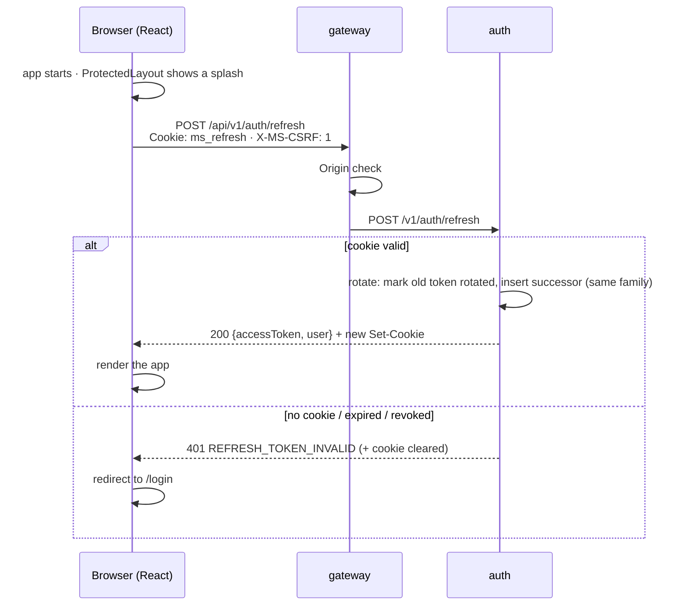
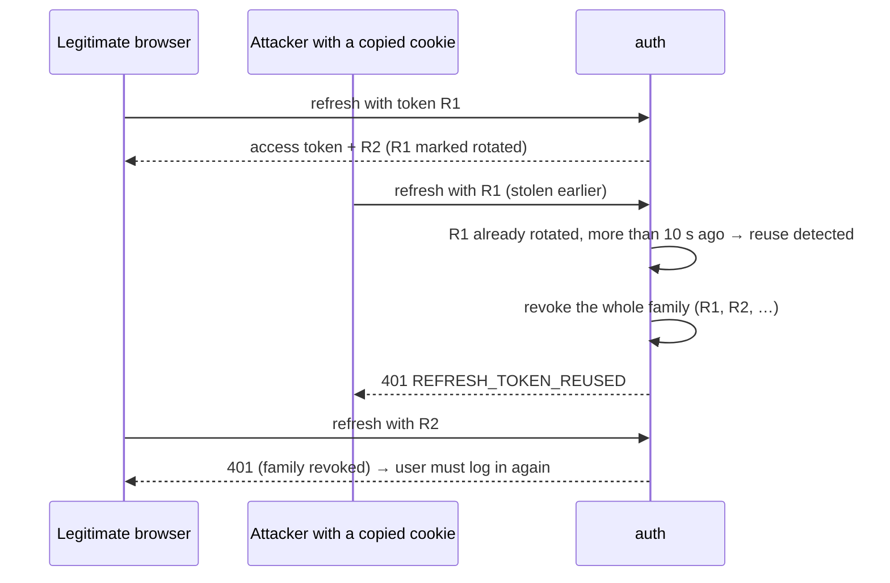

# Auth in the browser

How the React app logs in, stays logged in, calls the API, and what CORS and CSRF mean for it. The decision and the alternatives are in [ADR-0016](../adr/0016-browser-session.md); token verification on the server side is [ADR-0015](../adr/0015-jwt-rs256-jwks-validate-everywhere.md). Background: [browser authentication](../learning/concepts/browser-authentication.md).

## Summary

| | Access token | Refresh token |
|-|--------------|---------------|
| What | RS256 JWT, 15 min | Opaque random value, 7 days, rotated on every use |
| Where in the browser | A variable inside the API client module | Cookie `ms_refresh`: `HttpOnly; SameSite=Strict; Path=/api/v1/auth` (`Secure` when served over HTTPS) |
| Readable by JavaScript | Yes | **No** |
| Sent how | `Authorization: Bearer …`, added by the API client | Automatically by the browser, only to `/api/v1/auth/*` |
| Survives a page reload | No | Yes |

One origin (`http://localhost:8080`) serves the app and the API, so there is **no CORS**.

## Login

```mermaid
sequenceDiagram
  actor U as User
  participant B as Browser (React)
  participant G as gateway
  participant A as auth

  U->>B: email + password
  B->>G: POST /api/v1/auth/login {email, password}
  G->>G: rate limit: 10/min per IP
  G->>A: POST /v1/auth/login
  A->>A: find user · Argon2id verify · create refresh token (new family)
  A-->>G: 200 {accessToken, expiresIn: 900, user}<br/>Set-Cookie: ms_refresh=…; HttpOnly; SameSite=Strict; Path=/api/v1/auth
  G-->>B: same response
  B->>B: keep accessToken in memory · store user in SessionContext · schedule refresh at exp − 60 s
  B-->>U: redirect to /dashboard
```

Failure paths:

| Case | Response | UI |
|------|----------|----|
| Wrong email or password | `401 INVALID_CREDENTIALS` (identical for both, so the response does not reveal which emails exist) | "Email or password is incorrect" |
| Too many attempts | `429 RATE_LIMITED` with `Retry-After` | "Too many attempts. Try again in N seconds" |
| auth down | `502`/`504` from the gateway | "Sign-in is temporarily unavailable" with retry |

## Startup and page reload

The access token is gone after a reload; the cookie is not.



## Calling the API

All requests go through one client (`lib/api/client.ts`), built on `openapi-fetch` with a middleware pair:

1. **Before the request:** if the token expires within 30 s, await a refresh first; then set `Authorization`.
2. **After the response:** on `401`, refresh once and replay the original request once. If the refresh fails, clear the session and redirect to `/login`.

Two rules keep this correct:

- **Single-flight refresh.** If five requests get `401` at the same moment, only one refresh call is made; the others await the same promise. Without this, the second refresh would present an already-rotated token.
- **Replay only once.** A `401` on the replay means the session is really gone; do not loop.

A mutation is replayed only when the first attempt was rejected with `401` (the server did nothing). It is never replayed after a timeout, because the server may have acted.

## Refresh rotation and reuse detection



Rotation turns a silent theft into a visible event: whoever uses the old token second trips the alarm, and both parties are logged out. Auth logs it at `warn` with the family ID.

**Several tabs.** Tabs share the cookie but not memory. A `BroadcastChannel('ms-session')` shares each new access token and logout between tabs, so normally only one tab refreshes. If two tabs still refresh at the same instant, one presents a token rotated milliseconds ago; auth treats a token rotated within the last 10 s as a benign race and returns the same successor ([auth-schema](../data/auth-schema.md)).

## Logout

`POST /api/v1/auth/logout` (cookie + `X-MS-CSRF`) → auth revokes the family and clears the cookie → the client drops the access token, clears the TanStack Query cache (so the next user of this browser sees nothing cached), broadcasts logout to other tabs, and closes the SSE stream.

The access token remains *valid* until it expires (at most 15 minutes), but nothing holds it any more. That is the stated limit of stateless tokens.

## CORS: why there is none

**CORS** is the browser mechanism by which a server allows pages from *other origins* to read its responses. An origin is scheme + host + port.

- The app is loaded from `http://localhost:8080` and calls `http://localhost:8080/api/…`: same origin, so no CORS check happens and the gateway sends no `Access-Control-*` headers.
- A page on any other origin that tries to call the API with `fetch` gets its response blocked by the browser, and any request with a custom header or JSON content type is stopped at the **preflight** (`OPTIONS`) request, which the gateway answers with `404`.
- Developing with Vite on the host (`http://localhost:5173`) would be a different origin. Vite's dev proxy forwards `/api` to the gateway, so the browser still sees one origin.

CORS is not a security feature for the server: it relaxes the browser's same-origin policy. `curl` ignores it entirely. That is why the API still needs authentication on every request.

If the frontend ever had to live on another origin, the gateway would need `Access-Control-Allow-Origin: <that origin>` (never `*` with credentials), `Access-Control-Allow-Credentials: true`, an allow-list of headers, and the cookie would need `SameSite=None; Secure`. This is the configuration the single-origin choice avoids.

## CSRF: where it applies and why it is small

**CSRF** works because browsers attach cookies automatically, including on requests triggered by other sites.

| Request type | Authenticated by | CSRF-able? |
|--------------|------------------|------------|
| Every API call (`/api/v1/monitors`, …) | `Authorization` header set by our JavaScript | **No.** Another site cannot make the browser add that header |
| `POST /api/v1/auth/refresh`, `/logout` | Cookie | In principle yes; defended below |
| `POST /api/v1/auth/login`, `/register` | Request body | "Login CSRF" (logging the victim into the attacker's account) is prevented by the same defences |

Defences on the cookie endpoints, in layers:

1. **`SameSite=Strict`**: the browser does not send `ms_refresh` on any request initiated by another site.
2. **Custom header `X-MS-CSRF: 1`** and `Content-Type: application/json`: an HTML form cannot send them; a cross-origin `fetch` that does triggers a preflight that fails.
3. **Origin check at the gateway**: if an `Origin` header is present and is not the app's origin, `403 CSRF_CHECK_FAILED`.

Even if all three failed, a forged refresh would give the attacker nothing: they cannot read the response.

## XSS: the threat that actually matters here

With tokens handled by JavaScript, injected script is the real risk: it can call the API as the user for as long as the page is open, and it can call `refresh` to obtain new access tokens. It **cannot** read the refresh cookie, so it cannot take the session elsewhere or outlive the tab.

Defences ([security](../cross-cutting/security.md)):

- React escapes interpolated values by default; `dangerouslySetInnerHTML` is banned by lint rule.
- User-supplied URLs (monitor targets, webhook URLs) are rendered as text, or as links only when the scheme is `http`/`https`. A `javascript:` URL in an `href` is an XSS vector.
- `Content-Security-Policy: default-src 'self'; script-src 'self'; object-src 'none'; frame-ancestors 'none'` from the gateway. No inline scripts, no third-party scripts, no CDN.
- No secrets in `localStorage` or `sessionStorage`, ever.

## SSE and the token

`EventSource` cannot set an `Authorization` header, and putting a token in a query string would write it into access logs. The stream is therefore opened with `fetch` and the normal header ([realtime](realtime.md)). When the token expires the server ends the stream and the client reconnects with a fresh token through the same single-flight refresh.

## API clients (no browser)

Scripts use an API key: `POST /api/v1/auth/token {apiKey}` → a 15-minute access token → `Authorization: Bearer`. No cookie, no CSRF concerns, no refresh token: the script simply exchanges the key again.

## Session handling checklist for the implementation

- [ ] Access token only in a module variable.
- [ ] Startup refresh before rendering protected routes.
- [ ] Single-flight refresh promise.
- [ ] Refresh timer at `exp − 60 s`, cleared on logout.
- [ ] One replay on `401`, never for timeouts on mutations.
- [ ] `BroadcastChannel` for token and logout.
- [ ] Query cache cleared on logout.
- [ ] `credentials: 'same-origin'` (the `fetch` default) is enough; never `'include'`.
