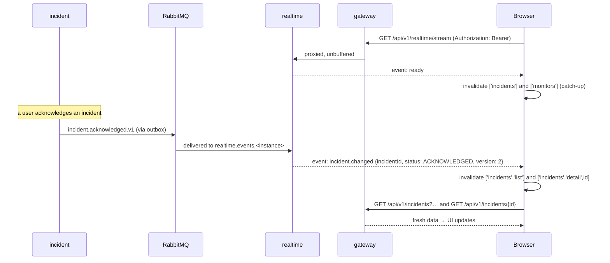
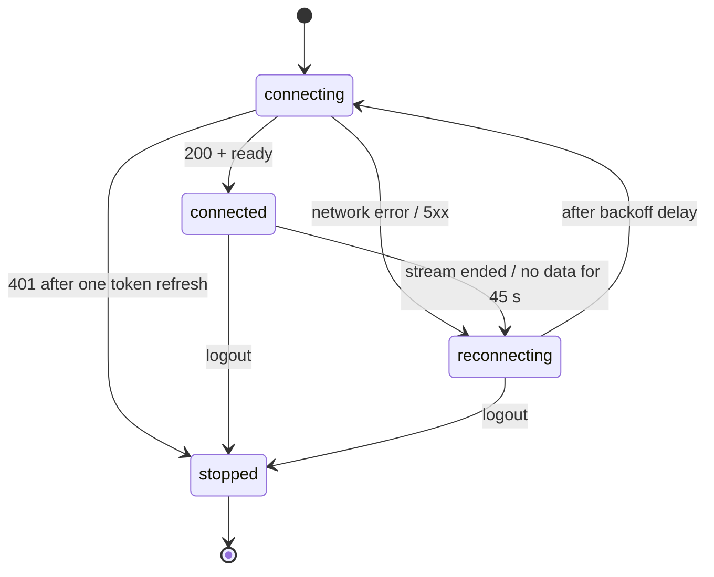

# Realtime in the browser

How incident and monitor changes reach the page without a refresh, what happens when the connection drops, and how the UI catches up on what it missed. Decision: [ADR-0019](../adr/0019-sse-realtime-service.md). Server side: [realtime service](../services/realtime.md). Background: [real-time delivery](../learning/concepts/realtime-delivery.md).

## The idea in one paragraph

The server pushes **hints**, not data. A hint says "incident X changed" and nothing more useful than its ID and new status. The browser reacts by **invalidating** the matching TanStack Query cache entries, which refetch through the ordinary REST endpoints. So there is exactly one way data enters the UI (REST), one place permissions are enforced (the services), and the push channel can be lossy without the UI ever being wrong for long.

## End to end

Typical latency from the user's click in one browser to the update in another: outbox poll (≤ 500 ms) + broker + refetch ≈ under 1 s; the target is 2 s.

## Phase 1: polling

Before the broker exists there is nothing to push. Monitor and incident queries use `refetchInterval: 5000`. This is a legitimate design, not a placeholder: it is trivially correct, has no connection state, and costs one small request per query every five seconds per open tab. Experience both and be able to say when polling is enough ([ADR-0019](../adr/0019-sse-realtime-service.md)).

## Phase 2: the stream

### Connecting

A single hook, `useRealtime()`, mounted once in `AppShell`:

1. Await a valid access token from the API client.
2. `fetch('/api/v1/realtime/stream', { headers: { Authorization, Accept: 'text/event-stream' }, signal })`.
3. If the response is not `200`, treat as a failed attempt (below).
4. Read `response.body` with a stream reader, feed chunks to `eventsource-parser`, dispatch each parsed event.
5. When the stream ends for any reason, go to **reconnecting**.

`fetch` is used instead of the browser's `EventSource` because `EventSource` cannot send an `Authorization` header ([auth in the browser](auth-in-the-browser.md#sse-and-the-token)). The cost is that reconnection, which `EventSource` does by itself, is written by hand.

### Handling events

| Event | Action |
|-------|--------|
| `ready` | State → `connected`. **Invalidate `['incidents']` and `['monitors']`.** Reset the backoff counter |
| `incident.changed` | Invalidate `['incidents', 'list']`, `['incidents', 'detail', incidentId]`, `['deliveries']` filtered to that incident. If `cause` is `incident.opened.v1`, show a toast "New incident" |
| `monitor.status.changed` | Invalidate `['monitors', 'list']`, `['monitors', 'detail', monitorId]`, `['monitors', 'checks', monitorId]` |
| unknown event name | Ignore ([versioning](../contracts/versioning.md#sse-event-versioning)) |
| heartbeat comment | Record `lastHeardAt = now` |

**Coalescing.** Several hints within 250 ms produce one invalidation per key, so a burst (an escalation plus three delivery results) causes one refetch, not five.

**Hint versions.** Each `incident.changed` carries `version`. If the cached incident already has that version or a newer one (because this tab made the change and already refetched), the detail query is not invalidated again.

### Connection states

| State | UI | Queries |
|-------|-----|---------|
| `connected` | Green dot, "Live" | No interval polling; one safety refetch every 60 s |
| `connecting` / `reconnecting` | Amber dot, "Live updates paused, reconnecting…" (shown only after 3 s, to avoid flicker) | **Fall back to 5 s polling** |
| `stopped` | — | Session ended |

### Reconnection

- **Triggers:** the stream closes (server restart, gateway restart, token expiry, network change), the `fetch` rejects, or the **watchdog** fires: nothing received, not even a heartbeat, for 45 s (three missed 15 s heartbeats). The watchdog matters because a connection can die without the browser noticing, for example behind a proxy that drops idle connections silently.
- **Delay:** exponential backoff with **full jitter**: `delay = random(0, min(30 s, 1 s × 2^attempt))`. Jitter matters here specifically: when realtime restarts, every browser loses its stream at the same instant, and without randomness they would all reconnect at the same instant too ([retries, backoff and jitter](../learning/concepts/retries-backoff-jitter.md)).
- **Token expiry:** the server ends the stream at the token's `exp`. The client's reconnect asks the API client for a token, which refreshes if needed. A `401` on connect triggers one forced refresh and one retry, then `stopped`.
- **Tab hidden:** when `document.visibilityState` is `hidden` for more than 5 minutes, the stream is closed; it reopens on return (and the `ready` handler refetches). No reason to hold a connection for a tab nobody is looking at.
- **`503 TOO_MANY_CONNECTIONS`:** honour `Retry-After`.

### Missed-event catch-up

There is no replay and no `Last-Event-ID` resume. The rule is simpler and stronger:

> **Every time the stream becomes `connected`, refetch everything the stream is responsible for.**

Whatever happened while disconnected, whether one event or a thousand, the UI converges on current state with two list requests. This works because hints are not the data. A design that pushed full objects and patched the cache would need sequence numbers, a server-side buffer and gap detection to be correct; this one needs none of that.

Remaining gaps and their covers:

| Gap | Cover |
|-----|-------|
| realtime lost its broker connection but kept browser connections open (no hints, heartbeats continue) | 60 s safety refetch while `connected`; refetch on window focus |
| A hint arrives before the service's transaction is visible to the refetch | Cannot happen for incident events: they are published from the outbox **after** commit |
| The refetch hits a service that is briefly down | Query retry (2 attempts); the next hint or safety refetch tries again |

## What the user sees, concretely

- `/incidents` open in two browsers. One user acknowledges; within about a second the other's row changes to `ACKNOWLEDGED` with the acknowledger's name.
- A monitor goes down: a toast "New incident: Checkout API", the incident appears at the top of the list, the monitor's badge turns `DOWN`.
- Stop the `realtime` container: after 3 s the indicator turns amber; the list still updates every 5 s by polling. Start it again: the indicator turns green and a refetch runs.

This is the [break-it lab](../roadmap/break-it-lab.md) experiment "the browser's live connection dropped while incidents change".

## Testing

| Level | What |
|-------|------|
| Unit | Backoff function (bounds, jitter range); hint → query keys mapping; coalescing |
| Component | With MSW streaming a scripted SSE body: `ready` causes a refetch; `incident.changed` updates the list; stream end shows the paused indicator and enables polling |
| e2e (Playwright) | Two browser contexts; acknowledge in one, assert the other updates without reload; stop `realtime`, assert indicator and that polling still updates |

## Limits worth stating

- Each hint costs one or two HTTP requests per interested tab. Fine at a few events per minute; wasteful at many per second, where sending data and patching the cache would be better.
- Browsers limit HTTP/1.1 connections per origin (commonly six). One stream per tab is fine; more than five tabs of the app on HTTP/1.1 would start to block. HTTP/2 at a TLS-terminating proxy removes the limit; noted for a real deployment.
- No presence, no typing indicators, no client → server messages: those would need WebSockets.
