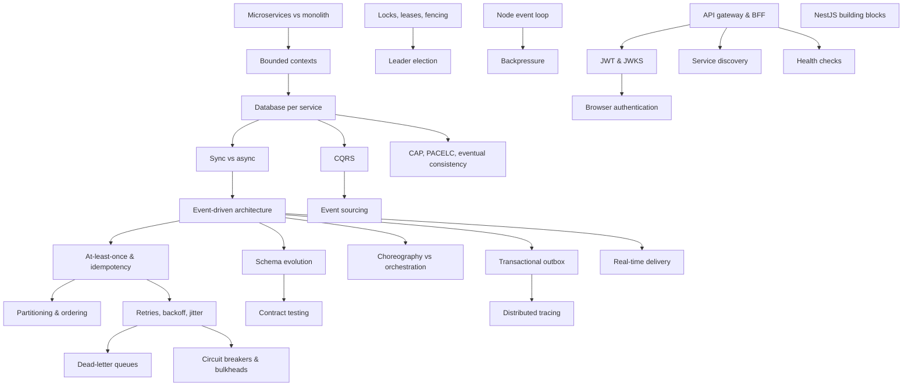

# Learning map

Which concept, where it is used, where it is decided, and in which phase you build it. Every concept guide follows the same template: TL;DR, the problem, how it works, in MicroSentinel, trade-offs, misconceptions, interview questions with model answers, further reading.

Interview material: [interview prep](interview-prep.md) (stories, system design, scale, weak spots) and the [question bank](interview-question-bank.md).

## Concept map

## Index

"Junior" marks concepts that junior full-stack interviews commonly test directly; the rest are differentiators.

| Concept | Guide | Main places used | Decided in | Phase | Junior? |
|---------|-------|------------------|-----------|-------|---------|
| Microservices vs modular monolith | [guide](concepts/microservices-vs-modular-monolith.md) | whole system | [ADR-0002](../adr/0002-service-boundaries.md) | 0 | ✓ |
| Bounded contexts and DDD basics | [guide](concepts/bounded-contexts-and-ddd.md) | [domain model](../02-domain-model.md) | [ADR-0002](../adr/0002-service-boundaries.md), [ADR-0014](../adr/0014-on-call-in-incident-and-local-replicas.md) | 0 | |
| Database per service | [guide](concepts/database-per-service.md) | [data-ownership](../architecture/data-ownership.md) | [ADR-0018](../adr/0018-single-postgres-and-ram-budget.md) | 1 | ✓ |
| Sync vs async communication | [guide](concepts/sync-vs-async-communication.md) | [communication](../architecture/communication.md) | [ADR-0014](../adr/0014-on-call-in-incident-and-local-replicas.md) | 1–2 | ✓ |
| Event-driven architecture | [guide](concepts/event-driven-architecture.md) | [event catalog](../contracts/event-catalog.md) | [ADR-0006](../adr/0006-rabbitmq-as-broker.md) | 2 | |
| Choreography vs orchestration, sagas | [guide](concepts/choreography-vs-orchestration.md) | [outage flow](../flows/outage-to-resolution.md) | [communication](../architecture/communication.md#choreography-not-orchestration) | 2 | |
| Transactional outbox | [guide](concepts/transactional-outbox.md) | every publisher | [ADR-0008](../adr/0008-transactional-outbox.md) | 2 | |
| At-least-once and idempotency | [guide](concepts/idempotency-and-at-least-once.md) | every consumer | [ADR-0012](../adr/0012-idempotent-consumers.md) | 1–2 | ✓ |
| Retries, backoff, jitter | [guide](concepts/retries-backoff-jitter.md) | [resilience](../cross-cutting/resilience.md) | [ADR-0023](../adr/0023-retry-topology-ttl-dlx.md) | 3 | ✓ |
| Dead-letter queues, poison messages | [guide](concepts/dead-letter-queues.md) | [retry flow](../flows/notification-retry-and-dlq.md) | [ADR-0023](../adr/0023-retry-topology-ttl-dlx.md) | 2–3 | |
| Circuit breakers and bulkheads | [guide](concepts/circuit-breakers-and-bulkheads.md) | [notification](../services/notification.md) | [resilience](../cross-cutting/resilience.md) | 3 | |
| Distributed locks, leases, fencing | [guide](concepts/distributed-locks-leases-fencing.md) | [monitor](../services/monitor.md) | [ADR-0010](../adr/0010-postgres-leases-for-scheduling.md) | 1, 3 | |
| Leader election | [guide](concepts/leader-election.md) | jobs, single active consumer | [ADR-0010](../adr/0010-postgres-leases-for-scheduling.md) | 3 | |
| CQRS | [guide](concepts/cqrs.md) | [analytics](../services/analytics.md) | [ADR-0021](../adr/0021-postgres-analytics-store.md) | 4 | |
| Event sourcing | [guide](concepts/event-sourcing.md) | (rejected for incident; replay in analytics) | [ADR-0011](../adr/0011-incident-state-machine-not-event-sourcing.md) | 4 | |
| API gateway and BFF | [guide](concepts/api-gateway-and-bff.md) | [gateway](../services/gateway.md) | [ADR-0020](../adr/0020-nestjs-api-gateway.md) | 0–1 | ✓ |
| Service discovery | [guide](concepts/service-discovery.md) | [deployment](../architecture/deployment-local.md) | [ADR-0018](../adr/0018-single-postgres-and-ram-budget.md) | 0 | |
| JWT and JWKS | [guide](concepts/jwt-and-jwks.md) | every service | [ADR-0015](../adr/0015-jwt-rs256-jwks-validate-everywhere.md) | 1 | ✓ |
| Distributed tracing | [guide](concepts/distributed-tracing.md) | [observability](../cross-cutting/observability.md) | [ADR-0025](../adr/0025-observability-stack.md) | 4 | |
| CAP, PACELC, eventual consistency | [guide](concepts/cap-pacelc-eventual-consistency.md) | replicas, read model, browser | [ADR-0014](../adr/0014-on-call-in-incident-and-local-replicas.md) | 2 | |
| Partitioning and per-key ordering | [guide](concepts/partitioning-and-ordering.md) | incident consumer, analytics | [ADR-0017](../adr/0017-ordering-and-replay.md) | 2 | |
| Backpressure | [guide](concepts/backpressure.md) | workers, consumers, gateway | [ADR-0026](../adr/0026-pinger-safety.md) | 1–3 | |
| Schema evolution and versioning | [guide](concepts/schema-evolution.md) | [versioning](../contracts/versioning.md) | [ADR-0022](../adr/0022-contracts-package-and-shared-libs.md) | 2 | |
| Health checks | [guide](concepts/health-checks.md) | every service | [deployment](../architecture/deployment-local.md) | 0 | ✓ |
| Contract testing | [guide](concepts/contract-testing.md) | [testing strategy](../cross-cutting/testing-strategy.md) | [ADR-0027](../adr/0027-testing-stack.md) | 4 | |
| Node.js event loop and I/O concurrency | [guide](concepts/node-event-loop.md) | [monitor-worker](../services/monitor.md) | [ADR-0026](../adr/0026-pinger-safety.md) | 1, 3 | ✓ |
| NestJS building blocks | [guide](concepts/nestjs-building-blocks.md) | every service | [ADR-0004](../adr/0004-nestjs-everywhere-express-for-fixtures.md), [ADR-0007](../adr/0007-amqplib-over-nest-microservices.md) | 0–2 | ✓ |
| Real-time delivery | [guide](concepts/realtime-delivery.md) | [realtime](../services/realtime.md), [frontend](../frontend/realtime.md) | [ADR-0019](../adr/0019-sse-realtime-service.md) | 1–2 | |
| Browser authentication, CORS, CSRF | [guide](concepts/browser-authentication.md) | [auth in the browser](../frontend/auth-in-the-browser.md) | [ADR-0016](../adr/0016-browser-session.md) | 1 | ✓ |

## Suggested study order

1. **Why and what:** monolith vs microservices → bounded contexts → database per service → sync vs async.
2. **The core distributed patterns** (go deep here): event-driven architecture → outbox → idempotency → ordering → retries → DLQ.
3. **Coordination:** locks, leases and fencing → leader election → backpressure → Node event loop.
4. **Edge and browser:** API gateway → JWT/JWKS → browser authentication → real-time delivery.
5. **Reading and history:** CQRS → event sourcing → CAP/PACELC.
6. **Operating it:** health checks → service discovery → tracing → circuit breakers → schema evolution → contract testing.
7. **Framework:** NestJS building blocks, last, once you know what the blocks are carrying.

## How to study a guide

Read it once; then close it and answer its interview questions out loud, in your own words, with a MicroSentinel example. Where you stumble, open the linked ADR or flow. A concept is learned when you can explain the failure it prevents using this project, and say when you would *not* use it.
