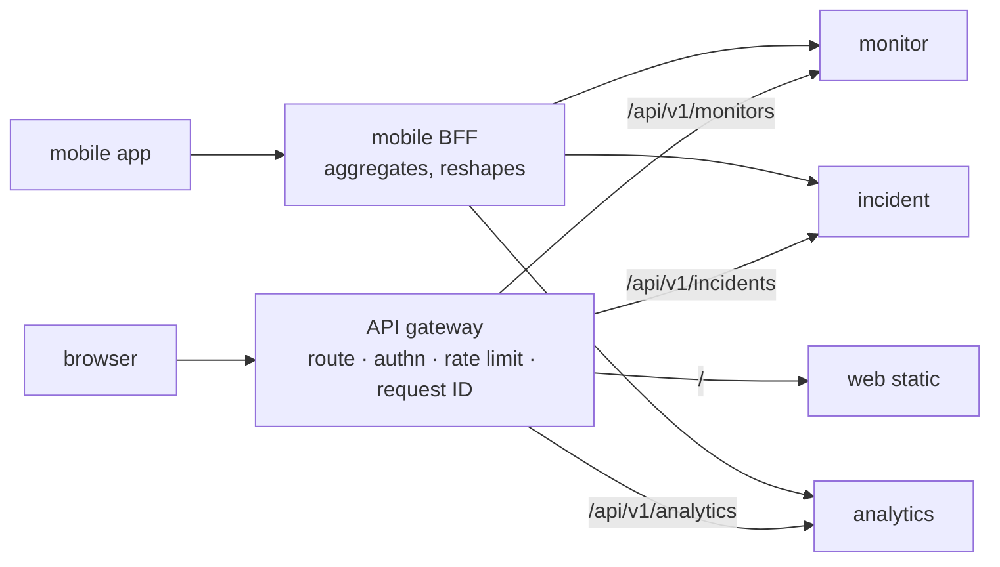

# API gateway and BFF

**TL;DR:** An **API gateway** is the single entry point in front of many services: it routes requests and handles edge concerns (authentication, rate limiting, request IDs, TLS) so services don't repeat them. A **backend-for-frontend (BFF)** is a server built for one specific client (the web app, a mobile app) that shapes and aggregates data for it. A gateway routes; a BFF composes.

## The problem it solves

Without a gateway, the browser would need to know seven service addresses, each service would need CORS, rate limiting and unauthenticated-request rejection, and every internal port would be exposed. Changing which service owns `/schedules` would break clients.

Without a BFF, a screen that needs data from three services makes three calls and joins them in the browser, and every client re-implements that composition.

## How it works

| | API gateway | BFF |
|-|-------------|-----|
| Clients served | All | One |
| Business knowledge | None | Knows what the screen needs |
| Typical work | Routing, auth check, rate limiting, TLS, request IDs, CORS | Aggregation, field selection, client-specific auth (sessions), caching |
| Owned by | Platform team | The client's team |
| Risk | Becoming a dumping ground of logic | Duplicated logic across BFFs |

Products: Traefik, Kong, Envoy, NGINX, cloud load balancers; or hand-written (Node, Go). Comparison: [ADR-0020](../../adr/0020-nestjs-api-gateway.md).

**Auth offloading:** the gateway rejects missing or invalid tokens before they reach services. It is a first filter, not the only check, if services verify too (defence in depth).

## In MicroSentinel

- A thin NestJS gateway with a static routing table, JWT verification, Redis-backed rate limits, request IDs, security headers and an origin check for cookie endpoints ([gateway](../../services/gateway.md), [ADR-0020](../../adr/0020-nestjs-api-gateway.md)).
- It forwards the `Authorization` header unchanged and injects **no** identity headers; services verify the token themselves ([ADR-0015](../../adr/0015-jwt-rs256-jwks-validate-everywhere.md)). Replacing it with Traefik would therefore be easy.
- It serves the web app and the API from **one origin**, which removes CORS ([ADR-0016](../../adr/0016-browser-session.md)).
- **No BFF.** The web app composes on the client with TanStack Query; each screen's queries are independent and render their own loading/error states ([web app](../../frontend/web-app.md)). `realtime` is the push-only slice of what a BFF might do, deliberately kept separate from the gateway ([ADR-0019](../../adr/0019-sse-realtime-service.md)).
- Building the gateway in Node is a **learning choice**; Traefik would be the pragmatic one.

## Trade-offs & when NOT to use it

- A gateway is a single point of failure for users and a hop of latency. Run several replicas.
- Logic creeps in ("just add this transformation"); keep it boring.
- A BFF is worth it when clients differ a lot (mobile vs web), when aggregation is heavy, or when you want server-side sessions so the browser never holds tokens. For one web client with simple screens, it's extra code.
- With a single service, you may not need a gateway at all; a reverse proxy suffices.

## Common misconceptions

- **"The gateway handles authorization."** It can check that a token is valid; whether *this user* may *do this* belongs to the service that owns the data.
- **"Services behind the gateway can trust forwarded user headers."** Only if nothing else can reach them. Verifying the token in each service removes that assumption.
- **"BFF and gateway are the same."** A gateway is generic; a BFF is client-specific.
- **"Retries belong in the gateway."** Not for non-idempotent requests.

## Interview questions

1. **What does an API gateway do?**
   "It's the single entry point: routes by path to the right service, rejects unauthenticated requests early, rate-limits, adds request IDs and security headers. Mine also serves the web app from the same origin so there's no CORS."
2. **Gateway vs BFF?**
   "A gateway is generic routing and edge concerns for every client. A BFF is a backend for one specific client that aggregates and reshapes data for its screens. I have a gateway but no BFF: my screens compose a few independent queries on the client."
3. **Should services trust the gateway?**
   "Not blindly. My gateway checks the JWT, but each service verifies it again with the public keys. If someone reaches a service directly, a forged header gets them nothing."
4. **Why did you write your own gateway?**
   "To understand what one does: streaming bodies through, middleware order, timeouts. In production I'd use Traefik or Envoy; they've solved edge cases mine hasn't."

## Further reading

- Chris Richardson, microservices.io: "Pattern: API Gateway / Backends for Frontends"; *Microservices Patterns*, chapter 8.
- Sam Newman, "Backends For Frontends" (samnewman.io, 2015) and *Building Microservices*, 2nd ed., chapter 14.
- Traefik and Envoy official documentation (routing, middleware/filters).

Used in: [ADR-0020](../../adr/0020-nestjs-api-gateway.md), [gateway](../../services/gateway.md), [realtime](../../services/realtime.md), [phase 0](../../roadmap/phase-0.md).
