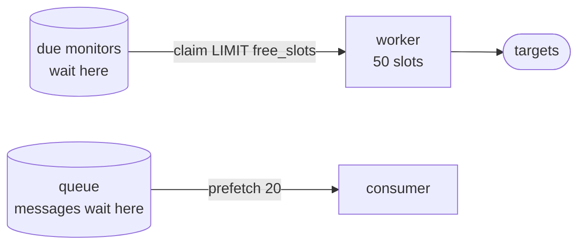

# Backpressure

**TL;DR:** Backpressure is how a slow consumer tells a fast producer to slow down, so excess work waits somewhere safe (a queue, a database table, the client) instead of piling up in memory until something crashes. Every unbounded buffer is a missing backpressure mechanism.

## The problem it solves

At startup after an outage, 500 monitors are all overdue. A naive worker loads all 500, fires 500 concurrent HTTP requests, opens 500 sockets, allocates 500 response buffers, and the event loop is too busy to service timers: healthy targets appear to time out. Or: notification is down for an hour; when it returns, a consumer with unlimited prefetch receives 10 000 messages into memory at once.

## How it works

The idea: **bound** every buffer, and when it is full, make the upstream wait or reject.

| Mechanism | How it pushes back |
|-----------|-------------------|
| Pull instead of push | Consumer asks for work when it has capacity |
| Bounded concurrency (semaphore) | New work waits until a slot frees |
| Broker **prefetch** (credit) | Broker stops delivering until acks free credit |
| Bounded queues with a policy | Reject, drop oldest, or block the producer when full |
| TCP flow control / Node stream `highWaterMark` | `write()` returns `false`; wait for `drain` |
| HTTP `429` / `503` with `Retry-After` | Client is told to come back later |
| Load shedding | Drop low-priority work under overload |

Where work waits matters: in a durable store (database, broker) it survives restarts and is visible; in process memory it is lost on crash and invisible.

## In MicroSentinel

Full list in [resilience](../../cross-cutting/resilience.md#backpressure). Key ones:

- **Workers claim only as many leases as free slots** (50 − in flight). Overdue monitors wait in the table; schedule lag is the visible signal ([ADR-0026](../../adr/0026-pinger-safety.md)).
- **Prefetch** on every consumer: 1 for ordered monitor events, 10 for event queues, 20 for delivery jobs, 500/100 for streams (where acks act as credit to advance the offset).
- **Outbox relay batches** of 100; the backlog stays in the table.
- **RabbitMQ memory watermark** blocks publishers when the broker is short of memory; the relay sees confirm timeouts and the outbox absorbs it.
- **Gateway rate limits** return `429` with `Retry-After`.
- **realtime's slow-client guard** closes an SSE connection whose write buffer exceeds 64 KB instead of buffering for a browser that isn't reading.

## Trade-offs & when NOT to use it

- Backpressure moves the problem upstream; eventually something must wait, drop or reject. Decide which, explicitly.
- Bounds too low waste capacity; too high and you're back to unbounded in practice. Measure (schedule lag, queue depth).
- Rejecting (`429`) is friendlier to the system than queuing indefinitely, but needs clients that respect it.

## Common misconceptions

- **"Async code can't be overloaded."** Node happily starts a million promises; each holds memory and sockets.
- **"A queue solves overload."** It defers it. An unbounded queue just turns overload into memory exhaustion later.
- **"Auto-scaling replaces backpressure."** Scaling takes minutes; backpressure works in milliseconds and protects you while scaling.

## Interview questions

1. **What is backpressure?**
   "A way for a slow consumer to make a fast producer slow down, so work waits somewhere bounded and durable instead of piling up in memory."
2. **Give an example from your project.**
   "My check workers only claim as many monitors from the database as they have free slots. If they're saturated, overdue monitors just wait in the table and I see it as schedule lag, instead of the worker starting thousands of requests and falling over. Consumers do the same with RabbitMQ prefetch."
3. **What does prefetch do?**
   "It limits how many unacknowledged messages the broker gives one consumer. When the consumer is busy, the broker stops sending and messages stay in the queue."
4. **How does Node handle backpressure in streams?**
   "`write()` returns false when the internal buffer passes the high-water mark, and you wait for the `drain` event before writing more. `pipe` and `pipeline` do that for you."

## Further reading

- Node.js documentation: "Backpressuring in Streams".
- RabbitMQ documentation: "Consumer Prefetch" and "Flow Control" / "Memory and Disk Alarms".
- Google, *Site Reliability Engineering*, chapter 21 "Handling Overload" and chapter 22 "Addressing Cascading Failures".

Used in: [resilience](../../cross-cutting/resilience.md), [ADR-0026](../../adr/0026-pinger-safety.md), [monitor](../../services/monitor.md), [notification](../../services/notification.md), [realtime](../../services/realtime.md), [analytics](../../services/analytics.md), [gateway](../../services/gateway.md), [phase 3](../../roadmap/phase-3.md).
