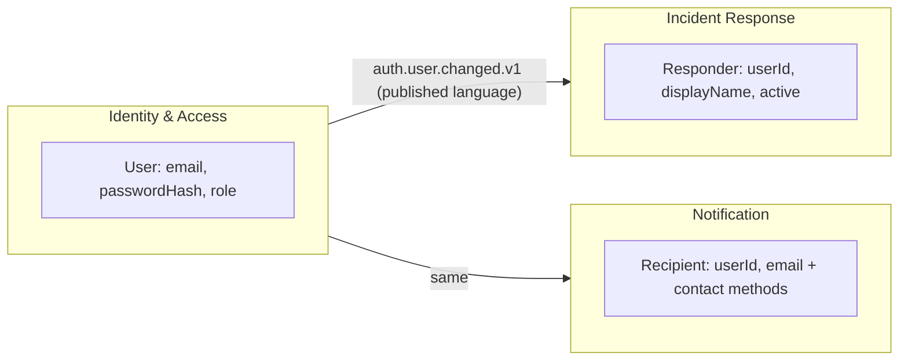

# Bounded contexts and DDD basics

**TL;DR:** Domain-Driven Design (DDD) is a way of modelling software around the business's own language. A **bounded context** is a boundary inside which each term has exactly one meaning and one model. Bounded contexts are the best starting point for service boundaries; **aggregates** are the units of consistency inside them.

## The problem it solves

Try to build one `User` class for MicroSentinel that serves everyone: login needs a password hash; on-call needs rotation position; notification needs phone numbers; analytics needs nothing. The class grows every field, every service depends on it, and a change for one purpose risks breaking the others. Worse, words drift: "acknowledge" means a user taking an incident in one place and a consumer confirming a message in another. Bugs follow from confusing them.

## How it works

Core vocabulary:

| Term | Meaning | MicroSentinel example |
|------|---------|-----------------------|
| **Ubiquitous language** | The shared vocabulary of developers and domain experts, used in code too | The [glossary](../../03-glossary.md) |
| **Bounded context** | A boundary within which a model and its language are consistent | Identity & Access, Monitoring, Incident Response, Notification, Analytics |
| **Context map** | How contexts relate: who is upstream, who adapts to whom | [domain model](../../02-domain-model.md#context-map) |
| **Entity** | An object with identity that persists over time | `Incident`, `Monitor` |
| **Value object** | Defined by its value, immutable | A check outcome, an accepted-status-code range |
| **Aggregate** | A cluster of objects changed together through one **root**, in one transaction | `Incident` + its timeline + its escalation timer |
| **Invariant** | A rule that must hold after every transaction | "At most one unresolved incident per monitor" |
| **Domain event** | A fact that happened in the domain | `monitor.state.changed.v1` |
| **Anti-corruption layer (ACL)** | Translation at a context's edge so an upstream model doesn't leak in | Incident mapping `auth.membership.changed.v1` into its own `responders` table |

Context-map relationship patterns used here: **published language** (the event catalog), **open host service** (JWT + JWKS), **customer/supplier** (incident's needs shape monitor's event), **conformist** (analytics accepts events as they are), **ACL** at every consumer.

Same person, three models, each minimal for its context.

## In MicroSentinel

- Contexts and their services: [domain model](../../02-domain-model.md#bounded-contexts). The gateway and realtime are deliberately **not** contexts: they own no model.
- Moving on-call out of Identity & Access ([ADR-0014](../../adr/0014-on-call-in-incident-and-local-replicas.md)) is a bounded-context argument: schedules change for incident-response reasons, not identity reasons.
- Aggregates set transaction boundaries: `applyTransition` changes one incident (and its timeline, timer and outbox rows) per transaction ([incident](../../services/incident.md)).
- ACLs live in each service's `consumers/` folder: contract types are mapped to domain inputs at the top of each handler and never passed deeper ([repo layout](../../cross-cutting/repo-layout.md)).
- "Words to avoid" in the glossary is ubiquitous-language maintenance in practice.

## Trade-offs & when NOT to use it

- Full **tactical DDD** (repositories per aggregate, domain services, rich models everywhere) is heavy for CRUD screens. Use the strategic part (contexts, language, context map) always; use the tactical part where invariants are real (incidents, leases), not for contact-method CRUD.
- Contexts drawn too early in an unfamiliar domain will be wrong. Cheap to fix in a monolith, expensive across services.
- One bounded context does **not** have to be one service; several contexts can share a deployable. The reverse (one context split across services) is usually a mistake.

## Common misconceptions

- **"Bounded context = microservice."** A context is a model boundary; a service is a deployment boundary. They often align, but needn't.
- **"Aggregate = table."** An aggregate is a consistency boundary; it can span tables (incident + timeline) and a table can be outside any aggregate (a replica).
- **"DDD needs event sourcing / CQRS."** No. They are optional patterns that combine well with DDD.
- **"The ubiquitous language is a glossary document."** The document helps; the point is that the *code* uses the words.

## Interview questions

1. **What is a bounded context?**
   "A boundary in which a model and its words mean one thing. In my project 'user' is credentials and role in auth, a pageable responder in incident, and a set of contact methods in notification. Each keeps only what it needs, and they communicate through published events."
2. **How did you choose service boundaries?**
   "From bounded contexts, then I checked each against two things: does splitting force a distributed transaction or a hot-path synchronous call, and does it change for its own reasons. That's why on-call moved from auth to incident."
3. **What is an aggregate and why does it matter?**
   "It's the unit you load and save in one transaction through a root, and it protects invariants. My incident aggregate includes its timeline and escalation timer, so acknowledging an incident and cancelling its escalation is one atomic change."
4. **What is an anti-corruption layer?**
   "A translation layer at a context's edge so another context's model doesn't leak in. My consumers map incoming event types into their own domain types immediately, so if auth renames something, only that mapping changes."

## Further reading

- Eric Evans, *Domain-Driven Design* (Addison-Wesley), Part IV "Strategic Design".
- Vaughn Vernon, *Implementing Domain-Driven Design* and *Domain-Driven Design Distilled* (Addison-Wesley).
- Martin Fowler, "BoundedContext" (martinfowler.com bliki).
- Sam Newman, *Building Microservices*, 2nd ed., chapter 2 "How to Model Microservices".

Used in: [domain model](../../02-domain-model.md), [ADR-0002](../../adr/0002-service-boundaries.md), [ADR-0014](../../adr/0014-on-call-in-incident-and-local-replicas.md), [incident](../../services/incident.md).
