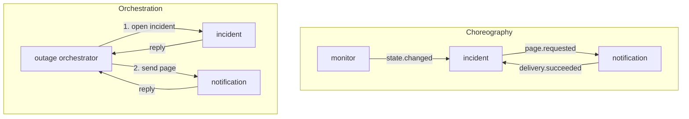

# Choreography vs orchestration (and sagas)

**TL;DR:** A business process that spans services can be coordinated two ways. **Choreography**: each service reacts to events and emits its own; nobody is in charge. **Orchestration**: one component tells each service what to do next and tracks the state of the whole process. A **saga** is such a multi-service process made of local transactions, with compensating actions to undo earlier steps if a later one fails.

## The problem it solves

There are no distributed transactions between services ([database per service](database-per-service.md)). The outage flow touches monitor, incident and notification; each commits its own transaction. Something has to define the sequence, and decide what happens if a step fails halfway. The two styles put that knowledge in different places.

## How it works

| | Choreography | Orchestration |
|-|--------------|---------------|
| Who knows the flow | Nobody, as a whole; each service knows its reaction | The orchestrator |
| Coupling | Services depend on events | Orchestrator depends on every participant's API |
| Adding a step | Add a consumer | Change the orchestrator |
| Visibility of progress | Reconstructed from traces and logs | A state row in the orchestrator |
| Failure handling | Each service handles its own; compensations are distributed | Central: the orchestrator decides retries and compensations |
| Risk | Cyclic event chains; "who is responsible for this?" | Orchestrator grows into a "god service" |
| Tools | A broker | A workflow engine (Temporal, Camunda) or a hand-written state machine |

**Sagas:** a sequence of local transactions T1…Tn. If Ti fails, run compensations Ci-1…C1 to semantically undo the earlier steps (cancel the reservation, refund the payment). Compensations are business actions, not rollbacks: the first transactions really committed.

## In MicroSentinel

- The outage flow is **choreographed**: monitor → incident → notification → incident ([outage-to-resolution](../../flows/outage-to-resolution.md)). No orchestrator.
- It is a saga in the loose sense (a chain of local transactions connected by events) but it needs **no compensations**: every step records a fact ("monitor is down", "incident opened", "email sent"). Nothing later can make an earlier fact untrue. This is worth saying explicitly; many interview examples (order → payment → shipping) do need compensations, and this domain happens not to.
- Closest thing to compensation: cancelling pending page deliveries when an incident is acknowledged ([ADR-0013](../../adr/0013-notification-owns-delivery-state.md)), which is a reaction, not an undo.
- Escalation is **orchestrated inside one service**: incident's own timer decides the next step. Keeping it local avoids a cross-service orchestrator.
- Organization creation is choreographed: `auth.org.created.v1` → incident creates the default policy.

## Trade-offs & when NOT to use it

- Choreography is excellent for a few steps with clear owners. Past five or six steps, or with branching and timeouts, it becomes hard to answer "where is this order stuck?". Then an orchestrator (or a workflow engine) pays for itself.
- Orchestration adds a component that knows everybody; keep it thin and make participants' operations idempotent so it can retry.
- Either way, each participant must be idempotent, and the flow must be observable.

## Common misconceptions

- **"A saga gives you ACID across services."** It gives you eventual completion or compensation; other transactions can see intermediate states (no isolation).
- **"Compensation = rollback."** It is a new transaction with business meaning, and it may itself fail and need retrying.
- **"Choreography means no coupling."** Services depend on each other's events and their meaning.
- **"Orchestration requires a workflow engine."** A state machine table plus a poller is an orchestrator.

## Interview questions

1. **Choreography or orchestration in your project, and why?**
   "Choreography: monitor publishes a state change, incident reacts and publishes a page request, notification reacts and reports back. It's three steps with clear owners. Escalation timing is orchestrated, but inside the incident service, so there's no cross-service coordinator."
2. **What is a saga?**
   "A business process across services built from local transactions, with compensating actions if a later step fails, because there's no distributed transaction. Mine doesn't need compensations because each step just records a fact; in an order system you'd refund or release stock."
3. **When would you switch to orchestration?**
   "When the flow has many steps, branches or timeouts and nobody can answer where a given instance is stuck. Then a central state machine or a workflow engine like Temporal makes it visible and testable."
4. **How do you make a saga reliable?**
   "Each step publishes through an outbox, each consumer is idempotent, retries go through a DLQ, and the whole flow is traceable with a correlation ID."

## Further reading

- Chris Richardson, *Microservices Patterns* (Manning), chapter 4 "Managing transactions with sagas"; and microservices.io "Pattern: Saga".
- Hector Garcia-Molina and Kenneth Salem, "Sagas" (ACM SIGMOD, 1987), the original paper.
- Sam Newman, *Building Microservices*, 2nd ed., chapter 6 "Workflow".

Used in: [communication](../../architecture/communication.md#choreography-not-orchestration), [data-ownership](../../architecture/data-ownership.md), [incident](../../services/incident.md), [phase 2](../../roadmap/phase-2.md).
