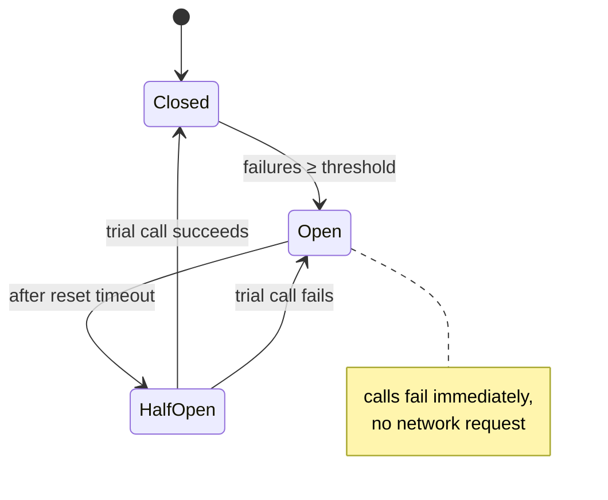

# Circuit breakers and bulkheads

**TL;DR:** A **circuit breaker** stops calling a dependency that keeps failing, for a while, so callers fail fast instead of each waiting for a timeout, and the dependency gets room to recover. A **bulkhead** gives each kind of work its own limited pool of resources, so one overloaded part cannot exhaust what the others need.

## The problem it solves

The SMS gateway starts hanging. Each SMS send waits the full 5 s timeout. Notification processes delivery jobs with prefetch 20, so within seconds all 20 slots are held by hanging SMS sends, and **email pages queue behind them**. A failing, non-critical channel has stopped the critical one. This is a **cascading failure**: one slow dependency takes down its callers.

## How it works

### Circuit breaker

- **Closed:** calls go through; failures are counted (consecutive, or a failure rate over a window).
- **Open:** calls fail immediately with a known error.
- **Half-open:** after a timeout, let one (or a few) trial calls through to test recovery.

### Bulkhead

Named after a ship's watertight compartments. Ways to build one:

| Bulkhead | Example |
|----------|---------|
| Separate processes / containers with memory limits | One service per container, `mem_limit` |
| Separate connection pools | One DB pool per service |
| Separate queues | Delivery jobs vs incident events |
| Concurrency limits per kind of work | Prefetch per queue; per-host check cap |
| Separate thread pools (JVM world) | Not applicable in Node; the equivalent is a semaphore |

## In MicroSentinel

- **Circuit breaker** (opossum) around notification's senders, keyed by channel type + destination host: opens after 5 consecutive failures or > 50 % failures over ≥ 10 calls in 30 s; half-open after 30 s ([notification](../../services/notification.md), [resilience](../../cross-cutting/resilience.md#circuit-breakers)). Attempts still count while open, so a long outage still ends in `DEAD`.
- **Not** used between services (no sync calls), not around targets (a failing target *is* the signal), not around the own database (readiness instead). Knowing where *not* to put one is part of the answer.
- **Bulkheads**: listed in [resilience](../../cross-cutting/resilience.md#bulkheads): processes, pools, queues, prefetch, per-host concurrency (5 of 50 check slots per hostname), per-channel breakers, realtime separated from domain services.
- Experiment: [break-it lab #5](../../roadmap/break-it-lab.md) (slow downstream).

## Trade-offs & when NOT to use it

- A breaker turns a slow failure into a fast one; callers must handle the fast failure sensibly (here: retry later).
- Thresholds are guesses; too sensitive and a blip blocks traffic, too lax and it never opens.
- Per-process breaker state means each replica learns independently. Usually fine.
- Bulkheads waste capacity: idle slots in one compartment can't help another.
- Don't put a breaker in front of something whose failure you need to observe (health checks, the monitored targets).

## Common misconceptions

- **"A circuit breaker retries for you."** It does the opposite: it stops calls.
- **"Timeouts are enough."** Timeouts bound one call; breakers stop paying the timeout on every call.
- **"Bulkheads need threads."** In Node, a semaphore or prefetch limit is a bulkhead.
- **"Breakers belong everywhere."** Only where a dependency can fail independently and failing fast is a useful outcome.

## Interview questions

1. **What is a circuit breaker?**
   "A wrapper around calls to a dependency that counts failures; past a threshold it opens and fails calls immediately for a while, then lets a trial call through to see if it's recovered. It stops you wasting timeouts on something that's down and gives it room to recover."
2. **Where did you use one, and where didn't you?**
   "Around notification senders, per channel and host, so a hanging SMS gateway doesn't tie up the workers sending email. I didn't put one around the monitored targets, because a failing target is exactly what I'm trying to detect."
3. **What's a bulkhead?**
   "Isolating resources so one part can't exhaust them for everyone: separate queues and prefetch limits per kind of work, a cap of five concurrent checks per host so one slow host can't use all fifty slots, separate containers with memory limits."
4. **How do these relate to cascading failures?**
   "A slow dependency makes its callers hold resources while waiting, they slow down, and their callers slow down. Timeouts bound each wait, breakers stop repeating it, and bulkheads keep the damage in one compartment."

## Further reading

- Michael Nygard, *Release It!*, 2nd ed. (Pragmatic Bookshelf): "Circuit Breaker", "Bulkheads", "Timeouts".
- Martin Fowler, "CircuitBreaker" (martinfowler.com bliki).
- opossum documentation (Node.js circuit breaker).

Used in: [resilience](../../cross-cutting/resilience.md), [notification](../../services/notification.md), [notification-retry-and-dlq](../../flows/notification-retry-and-dlq.md), [phase 3](../../roadmap/phase-3.md).
