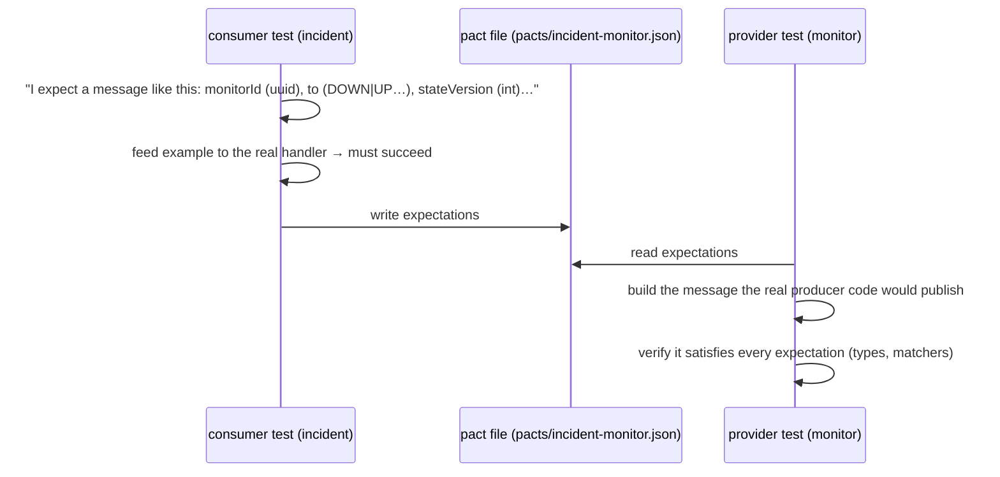

# Contract testing

**TL;DR:** A contract test checks that two services agree on the shape and meaning of what they exchange, without running both together. In **consumer-driven contract testing** (Pact), the consumer's tests record what it actually relies on; the provider's tests prove it still delivers that. It catches "the producer removed a field one consumer needs" before deploy, cheaply.

## The problem it solves

End-to-end tests that run every service together are slow, flaky and catch integration bugs late. Unit tests with hand-written mocks catch nothing: the mock says whatever you wrote, and it drifts from the real producer. In MicroSentinel, if monitor stopped sending `stateVersion`, incident's unit tests (with a hand-made event) would stay green and production would break.

## How it works

Kinds of contract checks:

| Kind | Who defines | Catches | Tool here |
|------|-------------|---------|-----------|
| Schema validation | Producer (spec) | Messages not matching the documented schema | AsyncAPI + catalog examples |
| Shared types | Producer (code) | Compile-time mismatches in one repo | `@microsentinel/contracts` |
| **Consumer-driven contracts** | Each consumer | Producer breaking a field *a consumer actually uses* | Pact message pacts |
| Spec-vs-implementation | Spec | API implementation drifting from OpenAPI | OpenAPI drift test |

Pact matchers check *type and format* ("a UUID", "an integer ≥ 1"), not exact values, so the provider can use any data. With HTTP pacts, Pact runs a mock provider for the consumer test and replays requests against the real provider. With **message pacts** (used here) there is no network: the consumer handler and the producer's builder function are tested directly. Across repositories, pacts are shared through a Pact Broker, which also answers "can I deploy this version?".

## In MicroSentinel

- Two message pacts: `monitor.state.changed.v1` (consumer incident, provider monitor) and `incident.page.requested.v1` (consumer notification, provider incident) ([testing strategy](../../cross-cutting/testing-strategy.md#contract-tests)).
- Pact files in `pacts/`, no broker ([ADR-0027](../../adr/0027-testing-stack.md)).
- Complemented by catalog ↔ AsyncAPI ↔ classes validation for every event, and OpenAPI drift tests per service.
- Phase 4 DoD #9: rename `stateVersion` in the producer and watch the provider pact test fail.
- Honest note: in one repository with shared types, Pact's added value is modest; it is a **learning choice** to try the technique on real contracts.

## Trade-offs & when NOT to use it

- Pact is most valuable with independent teams and deploy pipelines; in a monorepo with shared types much is already caught by the compiler.
- Contracts test shape, not behaviour: a producer can send a valid `stateVersion` that is wrong.
- Pacts need maintenance as consumers evolve.
- They don't replace a few end-to-end tests of critical journeys.

## Common misconceptions

- **"Contract tests are integration tests."** They test each side in isolation against a shared artefact; nothing runs together.
- **"The provider writes the contract."** In consumer-driven contracts the consumers do; that is the point.
- **"Pact checks values."** It checks types and formats via matchers, plus any exact values the consumer insists on.

## Interview questions

1. **What is contract testing?**
   "Testing that a consumer and a provider agree on their interface without running them together. With consumer-driven contracts, the consumer's tests write down exactly what it relies on, and the provider's tests verify it still provides that."
2. **How is it different from shared types?**
   "Shared types catch mismatches only when both sides are compiled together. A contract captures what each consumer actually uses and is checked in the provider's own pipeline, so it also works across repos and independent deploys."
3. **What did you test with it?**
   "Two events: the monitor state change that incident consumes and the page request notification consumes. If I remove a field incident needs from the monitor's event builder, the provider test fails and names the field."
4. **Why not just end-to-end tests?**
   "They're slow, flaky and tell you late. I keep five end-to-end journeys for the critical paths and use contract tests for the interfaces."

## Further reading

- Pact documentation (docs.pact.io): "Introduction", "Message Pact", "Pact Broker".
- Martin Fowler, "ContractTest" (martinfowler.com bliki); Ian Robinson, "Consumer-Driven Contracts: A Service Evolution Pattern" (martinfowler.com, 2006).
- Sam Newman, *Building Microservices*, 2nd ed., chapter 9 "Testing".

Used in: [ADR-0027](../../adr/0027-testing-stack.md), [testing strategy](../../cross-cutting/testing-strategy.md), [schema evolution](schema-evolution.md), [phase 4](../../roadmap/phase-4.md).
