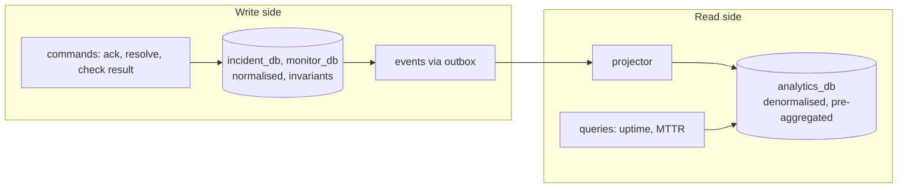

# CQRS (Command Query Responsibility Segregation)

**TL;DR:** Use different models for writing data (commands) and for reading it (queries). The write side is shaped to protect invariants; the read side is shaped for the questions users ask, often in a separate store kept up to date from events. It buys query performance and flexibility at the cost of eventual consistency and more moving parts.

## The problem it solves

"Show uptime % and MTTR for every monitor in my organization over 30 days." The data that answers it lives in three places: check results (monitor keeps only 24 h), incidents (incident's database), monitor names (monitor's database). Without a read model you'd need cross-database joins (forbidden, [database per service](database-per-service.md)), or call three services and join in memory on every dashboard load, over millions of check rows. And the shapes are wrong: incident's tables are optimised for "update this incident safely", not "aggregate thousands of incidents by hour".

## How it works

Levels of CQRS, from light to heavy:

| Level | What | Example |
|-------|------|---------|
| Separate read/write code paths, same tables | Query service with its own DTOs and SQL | Incident list endpoint using a keyset query |
| Separate read tables in the same database, updated in the same transaction | A summary table maintained alongside writes | — |
| **Separate read store, updated asynchronously from events** | A projector service | analytics |
| With event sourcing on the write side | Read models are the only way to query | Not used ([ADR-0011](../../adr/0011-incident-state-machine-not-event-sourcing.md)) |

A **projection** (or projector) is the code that turns events into read-model rows. A **read model** is disposable: if it is wrong, fix the projector and rebuild it from the event history.

## In MicroSentinel

- **analytics** is the read side for uptime, latency, MTTA, MTTR ([analytics](../../services/analytics.md), [ADR-0021](../../adr/0021-postgres-analytics-store.md)).
- Fed only by events from RabbitMQ streams; stores its stream offset in the same transaction as each batch.
- Tables shaped for queries: daily-partitioned raw checks, hourly rollups, one row per incident, a monitor dimension ([schema](../../data/analytics-schema.md)).
- Projections are idempotent: inserts `ON CONFLICT DO NOTHING`, rollups **recomputed** not incremented, incident facts are per-column upserts.
- Eventual consistency is visible: every response carries `asOf`; the UI shows "as of HH:MM:SS".
- Rebuild from history: [analytics-rebuild](../../flows/analytics-rebuild.md).

## Trade-offs & when NOT to use it

Costs: eventual consistency (read model lags, typically seconds); another store and service; projector code; rebuild procedures; two models to understand.

Don't use a separate read store when one database with good indexes answers the queries fast enough, which is most CRUD apps. In a modular monolith, a SQL view or a reporting query across schemas is often all you need. CQRS is a tool for specific read problems, not an architecture for a whole system.

Here, honestly: with a modular monolith, these dashboards would be a few `GROUP BY` queries plus a rollup table. The separate service exists because the data lives in separate services.

## Common misconceptions

- **"CQRS requires event sourcing."** No. Event sourcing almost requires CQRS (you can't query an event log efficiently), not the other way round.
- **"CQRS means two databases."** It means two models; the stores may be the same.
- **"The read side can be written to directly."** Only the projector writes it; otherwise it stops being reproducible.
- **"Users won't notice the lag."** They will if they write then read immediately; design for it (show `asOf`, read your own writes from the write side).

## Interview questions

1. **What is CQRS?**
   "Separating the model you write with from the model you read with. In my project the incident service's tables are designed to safely change one incident, and the analytics service keeps its own tables built from events, shaped for uptime and MTTR queries."
2. **When is CQRS overkill?**
   "When one database with sensible indexes answers your queries, which is most of the time. I needed it because the data lived in different services' databases and I'm not allowed to join across them."
3. **How do you deal with the read model being stale?**
   "Make it visible: my API returns an `asOf` timestamp and the UI shows it. Keep the lag low and measured: stream lag is a metric. And never use the read model for decisions that need current state."
4. **What happens if the projection has a bug?**
   "Fix the projector, truncate the read model and replay the events from the stream. I've done it: the numbers come back identical."
5. **How do you keep the projector correct under duplicates?**
   "Idempotent writes: inserts keyed by event ID with on-conflict-do-nothing, aggregates recomputed from raw rows rather than incremented, and the stream offset committed in the same transaction as the data."

## Further reading

- Martin Fowler, "CQRS" (martinfowler.com bliki).
- Greg Young, "CQRS Documents" (2010).
- Chris Richardson, microservices.io: "Pattern: Command Query Responsibility Segregation (CQRS)"; *Microservices Patterns*, chapter 7.
- Martin Kleppmann, *Designing Data-Intensive Applications*, chapter 11 ("Deriving several views from the same event log").

Used in: [ADR-0021](../../adr/0021-postgres-analytics-store.md), [analytics](../../services/analytics.md), [analytics-rebuild](../../flows/analytics-rebuild.md), [phase 4](../../roadmap/phase-4.md).
