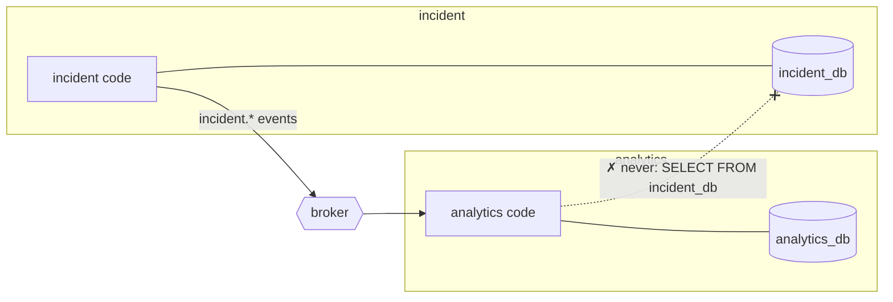

# Database per service

**TL;DR:** Each service is the only one that reads and writes its data. Other services get that data through events (and keep local copies) or through the owner's API, never by querying its tables. The rule is about **ownership and coupling**, not about how many database servers you run.

## The problem it solves

Imagine analytics computing MTTR by joining directly against `incident_db.incidents`. Now incident renames `resolved_at` to `closed_at` in a migration. Analytics breaks at deploy time, or worse, silently returns nulls. Incident's team can no longer change its own schema without coordinating with everyone who reads it, and nobody can tell from incident's code who depends on what. Shared tables are invisible APIs with no versioning.

## How it works

Ways for service B to get service A's data:

| Way | Fresh? | Coupling | Used here for |
|-----|--------|----------|---------------|
| Call A's API when needed | Yes | Temporal (A must be up) | Nothing service-to-service ([ADR-0014](../../adr/0014-on-call-in-incident-and-local-replicas.md)) |
| **Local replica** from A's events | Eventually | Low | `responders`, `recipients`, `monitors_dim` |
| Carry it in the event (event-carried state transfer) | At event time | Low | Monitor name and URL in `monitor.state.changed.v1` |
| Read A's tables | Yes | **Hidden, high** | Never |

Enforcement mechanisms, from weakest to strongest: convention; separate schemas; **separate databases with separate roles** (used here); separate servers.

## In MicroSentinel

- Five databases on one server, one login role each, `REVOKE CONNECT … FROM PUBLIC` ([ADR-0018](../../adr/0018-single-postgres-and-ram-budget.md)). A service physically cannot open another's database.
- Ownership table: [data-ownership](../../architecture/data-ownership.md).
- No cross-service foreign keys: `incidents.monitor_id` is a plain UUID; incident copies the monitor's name and URL at open time so history stays readable after deletion.
- Analytics is fed only by events, the case where the temptation to cheat is highest.
- Each service has its own migrations and its own `*-migrate` job.

## Trade-offs & when NOT to use it

Costs: no joins across services (reports need a read model); no foreign-key integrity across services; duplicated data and the staleness that comes with it; more databases to run, back up and migrate; distributed transactions are off the table, so cross-service operations become sagas.

When not: in a modular monolith, a schema per module in one database gives most of the benefit with one transaction available, which is usually the better trade. Even with microservices, a small team sometimes accepts a shared *read-only* reporting replica; if so, treat it as a published contract, not a back door.

## Common misconceptions

- **"It means one database server per service."** It means one owner per dataset. Separate servers add operational isolation (failure, performance, version), which is a separate benefit ([ADR-0018](../../adr/0018-single-postgres-and-ram-budget.md)).
- **"Read-only access is harmless."** A reader still depends on column names and meaning; it just can't corrupt the data.
- **"We can just use a shared database view."** A view is still a shared schema with no versioning or ownership.
- **"Each service needs a different database technology."** Allowed, not required. Polyglot persistence is a cost unless a workload needs it.

## Interview questions

1. **Why shouldn't services share a database?**
   "Because the schema becomes an unversioned API between them. One team can't change its tables without breaking another, and you can't see the dependency in code. Each service owning its data keeps changes local; others get data through events or the owner's API."
2. **How does a service get data it doesn't own?**
   "Either call the owner's API, which creates runtime coupling, or keep a local copy updated from the owner's events. I used versioned snapshot events and an upsert that only applies newer versions, so duplicates and reordering don't matter."
3. **You run one Postgres server for five databases. Is that database-per-service?**
   "Logically yes: separate databases and roles, so no service can see another's tables. Operationally no: a heavy query in one affects the others and the server is one failure domain. Moving a service to its own server is just a connection string."
4. **How do you report across services then?**
   "A read model: a service that consumes events from all of them and stores data shaped for the reports. That's my analytics service. It's CQRS at the system level."

## Further reading

- Chris Richardson, microservices.io: "Pattern: Database per service" and "Pattern: Shared database".
- Sam Newman, *Monolith to Microservices*, chapter 4 "Decomposing the Database".
- Martin Kleppmann, *Designing Data-Intensive Applications*, chapter 11 (derived data).

Used in: [data-ownership](../../architecture/data-ownership.md), [ADR-0018](../../adr/0018-single-postgres-and-ram-budget.md), [auth-org](../../services/auth-org.md), [phase 1](../../roadmap/phase-1.md).
