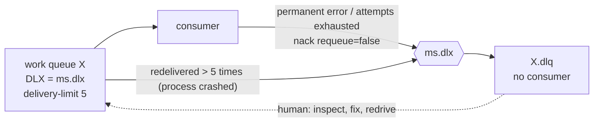

# Dead-letter queues and poison messages

**TL;DR:** A **dead-letter queue (DLQ)** is where messages go when they cannot be processed: they are parked, with the reason, for a human to inspect and redrive. A **poison message** is one that fails every time; without a DLQ it either blocks the queue or loops forever.

## The problem it solves

A message with a malformed payload reaches `notification.incident-events`. The handler throws. What next?

- **Ack it:** the message (perhaps a real page) is silently lost.
- **`nack` with requeue:** it is redelivered immediately, fails again, forever, consuming CPU; with prefetch 1 it blocks every message behind it.
- **Crash on it:** the broker redelivers to the restarted process, which crashes again. A crash loop.

None of these is acceptable. The message needs to leave the queue *without being lost*.

## How it works

RabbitMQ's mechanism: a queue argument `x-dead-letter-exchange` names an exchange. A message is **dead-lettered** (republished there, with an `x-death` header recording why) when it is:

1. rejected or nacked with `requeue=false`;
2. expired (message or queue TTL);
3. over the queue's length limit;
4. redelivered more times than a quorum queue's `x-delivery-limit`.

A DLQ is just a queue bound to that exchange with nobody consuming it.

The same "dead-letter on TTL" rule is what makes **wait queues** work for delayed retries ([retries](retries-backoff-jitter.md), [ADR-0023](../../adr/0023-retry-topology-ttl-dlx.md)).

Operating a DLQ:

- **Alert on depth > 0.** A DLQ nobody watches is a slower way to lose messages.
- **Keep the reason** with the message (`x-ms-last-error`, `x-death`).
- **Redrive deliberately** after fixing the cause; never on a timer.
- Decide **retention**: how long a parked message is worth keeping.

## In MicroSentinel

- Every work queue `X` has `X.dlq` bound to `ms.dlx` ([communication](../../architecture/communication.md#broker-topology)).
- Three protections against poison ([notification-retry-and-dlq](../../flows/notification-retry-and-dlq.md#poison-message)): validation failure → DLQ immediately; repeated exceptions → DLQ after the last retry tier; process crash → quorum delivery limit (5) dead-letters automatically.
- For deliveries the **database row** (`DEAD`) is the source of truth and the DLQ is the audit trail; redrive from the UI resets the row and enqueues a fresh job.
- `pnpm dlq:redrive <queue>` for any other DLQ.
- Streams cannot dead-letter, so analytics **quarantines** bad events in a table and skips them ([analytics](../../services/analytics.md#poison-events)).
- Experiment: [break-it lab #4](../../roadmap/break-it-lab.md).

## Trade-offs & when NOT to use it

- DLQs move failure out of sight; without alerts they become graveyards.
- Redrive can reintroduce old messages out of order; consumers must tolerate that (versions).
- For ordered streams where skipping breaks correctness, you may prefer to **stop** and alert instead of dead-lettering.
- Don't dead-letter transient failures on the first attempt; retry first.

## Common misconceptions

- **"A DLQ is a retry mechanism."** It's a parking lot. Retries happen before.
- **"Requeue = retry."** Requeue is immediate redelivery to the head of the queue.
- **"Dead-lettered means deleted."** It means moved, with its headers intact.
- **"Validation errors are bugs, so crash."** Crashing on a message is how a poison message takes down a service.

## Interview questions

1. **What is a dead-letter queue?**
   "A queue where messages that can't be processed are parked with the reason, so they don't block the main queue and aren't lost. Someone gets alerted, fixes the cause and redrives them."
2. **What's a poison message and how do you protect against it?**
   "A message that fails every time. I validate payloads and reject invalid ones straight to the DLQ, cap retries and dead-letter after the last one, and set a delivery limit on the quorum queue so even a message that crashes the process gets dead-lettered after five redeliveries."
3. **Why not just nack and requeue?**
   "Requeue puts it straight back at the head of the queue, so it's redelivered immediately in a tight loop and blocks everything behind it."
4. **How do you redrive?**
   "Manually, after fixing the cause: move messages from the DLQ back to the work queue. For deliveries I reset the database record and enqueue a new job, because the record is the truth. Consumers are idempotent, so a redriven message that was already handled is harmless."

## Further reading

- RabbitMQ documentation: "Dead Letter Exchanges" and "Quorum Queues" (poison message handling, delivery limit).
- Gregor Hohpe and Bobby Woolf, *Enterprise Integration Patterns*: "Dead Letter Channel", "Invalid Message Channel".

Used in: [ADR-0023](../../adr/0023-retry-topology-ttl-dlx.md), [notification](../../services/notification.md), [notification-retry-and-dlq](../../flows/notification-retry-and-dlq.md), [phase 2](../../roadmap/phase-2.md), [phase 3](../../roadmap/phase-3.md).
