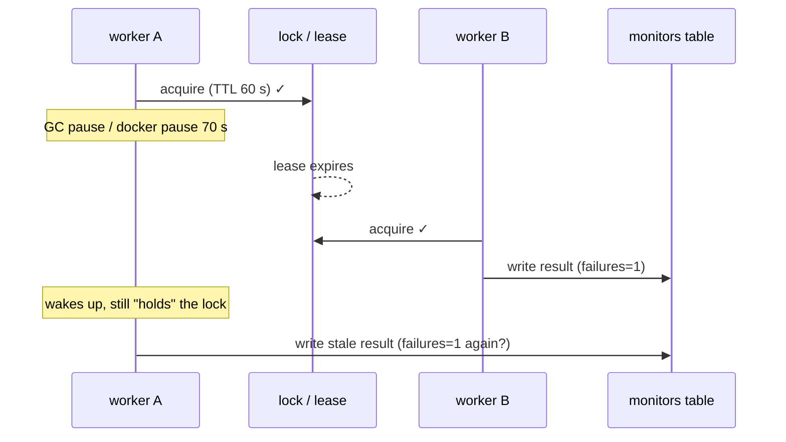
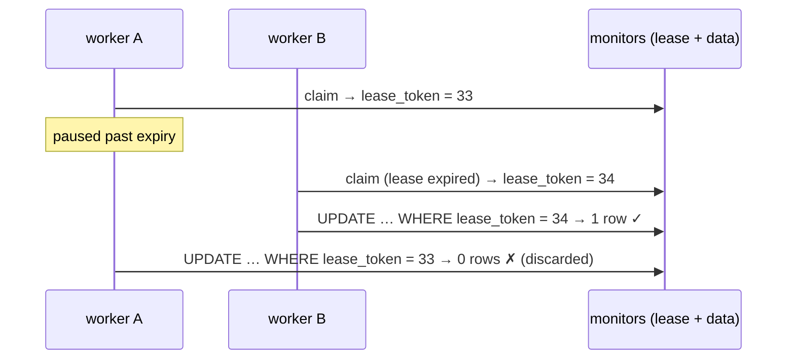

# Distributed locks, leases and fencing tokens

**TL;DR:** A distributed lock lets one process at a time do something across machines. Because a holder can die, every practical lock has a timeout, which makes it a **lease**. A lease can expire while its holder still believes it holds it (after a pause), so a lease alone cannot guarantee mutual exclusion. The fix is a **fencing token**: a number that increases with each grant, which the protected resource checks and uses to reject stale holders.

## The problem it solves

Three `monitor-worker` replicas must not apply results for the same monitor concurrently: double-applied results corrupt failure counters, so one real failure plus duplicates could reach `failureThreshold: 3` and page someone for nothing.

The tricky case:

A never got a chance to notice the expiry; it was paused. Any scheme where the holder checks "do I still hold it?" and then writes has the same gap between check and write.

## How it works

**Fencing:** each grant carries a token that only increases (1, 2, 3…). Every write includes the token; the storage rejects any write with a token lower than the highest it has seen.

The safety comes from the **storage** enforcing the token, not from the lock service.

Options for coordinating work across replicas:

| Option | Correct under pauses? | Notes |
|--------|----------------------|-------|
| Redis `SET key val NX PX ttl` | Not alone | Lease semantics; Redis doesn't issue a fencing token for your DB to check |
| Redlock (multi-node Redis) | Debated | Kleppmann: depends on bounded pauses and clock drift, no fencing token. Sanfilippo: safe under stated assumptions. Either way, add fencing at the resource |
| ZooKeeper / etcd lease with a revision number | Yes, with fencing | The revision/zxid serves as a token; another system to run |
| **Database row lease + token checked on write** (used here) | Yes | Lock and data in one system: the check is a `WHERE` clause |
| Static partitioning / consistent hashing | Avoids locks | Needs membership and rebalancing |

`SELECT … FOR UPDATE SKIP LOCKED` is the PostgreSQL feature that makes the claim efficient: `FOR UPDATE` locks the selected rows until commit; `SKIP LOCKED` makes other transactions skip locked rows instead of waiting. N workers claim N disjoint batches with no contention.

## In MicroSentinel

- Claim and complete statements: [monitor-schema](../../data/monitor-schema.md#the-three-statements-that-matter); decision: [ADR-0010](../../adr/0010-postgres-leases-for-scheduling.md).
- Lease 60 s, longer than any check (30 s max), so a healthy worker never loses its lease mid-check.
- `lease_token` is the fencing token, checked in the completing `UPDATE`. Zero rows updated → discard the result.
- All times from PostgreSQL's `now()`: workers' clocks are never compared.
- Claiming only as many as there are free slots is also [backpressure](backpressure.md).
- The same `SKIP LOCKED` pattern powers the outbox relay and incident's escalation timer.
- What can still happen: a **double check** (two HTTP requests to the target). Harmless for `GET`/`HEAD`. The scheduler makes double checks rare and double application impossible; incidents and pages are protected separately downstream.
- Experiment: [break-it lab #6](../../roadmap/break-it-lab.md) (`docker pause` past the lease).

## Trade-offs & when NOT to use it

- Polling the database every second per worker; fine for thousands of monitors, not millions.
- A lease too short causes needless takeovers and double checks; too long delays recovery after a crash (60 s here).
- Fencing only works if **every** write path checks the token. A side effect that bypasses the database (an external API call) cannot be fenced; make it idempotent instead.
- If you don't need mutual exclusion, don't build it: if the duplicate is harmless, accept it.

## Common misconceptions

- **"A lock with a timeout guarantees only one holder."** Only if the holder can never pause longer than the timeout. It can.
- **"Check that I still hold the lock before writing."** The pause can happen between the check and the write.
- **"Redlock is broken / Redlock is fine."** The useful position: for *correctness*, use fencing at the resource whatever the lock is; Redis locks are fine for *efficiency* (avoiding duplicate work when duplicates are harmless).
- **"`SKIP LOCKED` is a lock service."** It's a row-level lock held only during the claiming transaction; the lease columns are what persist.

## Interview questions

1. **How do you stop two workers processing the same job?**
   "In Postgres: workers claim due rows with `SELECT … FOR UPDATE SKIP LOCKED`, which gives each row to one worker without blocking the others, and set a lease expiry and an incrementing lease token. When a worker writes its result it includes `WHERE lease_token = mine`, so a worker whose lease expired and was taken over writes nothing."
2. **What's a fencing token?**
   "A number that increases each time the lock or lease is granted. The protected resource remembers the highest it has seen and rejects writes with a lower one. It protects against a holder that was paused and doesn't know its lease expired."
3. **What's wrong with a Redis lock?**
   "Nothing for avoiding duplicate work, but for correctness a lock with a TTL can expire during a GC pause and two holders write. Kleppmann's critique of Redlock is that it has no fencing token. If your data store can check a token, the store is doing the real work."
4. **Why is a double ping harmless but a double incident not?**
   "A GET is safe: the target sees one more request. A double incident means two escalation chains and two pages to a person at 3 a.m. So the scheduler only has to make double checks rare; incidents are protected by idempotent consumers and a unique constraint."
5. **What happens if a worker dies holding leases?**
   "They expire within 60 seconds and other workers claim them. No cleanup, no rebalancing."

## Further reading

- Martin Kleppmann, "How to do distributed locking" (martin.kleppmann.com, 2016), and *Designing Data-Intensive Applications*, chapter 8 ("The leader and the lock", "Fencing tokens").
- Salvatore Sanfilippo, "Is Redlock safe?" (antirez.com, 2016).
- PostgreSQL documentation: `SELECT` → "The Locking Clause" (`FOR UPDATE`, `SKIP LOCKED`).
- Mike Burrows, "The Chubby lock service for loosely-coupled distributed systems" (OSDI 2006), sequencers.

Used in: [ADR-0010](../../adr/0010-postgres-leases-for-scheduling.md), [monitor](../../services/monitor.md), [monitor-schema](../../data/monitor-schema.md), [flapping-and-duplicates](../../flows/flapping-and-duplicates.md), [phase 1](../../roadmap/phase-1.md), [phase 3](../../roadmap/phase-3.md).
