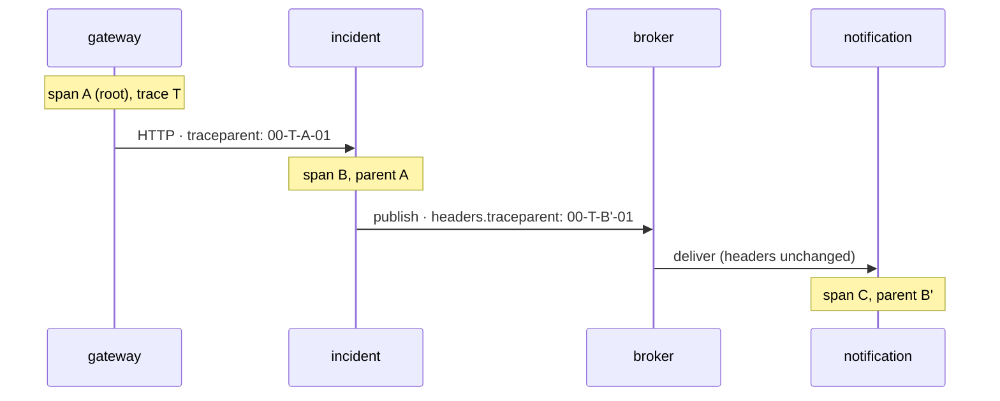

# Distributed tracing and context propagation

**TL;DR:** A **trace** records one operation as it moves through many services, as a tree of timed **spans**. It works because each hop passes a small **trace context** (trace ID + parent span ID) to the next, in HTTP headers or message headers. OpenTelemetry is the vendor-neutral standard for producing traces; W3C Trace Context is the standard header format.

## The problem it solves

"The page for incident 777 took four minutes to arrive. Why?" Without tracing: grep seven services' logs by time and guess which lines belong together. Was it the worker's retries, the outbox, a queue backlog in notification, or SMTP? With tracing: open one trace and see each step's start, duration and errors on a single timeline.

## How it works

| Term | Meaning |
|------|---------|
| Trace | All spans sharing one trace ID |
| Span | One unit of work: name, start, duration, attributes, status, parent |
| Span kind | `server`, `client`, `producer`, `consumer`, `internal` |
| Context propagation | Injecting the current context into outgoing calls and extracting it from incoming ones |
| `traceparent` | `00-<32 hex trace-id>-<16 hex parent span-id>-<flags>` (W3C) |
| Span link | A reference to a span in another trace (or several parents), for batches |
| Sampling | Deciding which traces to keep: head-based (decide at the start), tail-based (decide after seeing the whole trace) |
| Instrumentation | Auto (library patches for HTTP, DB, broker) and manual (your own spans) |

OpenTelemetry pieces: the **API** (what code calls), the **SDK** (processing, sampling, export), **exporters** (OTLP), the **Collector** (receives, processes, forwards), and a **backend** (Tempo, Jaeger).

Three signals, one correlation: logs carry `trace_id`/`span_id`; metrics can carry exemplars pointing at traces.

## In MicroSentinel

- OTel SDK preloaded with `node --import`; auto-instrumentation for HTTP, Express, `pg`, `amqplib`, `ioredis`, pino; export to `grafana/otel-lgtm` ([observability](../../cross-cutting/observability.md), [ADR-0025](../../adr/0025-observability-stack.md)).
- **The outbox breaks automatic propagation** (publish happens later, elsewhere), so the context is stored in the outbox row and the relay's producer span is made its child. The pseudocode is in [observability](../../cross-cutting/observability.md#over-rabbitmq).
- Retries keep the original `traceparent`, so all attempts of a delivery are in one trace.
- Analytics batches use **span links** to the producers (a batch has many parents).
- Each [flow](../../flows/) lists its expected span tree; matching it is the Phase 4 Definition of Done.
- Context is carried from Phase 2, before the SDK exists in Phase 4, so tracing is switch-on, not retrofit.

## Trade-offs & when NOT to use it

- Overhead: a few percent CPU and memory per process; storage for every span. Production samples (e.g. keep all errors, 10 % of the rest via tail sampling).
- Traces are only as good as propagation: one hop that drops headers splits the trace.
- High-cardinality attributes are fine on spans (IDs), not on metrics.
- A single process app gets less from tracing than from good logs and a profiler.

## Common misconceptions

- **"Tracing is logging with IDs."** Logs are events; traces are timed causal structure. You want both, linked.
- **"Auto-instrumentation covers messaging."** Simple publish/consume, yes; an outbox, batch consumers or retries need manual context handling.
- **"A correlation ID is the same thing."** It groups logs; it doesn't give timing or the parent/child tree.
- **"Trace everything forever."** Sampling and retention are part of the design.

## Interview questions

1. **How do you debug a request that crosses several services?**
   "Distributed tracing. Every service is instrumented with OpenTelemetry; each hop passes a traceparent header with the trace ID and parent span, so one outage shows up as one trace: failed check, state change, incident opened, page sent, email delivered, with timings. Logs carry the trace ID so I can jump from a trace to the log lines."
2. **How does trace context cross a message broker?**
   "In message headers, same W3C format. With an outbox it's trickier because the publish happens later in another loop, so I store the trace context in the outbox row and start the publish span as its child. The consumer extracts it and continues the trace."
3. **What is a span?**
   "One timed unit of work, with a name, attributes and a parent. A trace is the tree of spans with the same trace ID."
4. **Head vs tail sampling?**
   "Head sampling decides at the start, cheap but blind: you may drop the trace that errors. Tail sampling decides after seeing the whole trace, in a collector, so you can keep all errors and slow traces. Locally I keep everything."

## Further reading

- OpenTelemetry documentation: "Concepts" (traces, context propagation) and the JavaScript/Node.js getting-started guide.
- W3C Recommendation "Trace Context".
- Benjamin Sigelman et al., "Dapper, a Large-Scale Distributed Systems Tracing Infrastructure" (Google Technical Report, 2010).
- Cindy Sridharan, *Distributed Systems Observability* (O'Reilly report).

Used in: [ADR-0025](../../adr/0025-observability-stack.md), [observability](../../cross-cutting/observability.md), every [flow](../../flows/), [phase 4](../../roadmap/phase-4.md).
