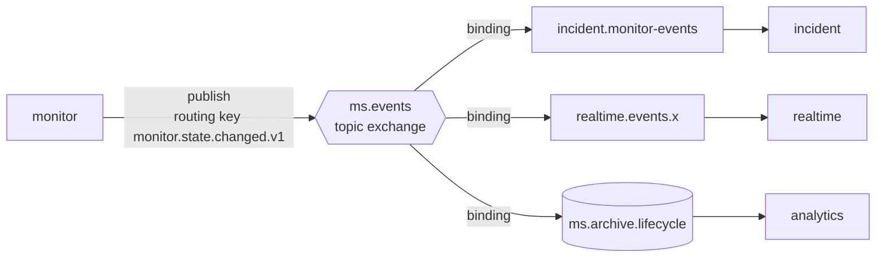

# Event-driven architecture

**TL;DR:** Services announce facts ("monitor went down") as events; other services subscribe and react. The producer doesn't know or care who listens. This decouples services and lets new behaviour be added by adding a consumer, at the price of flows that are spread across many places.

## The problem it solves

Without events, a monitor going down would require monitor to call incident, which calls notification, which calls realtime, and someone adding analytics later must edit monitor or incident to call it too. Every new reaction changes the producer. With events, monitor publishes `monitor.state.changed.v1` once; incident, realtime and the archive stream receive it; adding analytics in Phase 4 needed **no change** to monitor.

## How it works

Key distinctions:

| | Event | Command |
|-|-------|---------|
| Meaning | A fact that happened | A request to do something |
| Tense | Past: `incident.resolved.v1` | Imperative: `notification.delivery.send.v1` |
| Receivers | Zero or more; unknown to the sender | Exactly one, known |
| Can be refused? | No, it already happened | Yes |

Event payload styles:

| Style | Content | Example here | Trade-off |
|-------|---------|--------------|-----------|
| **Notification** (thin) | ID only; consumers call back for details | realtime's SSE hints to the browser | Small, but consumers depend on the producer's API |
| **Event-carried state transfer** (fat) | Everything consumers need | `monitor.state.changed.v1` carries name and URL; `auth.user.changed.v1` is a full snapshot | Larger, but consumers are independent |
| **Delta** | Only what changed | Not used | Needs ordering and the previous state to apply |

RabbitMQ mechanics: a publisher sends to an **exchange** with a **routing key**; **bindings** connect queues to exchanges by pattern (`incident.#`); each consumer reads its own queue. A topic exchange gives **pub/sub** (each queue gets a copy); several consumers on one queue give **competing consumers** (each message to one of them).

## In MicroSentinel

- One topic exchange `ms.events`, routing key = event type ([communication](../../architecture/communication.md#broker-topology)).
- Every event in the [catalog](../../contracts/event-catalog.md), with producer, consumers and payload.
- Consumers own their queues and bindings; producers know nothing about consumers.
- Replicas are built from snapshot events ([data-ownership](../../architecture/data-ownership.md#local-replicas)).
- One internal command (`notification.delivery.send.v1`) on a private exchange, to show the difference.

## Trade-offs & when NOT to use it

- **Flow is implicit.** "What happens when a monitor goes down?" is answered by reading five consumers, not one function. Mitigated by the [flow docs](../../flows/) and tracing.
- **Eventual consistency** everywhere downstream.
- **Contracts are forever.** Events sit in streams for years; every shape must stay readable ([schema evolution](schema-evolution.md)).
- **Debugging needs tooling**: correlation IDs, traces, a broker UI.
- Don't use events for queries, for things the caller needs answered now, or inside one service where a function call does.

## Common misconceptions

- **"Event-driven means event sourcing."** Event sourcing stores state as events inside one service; event-driven architecture communicates with events between services. Independent ideas.
- **"Events decouple everything."** They remove runtime coupling, not semantic coupling: consumers still depend on the event's meaning and shape.
- **"Fire and forget."** The *producer* forgets; the system must not. Durability, confirms, acks and DLQs are what keep events from vanishing.
- **"Put everything in the event."** Fat events leak internal models; include what consumers need, versioned.

## Interview questions

1. **Event vs command?**
   "An event is a fact in the past tense that any number of services may react to, and the producer doesn't know who. A command is a request to one specific receiver to do something, and it can fail or be refused. In my project `incident.opened` is an event; `delivery.send` is a command notification sends to itself."
2. **How do you add a new consumer without changing the producer?**
   "The consumer declares its own queue and binds it to the exchange with the routing keys it wants. My analytics service was added two phases later without touching any producer."
3. **What goes in an event?**
   "Enough that consumers don't have to call back: IDs, the new state, and the few fields consumers need. Mine include a version number for ordering and an envelope with an ID for idempotency. For replicas I send full snapshots so consumers can just upsert the latest version."
4. **What are the downsides?**
   "The flow is spread across consumers, so you need tracing and good docs; everything downstream is eventually consistent; and event schemas have to stay compatible for as long as old events exist."

## Further reading

- Martin Fowler, "What do you mean by 'Event-Driven'?" (martinfowler.com, 2017).
- Gregor Hohpe and Bobby Woolf, *Enterprise Integration Patterns*: Publish-Subscribe Channel, Event Message, Command Message.
- RabbitMQ documentation: "AMQP 0-9-1 Model Explained" and the tutorials on topics and routing.

Used in: [communication](../../architecture/communication.md), [event catalog](../../contracts/event-catalog.md), [auth-org](../../services/auth-org.md), [notification](../../services/notification.md), [realtime](../../services/realtime.md), [phase 2](../../roadmap/phase-2.md).
