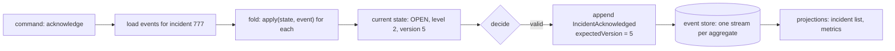

# Event sourcing

**TL;DR:** Instead of storing the current state and overwriting it, store the sequence of events that led to it, and derive current state by replaying them. The event log is the source of truth; every other table is a projection. You get a complete history and the ability to build new views of the past, and you pay with harder queries, permanent event versioning and a different way of thinking.

MicroSentinel does **not** event-source its incidents ([ADR-0011](../../adr/0011-incident-state-machine-not-event-sourcing.md)). This guide teaches the pattern properly anyway, because it is a classic interview topic and because knowing when *not* to use it is the stronger answer.

## The problem it solves

With a normal `incidents` row, each update overwrites the previous state. If you later ask "how long did incidents stay at escalation level 2 before someone acknowledged, last quarter?" and you never recorded level changes with timestamps, the answer is gone. Audit requirements ("prove exactly who changed what, in order") have the same problem. And every write is also a potential dual write if you publish events separately.

## How it works



| Concept | Meaning |
|---------|---------|
| **Event store** | Append-only storage of events, grouped into **streams** (one per aggregate, e.g. `incident-777`) |
| **Fold / rehydrate** | `state = events.reduce(apply, initial)` |
| **Optimistic concurrency** | Append only if the stream is still at `expectedVersion`; otherwise retry |
| **Projection** | A read model built by consuming the event stream ([CQRS](cqrs.md)) |
| **Snapshot** | A saved state at version N, so rehydration replays only events after N |
| **Upcasting** | Converting old event versions to the current shape when reading |

A minimal event store in PostgreSQL:

```sql
CREATE TABLE events (
  stream_id  text        NOT NULL,
  version    integer     NOT NULL,
  type       text        NOT NULL,
  data       jsonb       NOT NULL,
  occurred_at timestamptz NOT NULL DEFAULT now(),
  PRIMARY KEY (stream_id, version)     -- the PK is the optimistic-concurrency check
);
```

Appending version 6 when someone else already appended 6 violates the primary key: a concurrency conflict.

## In MicroSentinel

What exists instead, and how it relates:

| Event-sourcing idea | What MicroSentinel does |
|---------------------|------------------------|
| Event log as source of truth | `incidents` row is the truth; `incident_events` is an **audit log** written in the same transaction |
| Optimistic concurrency on the stream | Optimistic concurrency on the row (`version` column) |
| Projections from events | analytics builds its read model by **replaying RabbitMQ streams** ([analytics-rebuild](../../flows/analytics-rebuild.md)): the replay half of event sourcing, applied to integration events |
| Rebuild state by folding | Phase 5 exercise [S9](../../roadmap/phase-5.md): a pure `fold(timelineRows) → status` tested against every stored incident |

Why not full event sourcing here ([ADR-0011](../../adr/0011-incident-state-machine-not-event-sourcing.md)): incidents are short-lived with ~10 events; the most common query ("open incidents for my org") needs a projection anyway; the "one unresolved incident per monitor" invariant is a one-line unique index on a row but awkward across streams; and Phase 2 already introduces enough new concepts.

## Trade-offs & when NOT to use it

**Good fit:** domains where history *is* the product (ledgers, accounting, audit-heavy workflows); when you need temporal queries ("state as of last Tuesday"); when new read models over old data are expected; collaborative domains where intent matters (who did what and why).

**Poor fit:** CRUD; domains where current state is all anyone asks about; cross-aggregate uniqueness constraints; teams new to it under time pressure.

Costs: every query needs a projection; projections are eventually consistent unless updated synchronously; events are permanent, so **schema evolution is forever** (upcasters for every old version); GDPR deletion is hard in an immutable log (crypto-shredding is the usual answer); debugging means reading streams; rebuilding large projections takes time.

## Common misconceptions

- **"Event sourcing = event-driven architecture."** One is a persistence model inside a service; the other is a communication style between services. Internal domain events and public integration events should usually differ.
- **"Kafka is an event store."** Kafka is a log; an event store also needs per-stream optimistic concurrency and efficient reads of one stream.
- **"You get an audit log for free, so use it everywhere."** An audit table next to normal state gives most of that benefit far more cheaply (which is what MicroSentinel does).
- **"Events can be fixed later."** They are facts; you correct with new compensating events, not edits.

## Interview questions

1. **What is event sourcing?**
   "Storing state as the list of events that produced it instead of overwriting a row. You get current state by replaying the events, and you build read models as projections. It gives you full history and lets you build new views of the past."
2. **Did you use it? Why not?**
   "I considered it for incidents and decided against it. They're short-lived with about ten events, the common query is 'open incidents', which would need a projection anyway, and 'one open incident per monitor' is a simple unique index on a row but hard across event streams. I used a normal row with optimistic locking plus an append-only timeline in the same transaction. I do replay events to rebuild my analytics read model, which is the projection side of the idea."
3. **How do you handle concurrency in an event-sourced aggregate?**
   "Append with an expected version. If another writer already appended that version, the append fails and you reload and retry. In Postgres a primary key on stream ID and version does it."
4. **How do you change an event's schema?**
   "You can't change stored events, so you version them and write upcasters that convert old versions to the current shape when reading. Or add a new event type. It's one of the main long-term costs."
5. **What are snapshots for?**
   "Long streams: you store the state at version N and replay only events after N."

## Further reading

- Martin Fowler, "Event Sourcing" (martinfowler.com, 2005).
- Greg Young, "CQRS Documents" and *Versioning in an Event Sourced System* (Leanpub).
- Chris Richardson, *Microservices Patterns*, chapter 6 "Developing business logic with event sourcing"; microservices.io "Pattern: Event sourcing".
- Martin Kleppmann, *Designing Data-Intensive Applications*, chapter 11 ("Event Sourcing", "State, Streams, and Immutability").

Used in: [ADR-0011](../../adr/0011-incident-state-machine-not-event-sourcing.md), [incident](../../services/incident.md), [analytics](../../services/analytics.md), [analytics-rebuild](../../flows/analytics-rebuild.md), [phase 4](../../roadmap/phase-4.md), [phase 5](../../roadmap/phase-5.md).
