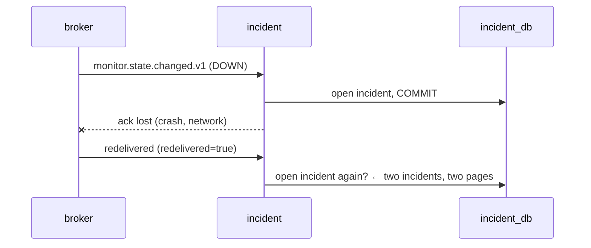

# At-least-once delivery and idempotency

**TL;DR:** Message brokers deliver **at least once**: under failure, the same message arrives again. An operation is **idempotent** if doing it twice has the same effect as doing it once. Combine the two and you get **effectively-once processing**, which is the honest meaning behind every "exactly-once" claim. Idempotency is designed per operation; there is no single switch.

## The problem it solves

A consumer does two things: apply the effect (write to its DB) and tell the broker "done" (ack). They are separate operations on separate systems:

Ack first and then apply? A crash in between loses the message: **at-most-once**. Every ordering of two operations on two systems leaves a gap; that is why **exactly-once delivery** cannot be guaranteed end to end. Duplicates also arise upstream (the outbox relay republishing), from retries, and from replays.

## How it works

Delivery semantics:

| Semantics | How | Risk |
|-----------|-----|------|
| At-most-once | Ack before processing (auto-ack) | Loss |
| **At-least-once** | Ack after processing | Duplicates |
| Effectively-once | At-least-once + idempotent effect | — (the goal) |

Ways to make an effect idempotent:

| Technique | Example | Handles |
|-----------|---------|---------|
| **Naturally idempotent operation** | `UPDATE … SET status='ACKNOWLEDGED' WHERE id=$1 AND status='OPEN'`; `INSERT … ON CONFLICT DO NOTHING` | Duplicates |
| **Inbox / processed-messages table**, in the same transaction as the effect | `INSERT INTO processed_messages (consumer, message_id)`; conflict → already done | Duplicates of any handler |
| **Idempotency key** chosen by the caller | Envelope `id`; `dedupe_key` for deliveries; `Idempotency-Key` header on webhooks | Duplicates across retries |
| **Version / sequence check** | Ignore `stateVersion` ≤ last seen | **Reordering** and stale data |
| **Unique constraint** on the invariant | One unresolved incident per monitor | Bugs in all of the above |
| **Recompute instead of increment** | Rollups recomputed from raw rows | Replays |

The inbox must be in the same transaction as the effect. A Redis "seen" set is **not** atomic with the database write and reintroduces the gap.

## In MicroSentinel

Three layers, each catching what the others miss ([ADR-0012](../../adr/0012-idempotent-consumers.md)):

1. **Inbox** in every queue consumer: `processed_messages`, keyed by `(consumer, message_id)`, inserted in the handler's transaction ([DDL](../../data/messaging-tables.md#processed_messages)).
2. **Versions**: `stateVersion` per monitor in incident; `version` on snapshot events for replicas.
3. **Constraints**: `incidents_one_unresolved_per_monitor_idx`, `incidents.trigger_event_id`, `deliveries.dedupe_key`, `check_results` primary key.

Plus: idempotent HTTP commands (acknowledge twice → `200`, same version); stream offsets stored in the same transaction as analytics batches; and the one exception, `notification.delivery-jobs`, where the delivery row's status is the idempotency record because retries reuse the message ID ([retry flow](../../flows/notification-retry-and-dlq.md#why-notificationdelivery-jobs-does-not-use-the-inbox)).

The gap that remains: an email accepted by SMTP but not yet recorded as `SENT` when the process dies will be sent again. Narrowed, documented, accepted ([ADR-0013](../../adr/0013-notification-owns-delivery-state.md)). The complete catalogue of duplicate sources: [flapping-and-duplicates](../../flows/flapping-and-duplicates.md).

## Trade-offs & when NOT to use it

- An inbox adds an insert per message and a table to prune; at very high volume prefer natural idempotency.
- Idempotency keys need a retention window longer than any possible redelivery (7 days here vs minutes of retries).
- **Side effects outside your database cannot be made atomic** with your record. You narrow the window and pass a key to the receiver.
- At-most-once is fine for genuinely disposable messages: realtime hints use auto-ack because a lost hint costs a refetch at worst.

## Common misconceptions

- **"Kafka (or RabbitMQ) gives exactly-once."** Kafka's exactly-once covers read-process-write *within Kafka* using transactions; once your effect is in another system, you're back to idempotency.
- **"Dedupe by message ID solves ordering."** It solves duplicates only. A retried old message with a fresh delivery is still old: use versions.
- **"GET is idempotent so retries are safe everywhere."** `POST` acknowledge is idempotent here *by design*; `POST` create monitor is not (a retry after a lost response gives `409`).
- **"Idempotent means no side effects."** It means repeated side effects are the same as one.

## Interview questions

1. **What happens if a consumer receives the same message twice?**
   "Nothing the second time. The handler first inserts the message ID into a processed-messages table inside the same transaction as its writes. If that insert conflicts, it's a duplicate, so I roll back and ack. Critical invariants also have unique constraints, so even a bug can't open two incidents for one monitor."
2. **Why is exactly-once delivery impossible?**
   "The effect and the acknowledgement are two operations on two systems, and a crash can always land between them. You choose between losing messages and duplicating them, and you choose duplicates plus idempotency. That's effectively-once processing."
3. **How do you handle out-of-order messages?**
   "Each aggregate's events carry a version that increases by one. The consumer stores the last version it processed and ignores anything older or equal. A late 'UP' after a newer 'DOWN' is just discarded."
4. **What's an idempotency key?**
   "A value that's identical for retries of the same logical operation, so the receiver can recognise a repeat. For events it's the envelope ID; for my deliveries it's event ID + channel + target under a unique constraint; for webhooks I send the delivery ID in an Idempotency-Key header."
5. **Can you make sending an email idempotent?**
   "Not completely: the SMTP server accepting it and my database recording it are separate. I lock the delivery row, count the attempt before sending, and record the result right after; a crash in between can resend once. For paging, a rare duplicate is better than a missed page."

## Further reading

- Martin Kleppmann, *Designing Data-Intensive Applications*, chapter 11 ("Fault tolerance", "Exactly-once message processing") and chapter 12 ("Enforcing constraints").
- Chris Richardson, microservices.io: "Pattern: Idempotent Consumer".
- Pat Helland, "Idempotence Is Not a Medical Condition" (ACM Queue, 2012).
- RabbitMQ documentation: "Consumer Acknowledgements and Publisher Confirms".

Used in: [ADR-0012](../../adr/0012-idempotent-consumers.md), [incident](../../services/incident.md), [notification](../../services/notification.md), [analytics](../../services/analytics.md), [flapping-and-duplicates](../../flows/flapping-and-duplicates.md), [phase 1](../../roadmap/phase-1.md), [phase 2](../../roadmap/phase-2.md).
