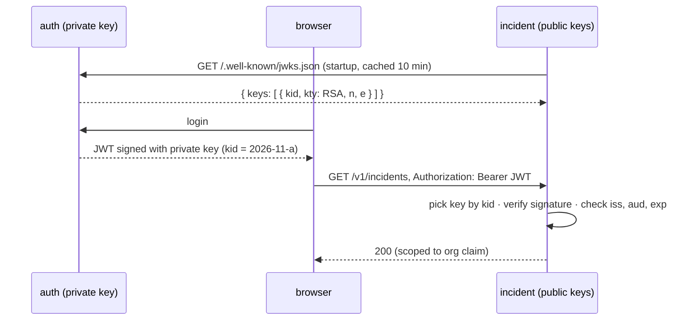

# Authentication with JWT and JWKS

**TL;DR:** A JWT (JSON Web Token) is a signed JSON document saying who someone is, valid until it expires. Anyone with the right key can verify it **without asking the issuer**, which is why it suits distributed systems. With asymmetric signing (RS256), only the issuer holds the private key; verifiers fetch the public keys from a **JWKS** (JSON Web Key Set) endpoint.

## The problem it solves

Seven services need to know who is calling. Options without JWTs: every service calls auth on every request ("is this session valid?"), putting auth on every request path (temporal coupling, latency, load); or a shared session store every service reads (shared state, a single point of failure). A self-contained, signed token lets each service decide locally.

## How it works

A JWT is three base64url parts separated by dots: `header.payload.signature`.

```json
// header
{ "alg": "RS256", "kid": "2026-11-a", "typ": "JWT" }
// payload (claims)
{ "iss": "microsentinel-auth", "aud": "microsentinel-api", "sub": "019a…a1",
  "org": "019a…42", "role": "ADMIN", "iat": 1763203200, "exp": 1763204100, "jti": "…" }
```

The signature is computed over `header.payload`. The payload is **encoded, not encrypted**: anyone can read it. The signature only proves it wasn't changed and who issued it.



| | HS256 (symmetric) | RS256 / ES256 / EdDSA (asymmetric) |
|-|-------------------|-------------------------------------|
| Keys | One shared secret signs and verifies | Private key signs; public key verifies |
| A verifier can mint tokens? | **Yes** | No |
| Key distribution | Secret copied to every service | Public keys published via JWKS |
| Rotation | All services at once | Publish new key, sign with it, retire old after tokens expire |

**Key rotation with JWKS:** the JWKS lists several keys; each token's `kid` says which one signed it. Add the new key to the JWKS → wait for caches to refresh → start signing with it → remove the old key after the longest token lifetime.

**Revocation:** a JWT is valid until `exp` unless verifiers consult a denylist. Hence short access tokens (15 min) plus refresh tokens that *can* be revoked.

## In MicroSentinel

- auth signs RS256 tokens and serves `/.well-known/jwks.json` ([auth-org](../../services/auth-org.md), [ADR-0015](../../adr/0015-jwt-rs256-jwks-validate-everywhere.md)).
- Every service, and the gateway, verifies with the shared `JwtAuthGuard` (`jose`): algorithms pinned to `RS256`, `iss`, `aud`, `exp` with 30 s tolerance; JWKS cached 10 min, refetched on unknown `kid` at most every 30 s.
- Claims: `sub`, `org`, `role`. Every query filters by `org` ([security](../../cross-cutting/security.md#authorization)).
- auth down → existing tokens keep working ([break-it lab #10](../../roadmap/break-it-lab.md)).
- Browser storage of the tokens: [browser authentication](browser-authentication.md).
- API keys are exchanged for the same kind of JWT, so services see one token type.

## Trade-offs & when NOT to use it

- **Can't revoke instantly** without a lookup (a `jti` denylist), which reintroduces shared state.
- **Claims go stale:** a role change takes effect at the next token (≤ 15 min here).
- **Tokens grow** with claims; don't put permissions lists or personal data in them.
- For a single server-rendered app, a server-side session cookie is simpler and revocable.
- For high-security revocation needs, opaque tokens with introspection (or short-lived tokens plus a denylist).

## Common misconceptions

- **"JWTs are encrypted."** Signed, not encrypted (JWE exists but is rarely what people mean). Never put secrets in them.
- **"Verify by decoding."** Decoding without checking the signature, `alg`, `iss`, `aud` and `exp` verifies nothing.
- **"Trust the `alg` header."** Attackers set it to `none`, or switch RS256 to HS256 and sign with the *public* key as the HMAC secret. Pin the accepted algorithms.
- **"JWT = stateless sessions, so logout works."** Logout without a denylist only discards the client's copy.
- **"Store JWTs in localStorage."** Readable by any XSS ([browser authentication](browser-authentication.md)).

## Interview questions

1. **How does a service verify a JWT without calling the auth service?**
   "The token is signed with auth's private key. Services fetch the public keys once from the JWKS endpoint and cache them, pick the key by the token's `kid`, verify the signature, and check issuer, audience and expiry. No call per request."
2. **RS256 vs HS256?**
   "HS256 uses one shared secret, so every service that can verify can also forge tokens, and rotating means redeploying everything. RS256 uses a private key only auth has; verifiers get public keys via JWKS, and rotation is publishing a new key."
3. **How do you revoke a JWT?**
   "You can't without some state. I keep access tokens short, 15 minutes, and revoke the refresh token on logout or when a member is removed. For instant revocation you'd add a denylist of token IDs that every service checks."
4. **What should and shouldn't go in the payload?**
   "Identity and coarse authorization: user ID, organization, role, issuer, audience, expiry. Not secrets, not personal data, not large permission lists, because it's readable and sent on every request."
5. **What attacks on JWT verification do you know?**
   "`alg: none`, and algorithm confusion where an RS256 public key is used as an HS256 secret. Both are prevented by pinning the allowed algorithms instead of trusting the header."

## Further reading

- RFC 7519 "JSON Web Token (JWT)", RFC 7517 "JSON Web Key (JWK)", RFC 7515 "JSON Web Signature (JWS)" (IETF).
- RFC 8725 "JSON Web Token Best Current Practices" (IETF).
- OWASP Cheat Sheet Series: "JSON Web Token for Java Cheat Sheet" (concepts apply generally) and "Authentication Cheat Sheet".
- `jose` library documentation (panva/jose).

Used in: [ADR-0015](../../adr/0015-jwt-rs256-jwks-validate-everywhere.md), [auth-org](../../services/auth-org.md), [gateway](../../services/gateway.md), [security](../../cross-cutting/security.md), [phase 1](../../roadmap/phase-1.md).
