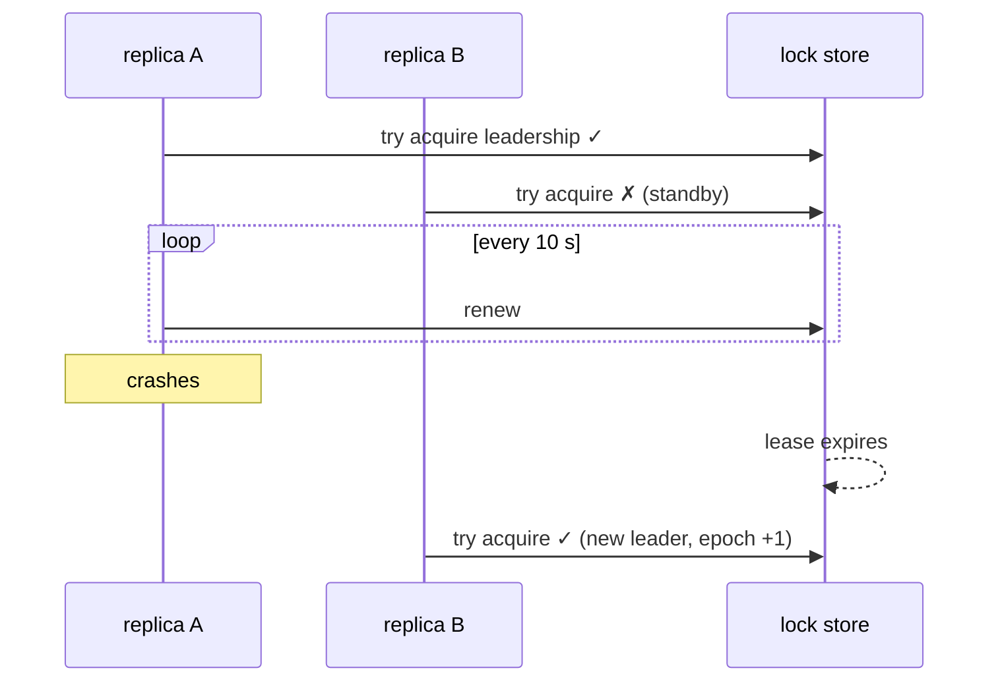

# Leader election

**TL;DR:** Leader election picks exactly one instance among replicas to do a job that must not run twice (a scheduler, a singleton job), and picks a new one if it fails. It is a lease on a role, so it has the same pause problem as any lease and needs fencing for correctness. Often you can avoid it by making work claimable in small units instead.

## The problem it solves

Some jobs should run on one replica only: dropping old partitions, recomputing rollups, a scheduler that hands out work. Run them everywhere and you get wasted work at best, conflicts at worst. Hard-code "replica 0 does it" and the job stops when replica 0 dies.

## How it works

Common mechanisms:

| Mechanism | How | Notes |
|-----------|-----|-------|
| Consensus systems (ZooKeeper, etcd, Consul) | Ephemeral node / lease with keep-alive; lowest sequence or first writer wins | Correct and battle-tested; another system to operate; Kubernetes uses etcd-backed Lease objects for controller leader election |
| Raft / Paxos inside your own cluster | The algorithm itself elects | Used by databases and brokers (RabbitMQ quorum queues use Raft), rarely by applications |
| Database advisory lock | `pg_try_advisory_lock(key)`; the session holding it is the leader | Simple; leadership ends when the session/connection ends |
| Lease row in a table | `UPDATE leader SET owner=me, expires=now()+30s WHERE expires < now()` | Needs renewal and fencing |
| Broker feature | RabbitMQ **single active consumer**: one consumer on a queue is active, others stand by | Leadership scoped to one queue |

The pause problem: a leader paused past its lease still thinks it leads. **Split brain** follows unless the resources it writes to check an epoch / fencing token ([locks guide](distributed-locks-leases-fencing.md)).

## In MicroSentinel

Leader election is **deliberately avoided** for the main scheduling problem, and used in its lightest forms elsewhere:

| Need | Approach | Why |
|------|----------|-----|
| Scheduling checks across workers | No leader: every worker claims due monitors with `SKIP LOCKED` leases ([ADR-0010](../../adr/0010-postgres-leases-for-scheduling.md), option E rejected) | Work is naturally divisible per monitor; no single point to fail over; no rebalancing |
| Outbox relay across replicas | No leader: `SKIP LOCKED` batches | Same |
| Escalation timers | No leader: `SKIP LOCKED` on due incidents | Same |
| Janitors, partition maintenance, rollups | `pg_try_advisory_xact_lock` per run: whoever gets it does this run | Tiny jobs; losing leadership mid-run is harmless (idempotent work) |
| Ordered consumption of `incident.monitor-events` | RabbitMQ single active consumer | Broker-managed leadership for one queue |
| Analytics stream consumption | Session-level advisory lock, one consumer | Offsets in the DB plus idempotent upserts make a brief overlap harmless |

The design lesson: **prefer claimable units of work over a leader** when the work divides naturally. Use a leader when the decision genuinely has to be made in one place (a global ordering, a single writer to an external system).

## Trade-offs & when NOT to use it

- A leader is a throughput bottleneck and a failover delay (lease duration).
- Correct leader election needs consensus; "leader by database row" is simple but still needs fencing for anything that matters.
- Avoid it when work can be partitioned or claimed per item; use it when one decision-maker is inherent (e.g. assigning partitions, sequencing).

## Common misconceptions

- **"Once elected, the leader is the only one acting."** Not after a pause or partition, unless writes are fenced.
- **"Leader election requires ZooKeeper."** Advisory locks and broker features cover many application needs.
- **"Active/standby is free availability."** Failover takes at least the lease time and the standby must be warmed up.

## Interview questions

1. **Did you need leader election for your scheduler?**
   "No, and I chose not to. Each monitor is its own unit of work, so every worker claims due monitors with `SKIP LOCKED` leases. There's no leader to fail over and nothing to rebalance. For small singleton jobs like dropping partitions I just take a Postgres advisory lock for that run."
2. **How would you implement leader election?**
   "With a lease in a consensus store like etcd, or a Postgres advisory lock if that's what I have: acquire, renew periodically, and a standby takes over when it expires. And anything the leader writes should check an epoch number so a stale leader can't write."
3. **What is split brain?**
   "Two nodes both believing they're the leader, usually after a network partition or a long pause, both writing. Fencing tokens or epochs at the storage layer prevent the damage."

## Further reading

- Martin Kleppmann, *Designing Data-Intensive Applications*, chapter 8 ("The Truth Is Defined by the Majority") and chapter 9 (consensus).
- Diego Ongaro and John Ousterhout, "In Search of an Understandable Consensus Algorithm" (Raft, USENIX ATC 2014).
- PostgreSQL documentation: "Advisory Locks".
- RabbitMQ documentation: "Single Active Consumer".

Used in: [ADR-0010](../../adr/0010-postgres-leases-for-scheduling.md), [ADR-0021](../../adr/0021-postgres-analytics-store.md), [monitor](../../services/monitor.md), [analytics](../../services/analytics.md), [phase 3](../../roadmap/phase-3.md).
