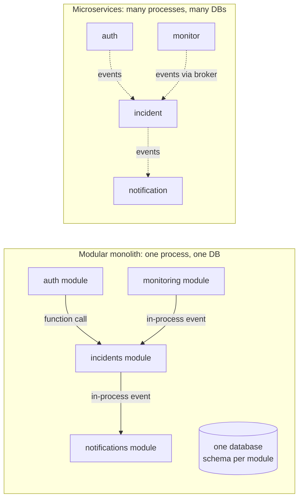

# Microservices vs modular monolith

**TL;DR:** A modular monolith is one deployable application split into modules with enforced boundaries; microservices deploy those modules as separate processes that talk over the network. Microservices buy independent deployment, scaling and failure isolation, and pay for it with network calls, eventual consistency and operational weight. For most new products, and for MicroSentinel at its real size, the monolith wins.

## The problem it solves

Not "how to structure code"; both options can have clean structure. The real question is: **what must be able to change, deploy, scale or fail independently?**

- Without boundaries at all (a "big ball of mud"), a change to paging logic breaks login, because everything reaches into everything.
- A modular monolith fixes that with module boundaries enforced in code.
- Microservices are the answer only when the boundary must also be a **runtime** boundary: different teams releasing on their own schedule, a component that needs 50 replicas while the rest needs 2, a component whose crash must not take down the rest, or a component in a different language.

## How it works

| | Modular monolith | Microservices |
|-|------------------|---------------|
| Call between modules | Function call: nanoseconds, cannot partially fail | Network: milliseconds, can time out, duplicate, reorder |
| Transaction across modules | One database transaction | Not possible; outbox + events + idempotency |
| Deploy | One artifact | One per service; versioned contracts |
| Scale | Whole app (fine for most loads) | Per service |
| Failure isolation | A memory leak kills everything | Contained to one service |
| Debugging | One stack trace | Distributed tracing |
| Team autonomy | Shared release train | Independent |
| Infrastructure | App + DB | + broker, + gateway, + N databases, + tracing |

## In MicroSentinel

MicroSentinel is microservices **on purpose, for learning** ([ADR-0002](../../adr/0002-service-boundaries.md)). The modular-monolith twin of the same design would be:

- One Nest app with modules `IdentityModule`, `MonitoringModule`, `IncidentsModule`, `NotificationsModule`, `AnalyticsModule`; each owns its tables in its own PostgreSQL schema and exposes a small service interface; no module imports another's entities.
- In-process events (`@nestjs/event-emitter` or a tiny bus) between modules, *still* written to an outbox table if they must survive a crash.
- One extra process type for the check workers (same codebase, like `monitor-worker` today).
- A simple job table with `SKIP LOCKED` for notification retries instead of RabbitMQ wait queues.

What would disappear: the broker, the gateway's proxying, JWKS distribution, five migrate jobs, cross-service tracing, local replicas, `UNKNOWN_RESPONDER`, and roughly half the code. What would remain: leases, confirmation logic, the incident state machine, idempotent commands, SSRF protection. Most of the *hard domain logic* is the same; most of the *added complexity* is microservices tax. Building it is Phase 5 stretch [S10](../../roadmap/phase-5.md).

## Trade-offs & when NOT to use it

Use a **modular monolith** when: one team or a few people; the domain is still being discovered (boundaries will move, and moving a module is a refactor while moving a service is a migration); load is modest; you have no platform team.

Consider **microservices** when several of these are true: multiple teams blocked on each other's releases; components with very different scaling or availability needs; a boundary that has been stable for a long time; operational maturity (CI/CD per service, tracing, on-call).

The usual path is **monolith first, extract later** (Fowler's "MonolithFirst"), extracting along boundaries that have proved themselves.

## Common misconceptions

- **"Microservices are more scalable."** A stateless monolith scales horizontally too. Microservices let you scale *parts differently*.
- **"Microservices give clean code."** They give network boundaries. Messy services connected by synchronous calls and shared databases are a **distributed monolith**: the costs of both, the benefits of neither.
- **"A monolith can't have boundaries."** A modular monolith has them, enforced by module rules and lint checks.
- **"Small means micro."** Size is not the criterion; independent change is. Splitting things that change together creates **nanoservices**.

## Interview questions

1. **Would you use microservices for a new startup?**
   "Usually not. I'd build a modular monolith with clear module boundaries and extract services when there's a concrete reason: a team boundary, a part that needs to scale or fail independently. My MicroSentinel project is microservices because I wanted to learn the problems; at its real size a monolith would be the better call, and I can explain exactly what would get simpler."
2. **What is a distributed monolith?**
   "Services that can't be deployed or changed independently: they share a database, or call each other synchronously in chains, or share domain libraries. You pay for the network and get none of the independence."
3. **How do you decide service boundaries?**
   "Along bounded contexts: each service owns a model and its invariants. Then a check: if splitting would need a distributed transaction or a synchronous call on a hot path, keep it together. In my project escalation stays with incidents for exactly that reason."
4. **What does microservices cost you that a monolith doesn't?**
   "Every call can fail or be duplicated, so you need timeouts, retries, idempotency. There are no cross-service transactions, so you need outboxes and eventual consistency. And you need tracing, per-service CI/CD and more infrastructure."
5. **How would you migrate a monolith to microservices?**
   "Strangler fig: put a gateway in front, extract one well-bounded module at a time behind it, give it its own data, replace in-process calls with events or an API, and keep the rest running. Start with the module that has the clearest boundary and the strongest reason to be separate."

## Further reading

- Sam Newman, *Building Microservices*, 2nd ed. (O'Reilly), chapters 1–3.
- Sam Newman, *Monolith to Microservices* (O'Reilly).
- Martin Fowler, "MonolithFirst" (martinfowler.com bliki).
- James Lewis and Martin Fowler, "Microservices" (martinfowler.com, 2014).
- Chris Richardson, microservices.io: "Pattern: Monolithic Architecture" and "Pattern: Microservice Architecture".

Used in: [ADR-0002](../../adr/0002-service-boundaries.md), [vision](../../00-vision-and-scope.md), [phase 0](../../roadmap/phase-0.md), [interview prep](../interview-prep.md).
