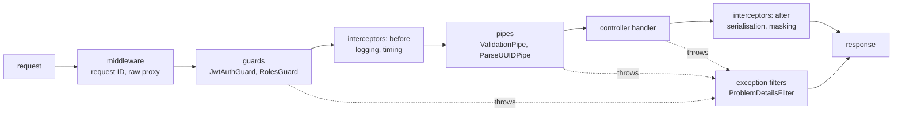

# NestJS building blocks in a distributed system

**TL;DR:** NestJS organises a Node service into **modules** wired by **dependency injection**, and runs each request through a fixed pipeline: middleware → guards → interceptors (before) → pipes → handler → interceptors (after) → exception filters. In a microservices system the same blocks carry the cross-cutting concerns every service shares (auth, validation, logging, error format), packaged once and reused. Nest's own microservices transports exist, but can hide the broker details you need to control.

## The problem it solves

Seven services each need: token verification, role checks, input validation, a uniform error body, request IDs in logs, health endpoints, configuration validation, graceful shutdown. Written ad hoc in Express, each service would do these slightly differently, in a different order, and the differences become bugs (one service that forgets the tenancy filter, one that returns HTML errors). Nest gives every service the same structure and the same extension points.

## How it works

### Modules and dependency injection

A **module** groups controllers and **providers** (classes Nest instantiates and injects). DI means a class declares what it needs in its constructor and Nest supplies it:

```ts
@Injectable()
export class IncidentService {
  constructor(private readonly dataSource: DataSource,
              private readonly outbox: OutboxService) {}
}
```

Benefits: testability (replace a provider in `Test.createTestingModule`), explicit dependencies, singletons by default. **Dynamic modules** (`MessagingModule.forRoot({...})`) let shared packages take configuration.

### The request pipeline



| Block | Purpose | Has access to | MicroSentinel uses |
|-------|---------|---------------|-------------------|
| **Middleware** | Raw request processing before routing | `req`, `res`, `next` | Request ID; the gateway's whole proxy chain |
| **Guard** | Decide whether the request may proceed (`true`/`false`/throw) | `ExecutionContext`, route metadata | `JwtAuthGuard`, `RolesGuard` with `@Roles()`, `@Public()` |
| **Interceptor** | Wrap the handler (RxJS): before/after logic, transform results, timeouts | Context + the handler's Observable | Logging/timing; `ClassSerializerInterceptor`; target masking; `RebuildingInterceptor` |
| **Pipe** | Validate and transform input arguments | The argument and its metadata | Global `ValidationPipe`; `ParseUUIDPipe`; custom `CursorPipe`, `TimeRangePipe`, `SafeUrlPipe` |
| **Exception filter** | Turn exceptions into responses | The exception and context | `ProblemDetailsFilter` → RFC 9457 with `code` |
| **Custom decorator** | Read data or set metadata | — | `@CurrentUser()`, `@Roles()`, `@Public()` |
| **Lifecycle hooks** | Startup/shutdown work | — | `OnApplicationBootstrap` starts loops and consumers; `OnApplicationShutdown` drains |

Order matters: guards run **before** pipes, so an unauthenticated request with an invalid body gets `401`, not `400`. Middleware runs before guards and doesn't know which handler will run. In Nest 12, lifecycle hooks are called in component-hierarchy order (Nest migration guide); don't rely on order between unrelated providers.

### ValidationPipe settings that matter

```ts
app.useGlobalPipes(new ValidationPipe({
  whitelist: true,              // strip properties without decorators
  forbidNonWhitelisted: true,   // …and reject the request instead (HTTP only)
  transform: true,              // plain object → DTO instance, strings → numbers where typed
}));
```

For consumed **events** the same library runs with `forbidNonWhitelisted: false` (tolerant reader) ([ADR-0005](../../adr/0005-typeorm-and-class-validator-usage.md)).

## In MicroSentinel

- Every service doc has a "Framework and Nest structure" section listing its modules, guards, pipes, interceptors and filters ([services](../../services/)).
- Shared Nest modules in `packages/`: `AuthGuardModule`, `MessagingModule`, `ObservabilityModule` ([ADR-0022](../../adr/0022-contracts-package-and-shared-libs.md)).
- The gateway is the counter-example: raw middleware bypasses guards and pipes, so its checks run as middleware in a fixed order, and `bodyParser` is off so bodies stream through ([gateway](../../services/gateway.md)).
- monitor uses a dynamic `AppModule.forRole(role)` to boot either the API or the worker from one codebase.
- Background work (outbox relay, lease loop, consumers, timers) lives in providers started by lifecycle hooks, with `enableShutdownHooks()` for graceful shutdown ([resilience](../../cross-cutting/resilience.md#graceful-shutdown)).
- Nest 12 projects are generated as ESM with Vitest; decorators with metadata need SWC in tests ([tech stack](../../architecture/tech-stack.md)).

## Microservices transports

`@nestjs/microservices` gives a transport-agnostic programming model: `@MessagePattern()` for request/response, `@EventPattern()` for events, `ClientProxy.send()`/`emit()` to call them, over TCP, Redis, NATS, MQTT, Kafka, RabbitMQ or gRPC. Guards, pipes, interceptors and filters apply to message handlers too.

What the RabbitMQ transport documents (Nest docs, checked 2026-11-15): one `queue` per server, `prefetchCount`, `noAck` defaulting to `true` (automatic acks; manual acks via `context.getChannelRef().ack(context.getMessage())`), `queueOptions`, topic exchanges with `wildcards: true`, `RmqRecordBuilder` for headers, `unwrap()` for the driver.

Why MicroSentinel uses `amqplib` through its own small Nest module instead ([ADR-0007](../../adr/0007-amqplib-over-nest-microservices.md)): several queues per service with different settings, wait queues and DLQ topology, publisher confirms awaited by the outbox relay, stream consumption with `x-stream-offset`, and a framework-neutral message format. The Phase 2 spike uses the Nest transport once so you can describe it from experience.

## Trade-offs & when NOT to use it

- Nest adds startup time and memory (~150–200 MB per process in dev) and a learning curve (DI, decorators, RxJS in interceptors).
- Decorator-heavy code hides control flow; a new reader must know the pipeline to see what runs.
- For a 60-line fixture, plain Express is clearer: `flaky-target` and `dev-stubs` ([ADR-0004](../../adr/0004-nestjs-everywhere-express-for-fixtures.md)).

## Common misconceptions

- **"Guards are middleware."** Middleware doesn't know the route handler or its metadata; guards do (`Reflector`), which is why role checks are guards.
- **"Pipes run before guards."** Guards first.
- **"Interceptors are only for logging."** They can transform responses, map errors, add timeouts, cache.
- **"Providers are per request."** Singletons by default; request scope exists but costs performance.
- **"Nest microservices = microservices architecture."** It's a messaging abstraction; architecture is how you split and connect services.

## Interview questions

1. **Explain the NestJS request lifecycle.**
   "Middleware first, then guards decide whether the request may proceed, interceptors wrap the handler, pipes validate and transform the arguments, the handler runs, interceptors can transform the result, and any exception goes through exception filters. In my services the JWT guard runs before validation, so an unauthenticated request gets 401 rather than 400."
2. **Guard vs middleware vs interceptor?**
   "Middleware is raw request processing before routing, like adding a request ID. A guard has the execution context and route metadata and decides access, like my roles guard reading `@Roles('ADMIN')`. An interceptor wraps the handler to do things before and after, like timing or serialising the response."
3. **What does dependency injection give you?**
   "Classes declare what they need and Nest provides it, so dependencies are explicit and swappable. In tests I build the real module and override just the providers I want to fake."
4. **How do you share cross-cutting logic across services?**
   "As Nest modules in shared packages: an auth guard module, a messaging module, an observability module with the logger and the problem-details filter. Each service imports them, so every service verifies tokens and formats errors the same way. Domain code is never shared."
5. **Have you used Nest microservices? Why not for RabbitMQ?**
   "I tried the RMQ transport in a spike. It's built around one queue per server, defaults to auto-ack, and wraps messages in its own format. I needed several queues, dead-letter and retry queues, publisher confirms and stream consumption, so I wrapped amqplib in a small Nest module. On a team I'd consider the golevelup RabbitMQ module."
6. **How do you validate input?**
   "A global ValidationPipe with class-validator DTOs: whitelist plus forbid-non-whitelisted for HTTP, so unknown fields are rejected. For events I use the same classes but only whitelist, so producers can add fields."

## Further reading

- NestJS documentation: "Modules", "Providers", "Middleware", "Guards", "Interceptors", "Pipes", "Exception filters", "Lifecycle events", "Microservices → RabbitMQ", and the v11 → v12 migration guide.
- The `sample/` directory of the nestjs/nest repository on GitHub (official runnable examples).

Used in: [ADR-0004](../../adr/0004-nestjs-everywhere-express-for-fixtures.md), [ADR-0007](../../adr/0007-amqplib-over-nest-microservices.md), every [service doc](../../services/), [phase 0](../../roadmap/phase-0.md), [phase 1](../../roadmap/phase-1.md), [phase 2](../../roadmap/phase-2.md).
