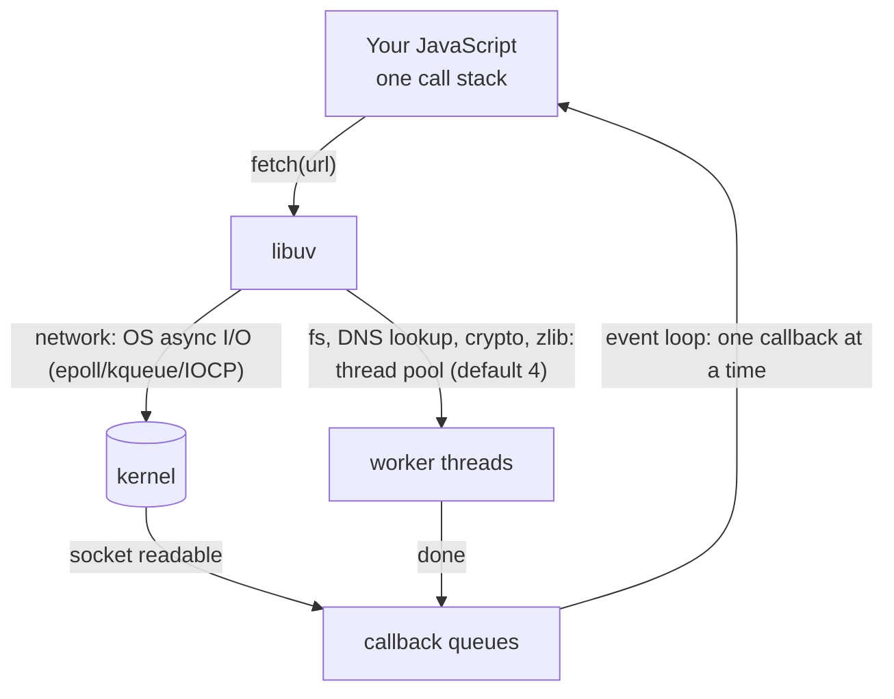

# The Node.js event loop and I/O concurrency

**TL;DR:** Node runs your JavaScript on **one thread**. Network I/O is handed to the operating system, and when a socket has data, a callback is queued; the **event loop** runs queued callbacks one at a time. So one process can wait on thousands of HTTP requests at once (ideal for a pinger), but any CPU-heavy synchronous code stops *everything* until it finishes. The safe pattern: lots of concurrent I/O, **bounded**, and no heavy synchronous work.

## The problem it solves

A monitoring worker spends almost all its time **waiting**: for DNS, TCP connect, TLS, the first response byte. A thread-per-request model would need hundreds of threads to check hundreds of URLs concurrently. Node needs one thread, because waiting costs nothing but a socket and a small object. The risk is the inverse: since everything shares that thread, one slow synchronous operation delays every timer and every response handler in the process.

## How it works

Event loop phases (simplified): **timers** (`setTimeout`/`setInterval` due) → **pending callbacks** → **poll** (wait for and run I/O callbacks) → **check** (`setImmediate`) → **close callbacks**. Between each callback Node drains the **microtask queue**: resolved promise continuations and `process.nextTick` (which runs first).

Key consequences:

| Fact | Consequence |
|------|-------------|
| One thread runs JS | `await fetch()` doesn't block; a `while` loop computing for 2 s blocks *all* callbacks for 2 s |
| Timers are "not before", not "exactly at" | A 10 s timeout fires late if the loop is busy, and can make a healthy target look like it timed out |
| `dns.lookup` uses the thread pool (4 threads by default) | Many concurrent hostname lookups queue behind each other; `UV_THREADPOOL_SIZE` raises it |
| `crypto` (e.g. `argon2`), `zlib`, `fs` also use the pool | Argon2 hashing doesn't block the loop but competes for pool threads |
| `JSON.parse` of a 100 MB body is synchronous | Blocks the loop; also allocates hundreds of MB |
| Unbounded `Promise.all(urls.map(fetch))` | Thousands of sockets and buffers at once: memory, file-descriptor and target-overload problems |

**Measuring blocking:** `perf_hooks.monitorEventLoopDelay()` reports how late the loop is running (histogram). Healthy: a few ms. Blocked: hundreds.

**CPU work that you must do:** move it to `worker_threads`, a child process, or a separate service.

## In MicroSentinel

The check executor is designed around these facts ([ADR-0026](../../adr/0026-pinger-safety.md), [monitor](../../services/monitor.md)):

- **Bounded concurrency:** `p-limit(50)` in-flight checks per worker, 5 per host, and the scheduler claims only `50 − inFlight` leases (backpressure into the database).
- **No body reading:** headers arrive → request aborted → socket destroyed. Nothing to parse, nothing large to buffer.
- **One deadline per check** with `AbortSignal.timeout()`; connect timeout 5 s.
- **Event-loop delay** exported as `nodejs.eventloop.delay`; p99 > 200 ms for 10 s marks the worker not-ready.
- **Confirmation thresholds** (3 failures) also absorb our own hiccups: one blocked burst rarely produces three consecutive false failures.
- Lab: [break-it lab #8](../../roadmap/break-it-lab.md) blocks the loop with a busy-wait and shows inflated latencies and timeouts.
- Elsewhere: Argon2 in auth runs in the thread pool, so logins are CPU-bound but don't freeze the loop; analytics batches inserts so large replays don't hold the loop with per-row work.

## Trade-offs & when NOT to use it

- Node is excellent for I/O-bound services (APIs, gateways, pingers, consumers). It is a poor fit for CPU-bound work (image processing, heavy computation) unless offloaded.
- Concurrency without limits is a bug, not a feature.
- Worker threads help with CPU work but add message-passing overhead and complexity.

## Common misconceptions

- **"Node is single-threaded."** Your JavaScript is; libuv uses OS async I/O and a thread pool underneath.
- **"`async` makes code non-blocking."** An `async` function that runs a tight loop still blocks; only awaiting real I/O yields.
- **"`setTimeout(fn, 1000)` runs after exactly 1 s."** After *at least* 1 s, when the loop gets to it.
- **"More concurrency is always faster."** Past a point it overloads targets, sockets and memory; throughput flattens and latency rises.
- **"`process.nextTick` is the same as `setImmediate`."** `nextTick` runs before other microtasks, before the loop continues; overusing it can starve I/O.

## Interview questions

1. **How does Node handle many concurrent requests on one thread?**
   "JavaScript runs on one thread, but network I/O is handed to the OS through libuv. While a request waits, the thread runs other callbacks. When data arrives, a callback is queued and the event loop runs it. Waiting is cheap, so one process can have thousands of requests in flight."
2. **What happens if you run a CPU-heavy loop in a request handler?**
   "It blocks the event loop: no other request, timer or I/O callback runs until it finishes. In my pinger that would make healthy sites look slow or time out. CPU work belongs in a worker thread or another process."
3. **Why is Node a good fit for a URL pinger?**
   "It's almost pure waiting on network I/O, which Node does very efficiently. The things to get right are a concurrency cap, timeouts, and never reading or parsing large response bodies."
4. **How did you cap concurrency?**
   "A semaphore with `p-limit` at 50 in-flight checks per worker and 5 per host, and the scheduler only claims as many jobs from the database as there are free slots, so overload shows up as schedule lag instead of memory growth."
5. **How do you detect event-loop blocking?**
   "`monitorEventLoopDelay` from `perf_hooks`. I export p99 as a metric and mark a worker not-ready if it stays above 200 ms."
6. **Microtasks vs macrotasks?**
   "Promise continuations and `process.nextTick` are microtasks, run right after the current callback before the loop moves on. Timers, I/O callbacks and `setImmediate` are in the loop's phases. So a resolved promise's `.then` runs before a `setTimeout(…, 0)`."

## Further reading

- Node.js documentation: "The Node.js Event Loop, Timers, and process.nextTick()" and "Don't Block the Event Loop (or the Worker Pool)".
- Node.js documentation: `perf_hooks.monitorEventLoopDelay`, `worker_threads`.
- libuv documentation: "Design overview".

Used in: [ADR-0026](../../adr/0026-pinger-safety.md), [monitor](../../services/monitor.md), [break-it lab](../../roadmap/break-it-lab.md), [phase 1](../../roadmap/phase-1.md), [phase 3](../../roadmap/phase-3.md).
