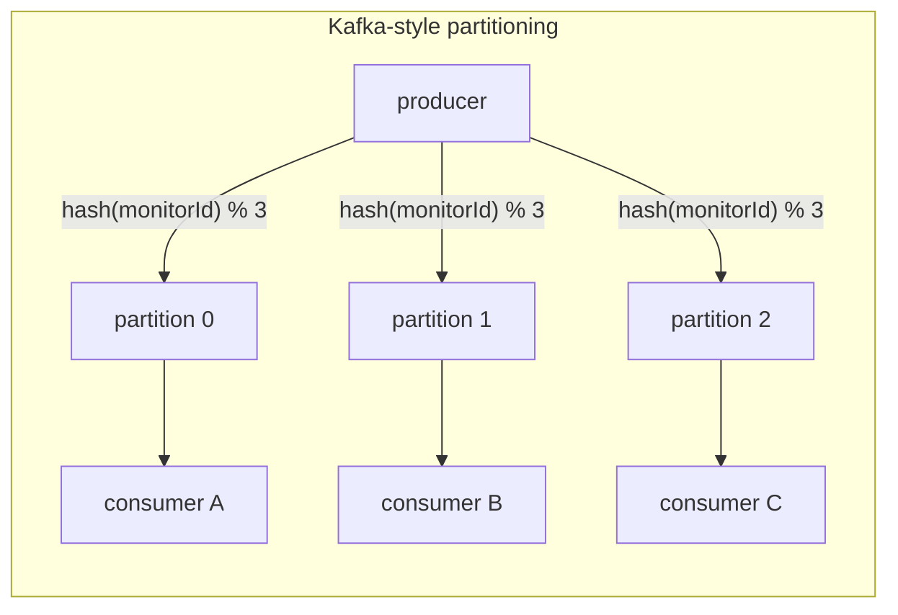

# Partitioning and per-key ordering

**TL;DR:** Global ordering of all messages doesn't scale; what systems usually need is **per-key ordering**: all events about one monitor in order, while different monitors are processed in parallel. Kafka gets this by hashing keys to partitions with one consumer per partition. RabbitMQ needs it built (single active consumer, consistent-hash exchange, super streams), or you make consumers **order-tolerant** with version numbers.

## The problem it solves

Monitor 42 goes `DOWN` (v12) then `UP` (v13). If incident processes v13 first, it finds no open incident and does nothing; then v12 opens an incident for a monitor that is actually up, and pages someone. Messages get reordered by: several consumers on one queue, prefetch > 1 with concurrent handling, retries (a failed message comes back later), and multiple outbox relays.

## How it works

Each partition is an ordered log; each is read by exactly one consumer in a group; keys always map to the same partition. Order holds per key, parallelism scales with partition count, and a stuck message blocks only its partition.

RabbitMQ options:

| Option | Order | Parallelism | Notes |
|--------|-------|-------------|-------|
| One queue, one consumer, prefetch 1, no retries | Total | None | Breaks on the first retry |
| **Single active consumer** (`x-single-active-consumer`) | Per queue | None (standby takes over) | Failover without reordering on that queue |
| Consistent-hash exchange → N queues | Per key | N | Plugin; rebalancing when N changes |
| Super streams | Per key, partitioned streams | N | Stream client protocol for full support |
| **Order-tolerant consumers** (versions) | Effectively per key | Unlimited | Each aggregate's events carry an increasing version; consumer ignores ≤ last seen |

The order-tolerant approach only works when the latest state is what matters (state transitions, snapshots). For deltas that must all be applied in order (append "+5", "-3"), you need real ordering or must buffer and reorder by sequence.

Related: **table partitioning** in PostgreSQL (splitting a table by a key, e.g. date) is a storage technique with different goals: fast retention and pruning ([analytics-schema](../../data/analytics-schema.md#design-notes)).

## In MicroSentinel

- `monitor.state.changed.v1` carries `stateVersion`; incident keeps `monitor_cursors.last_state_version` and ignores stale events ([ADR-0017](../../adr/0017-ordering-and-replay.md)).
- `incident.monitor-events` additionally uses **single active consumer** and prefetch 1, so the normal case is in order and the version check rarely discards anything.
- Snapshot events (`auth.*`, `monitor.definition.changed.v1`) use "latest version wins" upserts.
- Flows that don't need order (check results, incident facts, hints) are designed to be commutative.
- The envelope's `subject` is the ordering key and `sequence` the version ([versioning](../../contracts/versioning.md#the-envelope)).
- The reordering-by-retry case is drawn in [flapping-and-duplicates](../../flows/flapping-and-duplicates.md#sequence-reordering-stale-up-after-down).

## Trade-offs & when NOT to use it

- Strict per-key ordering means a poison message blocks that key (or partition) until handled.
- Partition count caps consumer parallelism and is hard to change later (Kafka) or needs manual rebalancing (consistent hash).
- Version checks need producers to maintain a counter per aggregate and consumers to store "last seen".
- If events are independent facts, don't pay for ordering at all.

## Common misconceptions

- **"Queues are FIFO, so my consumer sees messages in order."** Only with one consumer, prefetch 1, sequential processing and no requeues.
- **"Kafka guarantees order."** Per partition only, and only if the producer is configured not to reorder on retries (idempotent producer).
- **"Timestamps can order events."** Clocks differ between machines; use a per-aggregate sequence from the owner.
- **"Ordering and deduplication are the same problem."** Dedupe stops repeats; versions stop stale messages.

## Interview questions

1. **Does RabbitMQ guarantee message order?**
   "A queue is FIFO, but processing order only holds with a single consumer handling one message at a time and no requeues. Competing consumers, prefetch and retries all reorder. So I don't rely on it."
2. **How did you get per-monitor ordering?**
   "Each state-change event has a version that increases by one per monitor. The incident consumer stores the last version per monitor and ignores anything not newer. As a first line of defence, that queue uses single active consumer with prefetch 1, so normally it's already in order."
3. **How does Kafka do it?**
   "The message key picks a partition, each partition is an ordered log, and each partition is read by one consumer in the group. You get ordering per key and parallelism across keys. That's the main thing Kafka would have given me for free."
4. **When is version checking not enough?**
   "When every event must be applied, like increments or appends. Then you need real ordering per key, or to buffer and reorder by sequence number."

## Further reading

- Martin Kleppmann, *Designing Data-Intensive Applications*, chapter 6 (partitioning) and chapter 11 ("Partitioned logs").
- Jay Kreps, "The Log: What every software engineer should know about real-time data's unifying abstraction" (LinkedIn Engineering, 2013).
- RabbitMQ documentation: "Single Active Consumer", "Streams" (super streams), and the consistent-hash exchange plugin README.
- Apache Kafka documentation: "Design" (partitions, consumer groups).

Used in: [ADR-0017](../../adr/0017-ordering-and-replay.md), [ADR-0006](../../adr/0006-rabbitmq-as-broker.md), [communication](../../architecture/communication.md#ordering-per-edge), [monitor](../../services/monitor.md), [incident](../../services/incident.md), [analytics](../../services/analytics.md), [phase 2](../../roadmap/phase-2.md).
