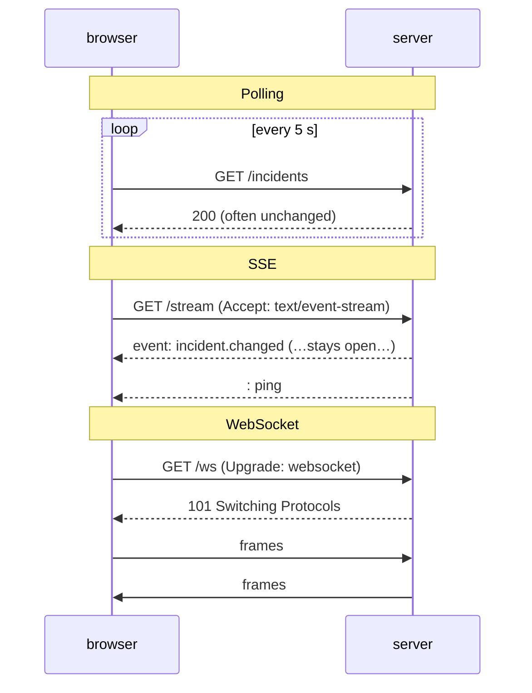

# Real-time delivery: polling, SSE, WebSockets

**TL;DR:** Three ways to get server changes into a browser. **Polling**: ask every few seconds; simplest, always correct, wasteful. **Server-Sent Events (SSE)**: one long HTTP response the server writes events into; one-way, plain HTTP. **WebSockets**: an upgraded two-way connection; needed only when the client also sends a stream of messages. Whatever the transport, design for missed messages: refetch on reconnect.

## The problem it solves

Two people watch the incident list. One acknowledges an incident. Without push, the other sees stale data until they refresh and might acknowledge it again or escalate manually. The product requirement is "visible within 2 s" (NFR in [requirements](../../01-requirements.md)).

## How it works

| | Polling | SSE | WebSocket |
|-|---------|-----|-----------|
| Direction | Client pulls | Server → client | Both |
| Protocol | HTTP | HTTP (`text/event-stream`) | Own framing after HTTP upgrade |
| Latency | ≤ interval | Immediate | Immediate |
| Proxies / gateways | Trivial | Need buffering off | Need upgrade support |
| Browser API | `fetch` | `EventSource` (auto-reconnect, `Last-Event-ID`, but **no custom headers**) or `fetch` + stream parsing | `WebSocket` (no custom headers either) |
| Auth | Normal headers | Headers with `fetch`; cookie with `EventSource` | Cookie, query token, or first-message auth |
| Connection limit | n/a | ~6 per origin on HTTP/1.1; multiplexed on HTTP/2 | Separate connections |
| Server cost | Requests even when idle | One open response per client | One socket per client, plus protocol state |
| Libraries | — | Nest `@Sse()`, plain `res.write` | `ws`, socket.io (rooms, fallbacks, its own protocol), Nest gateways |

**Hints vs data:** a push can carry the full object (patch the client cache; needs ordering and gap detection) or just a hint "X changed" (client refetches through the normal API; simpler, permissions stay in one place).

**Missed events:** connections drop. Options: server keeps a replay buffer and resumes from `Last-Event-ID`; or the client refetches current state on every (re)connect. The second needs no server state.

## In MicroSentinel

- Phase 1 polls every 5 s; Phase 2 adds SSE from a dedicated **realtime** service fed by broker events, so domain services never hold browser connections ([ADR-0019](../../adr/0019-sse-realtime-service.md), [realtime service](../../services/realtime.md)).
- Pushes **hints**; the browser invalidates TanStack Query caches and refetches ([frontend realtime](../../frontend/realtime.md)).
- Read with `fetch` + `eventsource-parser` so the bearer token can be sent; reconnect with full jitter; heartbeat every 15 s and a 45 s watchdog.
- **Catch-up rule:** refetch everything on every `ready` event. No replay buffer.
- Fallback to polling while disconnected; 60 s safety refetch while connected.
- Each realtime instance has its own exclusive queue, so events are broadcast to all instances.
- Experiment: [break-it lab #9](../../roadmap/break-it-lab.md).

## Trade-offs & when NOT to use it

- Polling is often enough: low event rates, few users, tolerance of a few seconds. It's the easiest to get right.
- SSE is right for server-to-client notifications, feeds and progress.
- WebSockets are right for chat, collaboration, games, anything with frequent client-to-server messages. Don't use them just to "be real-time".
- Long-lived connections need capacity planning, connection limits, slow-client handling and reconnection storms in mind.

## Common misconceptions

- **"SSE is outdated; use WebSockets."** For one-way push SSE is simpler and works through ordinary HTTP infrastructure.
- **"Push means you don't need to refetch."** Push channels lose messages; correctness needs a catch-up path.
- **"socket.io is WebSockets."** It's a protocol on top (with fallbacks); a plain WebSocket client can't talk to it.
- **"One connection per tab is free."** Browser per-origin limits on HTTP/1.1 and server memory both say otherwise.

## Interview questions

1. **Polling, SSE or WebSockets: how do you choose?**
   "By direction and rate. If updates only go server to client, SSE: plain HTTP, easy through proxies. If the client also streams messages, WebSockets. If updates are rare and a few seconds' delay is fine, polling is simplest. I started with polling and moved to SSE."
2. **How do you handle a dropped connection?**
   "Reconnect with exponential backoff and jitter, and on every reconnect refetch the current state, so anything missed while disconnected is covered. While disconnected the UI falls back to polling and says live updates are paused."
3. **Why push hints instead of data?**
   "The browser refetches through the normal REST API, so authorization, pagination and data shape stay in one place, and a lost or duplicated hint costs only an extra request. Pushing data would need ordering and gap detection."
4. **Who sends the events to the browser?**
   "A small realtime service that consumes incident events from RabbitMQ, each instance with its own queue, and writes to the SSE connections of that organization. The incident service doesn't know browsers exist."
5. **How do you authenticate an SSE connection?**
   "EventSource can't send headers, so I read the stream with fetch and send the bearer token, and the server closes the stream when the token expires; the client reconnects with a fresh one."

## Further reading

- WHATWG HTML Living Standard, "Server-sent events".
- MDN Web Docs: "Using server-sent events", "The WebSocket API".
- RFC 6455 "The WebSocket Protocol" (IETF).
- NestJS documentation: "Server-Sent Events" and "Gateways" (WebSockets).

Used in: [ADR-0019](../../adr/0019-sse-realtime-service.md), [realtime service](../../services/realtime.md), [frontend realtime](../../frontend/realtime.md), [phase 2](../../roadmap/phase-2.md).
