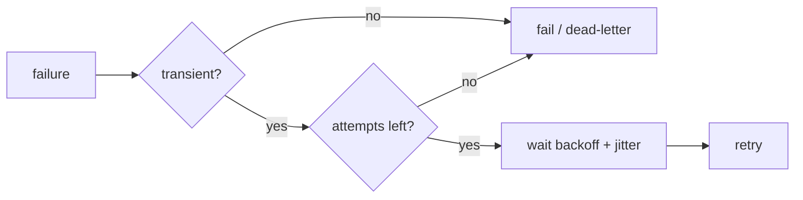

# Retries, backoff and jitter

**TL;DR:** Retry transient failures, not permanent ones. Wait longer between attempts (**exponential backoff**), randomise the wait (**jitter**) so clients don't retry in lockstep, cap the number of attempts, and make sure only one layer retries. Retries are only safe for idempotent operations.

## The problem it solves

- Without retries, a one-second SMTP blip means a missed page.
- With naive retries (immediately, forever), a struggling SMS gateway receives every failed request again at once, making recovery harder; one bad message loops at full speed.
- With retries at every layer (browser × gateway × service × client library), one failure becomes dozens of calls: a **retry storm**.
- With identical backoff and no jitter, all 50 browsers that lost their SSE connection when realtime restarted reconnect at exactly 1 s, 2 s, 4 s: the **thundering herd**.

## How it works

Decide first whether to retry:

| Error | Retry? |
|-------|--------|
| Timeout, connection refused/reset, DNS failure | Yes |
| `502`, `503`, `504` | Yes |
| `429 Too Many Requests` | Yes, after `Retry-After` |
| Other `4xx` (`400`, `401`, `404`, `422`) | No: it will fail the same way |
| Validation failure of a message | No: dead-letter it |
| Unknown exception | Usually yes, with a cap |

Then the delay:

```
exponential:      delay(n) = base × 2^n                 1 s, 2 s, 4 s, 8 s …
capped:           delay(n) = min(cap, base × 2^n)
full jitter:      delay(n) = random(0, min(cap, base × 2^n))
equal jitter:     delay(n) = d/2 + random(0, d/2),  d = min(cap, base × 2^n)
```



**Full jitter** spreads retries most evenly and is the usual default (Marc Brooker's analysis on the AWS Architecture Blog compares the variants).

**Retry budget:** limit total retries rather than per-call, and retry at **one** layer per hop. If the queue retries, the HTTP client inside the handler should not also retry five times.

## In MicroSentinel

Full table in [resilience](../../cross-cutting/resilience.md#retries). Highlights:

- Message handlers retry through **broker wait queues** with fixed tiers (5 s, 30 s, 2 min; deliveries 10 s, 1 min, 5 min, 15 min), not by sleeping in process ([ADR-0023](../../adr/0023-retry-topology-ttl-dlx.md)). Tier delays are fixed per queue, so there's no per-message jitter; spread comes from messages failing at different times.
- `ErrorClassifier` in notification separates transient from permanent failures.
- In-process retries (JWKS fetch, Phase 1 signal) use full jitter.
- Browser SSE reconnect uses full jitter capped at 30 s ([frontend realtime](../../frontend/realtime.md#reconnection)).
- The gateway **never** retries upstream calls: a `POST` might have been applied.
- `RETRY_TIERS_SCALE` shrinks delays for tests and demos.

## Trade-offs & when NOT to use it

- Retries add latency to failures and load to dependencies. Bound both.
- Never retry non-idempotent operations blindly. A timed-out "create monitor" might have succeeded; retrying gives `409` at best and a duplicate at worst (without a unique key).
- Long retry tails delay the final "this failed" signal; for paging, 21 minutes of retries is acceptable because escalation and other channels continue meanwhile.
- If a dependency is clearly down, stop retrying for a while: that's a [circuit breaker](circuit-breakers-and-bulkheads.md).

## Common misconceptions

- **"Retries make the system more reliable."** They hide transient faults and amplify persistent ones.
- **"Exponential backoff is enough."** Without jitter, synchronised clients stay synchronised.
- **"Retry on every error."** `400` will be `400` forever.
- **"`nack` with requeue is a retry."** It's an immediate redelivery: a hot loop ([DLQ guide](dead-letter-queues.md)).

## Interview questions

1. **How do you implement retries well?**
   "Only for transient errors and idempotent operations; exponential backoff with a cap; jitter so clients spread out; a maximum number of attempts; and retries at one layer only. After the last attempt, fail clearly or dead-letter."
2. **What is jitter and why does it matter?**
   "Randomness added to the backoff delay. Without it, clients that failed together retry together and can knock the recovering service over again. When my realtime service restarts, every browser reconnects with full jitter so they don't arrive in one wave."
3. **How do you retry a failed message from a queue with a delay?**
   "In RabbitMQ I republish it to a wait queue that has a TTL and no consumers; when the TTL expires, the dead-letter exchange routes it back to the main queue. Several wait queues give increasing delays. Then after the last attempt it goes to a dead-letter queue."
4. **What's a retry storm?**
   "Retries multiplying across layers: if the client, the gateway and the service each retry three times, one failure becomes 27 calls. You avoid it by retrying at one layer and having budgets."

## Further reading

- Marc Brooker, "Exponential Backoff And Jitter" (AWS Architecture Blog, 2015).
- Google, *Site Reliability Engineering* (O'Reilly), chapter 22 "Addressing Cascading Failures".
- Michael Nygard, *Release It!*, 2nd ed. (Pragmatic Bookshelf), stability patterns.

Used in: [resilience](../../cross-cutting/resilience.md), [ADR-0023](../../adr/0023-retry-topology-ttl-dlx.md), [notification](../../services/notification.md), [realtime](../../services/realtime.md), [frontend realtime](../../frontend/realtime.md), [phase 3](../../roadmap/phase-3.md).
