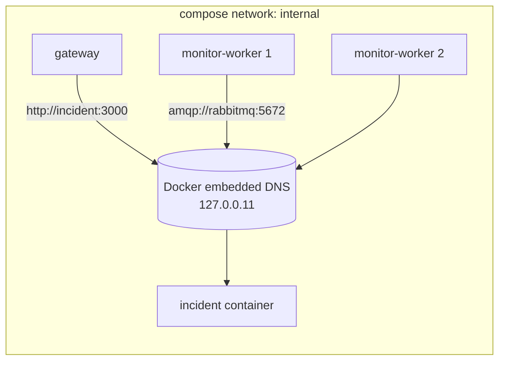

# Service discovery

**TL;DR:** Service discovery is how one component finds the network address of another when instances come and go. Locally, Docker Compose's built-in DNS does it: a service name is a hostname. In larger systems a registry (Consul, Kubernetes Services, a service mesh) tracks healthy instances.

## The problem it solves

Hard-coding `172.18.0.7:3000` breaks the moment a container restarts with a new IP or a second replica starts. Clients need a stable name that always resolves to a live instance, and ideally only to *healthy* ones.

## How it works

| Approach | How | Example |
|----------|-----|---------|
| **DNS-based** | A name resolves to one or more instance IPs | Compose service names; Kubernetes `ClusterIP` Service names |
| **Client-side discovery** | Client queries a registry, picks an instance, load-balances itself | Netflix Eureka + Ribbon; Consul with a client library |
| **Server-side discovery** | Client calls a stable address; a load balancer routes to an instance | Kubernetes Services (kube-proxy), cloud load balancers, a gateway |
| **Service mesh** | A sidecar proxy next to each service handles discovery, retries, mTLS | Istio, Linkerd |

Registration happens either by the instance itself (self-registration) or by the platform (the orchestrator knows what it started). Health checks remove unhealthy instances from the pool.

## In MicroSentinel

- Every address is a Compose service name: `http://auth:3000`, `postgres:5432`, `amqp://rabbitmq:5672`, `redis:6379` ([deployment-local](../../architecture/deployment-local.md#networks-and-ports)). Configured by environment variables ([configuration](../../cross-cutting/configuration.md)), never hard-coded.
- Scaled services (`--scale monitor-worker=3`) get one DNS name with several A records; Docker's DNS round-robins between them. Nobody calls the workers, so it doesn't matter here.
- The broker removes most discovery needs: producers know only the exchange; consumers attach to queues. Who consumes is invisible to the producer.
- `depends_on: condition: service_healthy` covers startup ordering, the closest Compose gets to "only route to healthy instances".
- In Phase 5 (Kubernetes), names become `incident.<namespace>.svc.cluster.local` and readiness probes remove unready pods from Service endpoints ([phase 5](../../roadmap/phase-5.md#s1-notes-kubernetes-mapping)).

## Trade-offs & when NOT to use it

- DNS caching: clients that cache a resolved IP keep calling a dead instance. Node's HTTP clients resolve per connection; long-lived connections (AMQP, DB pools) reconnect by name on failure.
- Compose DNS has no health awareness: a running but unready container still resolves.
- Client-side discovery puts load-balancing logic in every client and language; server-side keeps clients simple.
- You need none of the heavy options on a single host.

## Common misconceptions

- **"Microservices need Consul or Eureka."** Container platforms provide DNS-based discovery out of the box.
- **"DNS round-robin is load balancing."** It's distribution with no health or load awareness.
- **"Discovery is only for HTTP."** Brokers and databases are discovered the same way.

## Interview questions

1. **How do your services find each other?**
   "By Docker Compose DNS: each service name resolves to its container, so the gateway calls `http://incident:3000` and services connect to `rabbitmq:5672`. Addresses come from environment variables. Between domain services there's no addressing at all; they only know the broker's exchange."
2. **Client-side vs server-side discovery?**
   "Client-side: the client asks a registry and picks an instance itself. Server-side: the client calls a stable address and a load balancer picks. Kubernetes Services are server-side, which keeps clients simple."
3. **What changes in Kubernetes?**
   "Service names become cluster DNS names, and readiness probes take unhealthy pods out of rotation, which Compose can't do."

## Further reading

- Chris Richardson, microservices.io: "Pattern: Client-side service discovery", "Pattern: Server-side service discovery", "Pattern: Service registry".
- Docker documentation: "Networking in Compose".
- Kubernetes documentation: "Service" and "DNS for Services and Pods".

Used in: [deployment-local](../../architecture/deployment-local.md), [c4-containers](../../architecture/c4-containers.md), [gateway](../../services/gateway.md), [phase 0](../../roadmap/phase-0.md).
