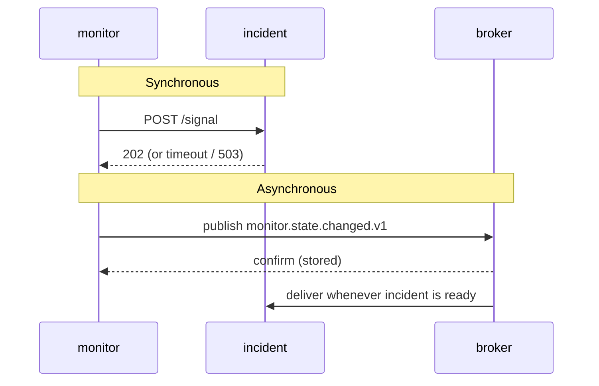

# Sync vs async communication

**TL;DR:** In synchronous communication the caller waits for the answer (HTTP, gRPC); in asynchronous communication the sender hands a message to a broker and moves on. Sync is simpler and immediately consistent but couples services in time; async decouples them and absorbs failures, at the cost of eventual consistency and harder debugging.

## The problem it solves

Phase 1 of MicroSentinel calls incident synchronously when a monitor goes down. Stop incident, cause an outage, and the signal is lost after three retries: nobody is ever paged for that outage ([break-it lab #0](../../roadmap/break-it-lab.md)). That is **temporal coupling**: the monitor service can only do its job if the incident service is up *at that moment*.

Availability also multiplies along a synchronous chain: three services at 99.5 % each give 0.995³ ≈ 98.5 % for the request. Latency adds up the same way.

## How it works

| | Synchronous (REST, gRPC) | Asynchronous (queue, pub/sub) |
|-|--------------------------|------------------------------|
| Caller waits | Yes | No (only for the broker's confirm) |
| Receiver down | Call fails | Message waits |
| Consistency | Immediate result | Eventual |
| Load spikes | Passed straight through | Buffered in the queue |
| Fan-out to many receivers | N calls, sender knows all | One publish, receivers subscribe |
| Errors | Returned to caller | Retried, dead-lettered; sender never learns |
| Debugging | One request, one stack | Needs tracing and correlation IDs |
| Good for | A user waiting for an answer; queries | Telling others a fact happened; work that may be slow or fail |

**REST vs gRPC** are both synchronous. gRPC adds a contract-first `.proto`, binary Protocol Buffers, HTTP/2 and streaming: faster and stricter, but it does not remove temporal coupling ([proto README](../../contracts/proto/README.md)).

**Async styles:** *events* (facts, past tense, any number of listeners) vs *commands* (requests to one receiver, imperative). Both can go through a broker ([event-driven architecture](event-driven-architecture.md)).

## In MicroSentinel

- The rule: *a user waiting for an answer gets one synchronous call into one service; anything a service needs to tell another is an event* ([communication](../../architecture/communication.md)).
- Every edge is classified there, with timeouts and failure behaviour.
- The one remaining service-to-service HTTP call is the cached JWKS fetch, off the request path.
- The brief's synchronous gRPC on-call lookup was replaced by a local replica ([ADR-0014](../../adr/0014-on-call-in-incident-and-local-replicas.md)).
- Phase 1 keeps one synchronous signal deliberately so the failure can be felt before it is fixed ([phase 1](../../roadmap/phase-1.md)).

## Trade-offs & when NOT to use it

Choose **sync** when the caller needs the answer to continue (login; "is this name taken?"), when the operation is a query, or when strict immediate consistency matters more than availability. Choose **async** when the sender doesn't need the outcome, when several services react, when the receiver may be slow or down, or when load is bursty.

Don't go async everywhere: a user creating a monitor expects `201` with the monitor, not "accepted, check back later". Request/reply over a broker exists, but it is synchronous communication with extra steps and usually worse than HTTP.

## Common misconceptions

- **"Async means faster."** It means the *sender* is not blocked. End-to-end the work may take longer.
- **"A broker makes the system reliable."** Only with durable queues, persistent messages, manual acks, publisher confirms and idempotent consumers. A fire-and-forget publish after a DB commit can still lose the event ([outbox](transactional-outbox.md)).
- **"gRPC solves the coupling problem."** It's still request/response.
- **"With async you don't need timeouts."** The broker connection, the publish confirm and every handler's own calls still need them.

## Interview questions

1. **When would you use a message queue instead of an HTTP call?**
   "When the sender doesn't need the result to continue, when more than one service cares, or when the receiver might be slow or down and I don't want that to stop the sender. In my project the monitor service publishes a state change and doesn't care whether incident is up; the event waits in a durable queue."
2. **What is temporal coupling?**
   "Service A only works if B is up at the same time. Every synchronous call creates it. I saw it in my first phase: if the incident service was down during an outage, the signal was lost after retries."
3. **What does async cost you?**
   "Eventual consistency, duplicates and reordering to handle, no immediate error back to the sender, and harder debugging, so you need tracing and correlation IDs."
4. **REST vs gRPC?**
   "Both are synchronous. gRPC is contract-first with Protocol Buffers over HTTP/2: smaller payloads, streaming, generated clients, good for internal calls. REST/JSON is universal and browser-friendly. Neither removes temporal coupling."
5. **How do you return a result to a user if the work is async?**
   "Accept with 202 and a resource they can poll, or push an update over SSE or WebSockets. In MicroSentinel the browser gets a hint over SSE and refetches."

## Further reading

- Gregor Hohpe and Bobby Woolf, *Enterprise Integration Patterns* (Addison-Wesley), chapters on messaging.
- Sam Newman, *Building Microservices*, 2nd ed., chapter 4 "Microservice Communication Styles".
- Chris Richardson, microservices.io: "Pattern: Messaging" and "Pattern: Remote Procedure Invocation".

Used in: [communication](../../architecture/communication.md), [ADR-0014](../../adr/0014-on-call-in-incident-and-local-replicas.md), [incident](../../services/incident.md), [phase 1](../../roadmap/phase-1.md), [phase 2](../../roadmap/phase-2.md), [proto README](../../contracts/proto/README.md).
