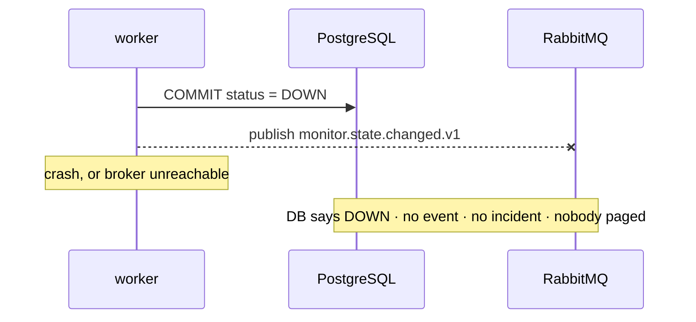

# Transactional outbox

**TL;DR:** To change your database and publish an event atomically, don't publish directly. Insert the event as a row in an `outbox` table **in the same transaction** as the data change; a separate relay reads unpublished rows, publishes them, and marks them done. The event exists if and only if the change committed. Delivery becomes at-least-once, so consumers must be idempotent.

## The problem it solves

The **dual write**: one operation must update two systems that share no transaction.



Reversing the order is no better: publish first, then the commit fails, and every consumer believes something the owning service's own database says never happened. Retrying in memory doesn't help, because the process that would retry is the one that crashed. Two-phase commit across a database and a broker is not supported by RabbitMQ and blocks when the coordinator fails.

## How it works

```mermaid
sequenceDiagram
  participant W as worker
  participant DB as PostgreSQL
  participant R as relay
  participant MQ as RabbitMQ
  W->>DB: BEGIN
  W->>DB: UPDATE monitors SET status='DOWN' …
  W->>DB: INSERT INTO outbox (routing_key, envelope, headers)
  W->>DB: COMMIT  ← both or neither
  loop every 500 ms
    R->>DB: BEGIN; SELECT … WHERE published_at IS NULL ORDER BY id LIMIT 100 FOR UPDATE SKIP LOCKED
    R->>MQ: publish each row (persistent) on a confirm channel
    MQ-->>R: confirms
    R->>DB: UPDATE outbox SET published_at = now() WHERE id = ANY(…); COMMIT
  end
```

Properties:

- **Atomic:** the business change and the event row commit together, using the database's own transaction.
- **At-least-once:** if the relay crashes after the broker confirmed but before `COMMIT`, the rows are published again. Same envelope `id` both times, so consumers can deduplicate.
- **Durable while the broker is down:** rows accumulate; nothing is lost; they are published when it returns.
- **Concurrency-safe:** `FOR UPDATE SKIP LOCKED` lets several relay instances share the table without publishing the same row at the same time.
- **Not strictly ordered:** concurrent transactions commit in a different order than their IDs; several relays interleave. Order-sensitive consumers use versions ([ordering](partitioning-and-ordering.md)).

Two ways to run the relay:

| | Polling publisher (used here) | Change data capture (Debezium) |
|-|--------------------------|--------------------------------|
| How | Query the table on an interval | Read the database's write-ahead log |
| Latency | Up to the poll interval | Sub-second |
| Load | Constant small queries | Replication slot |
| Ordering | Approximate | Commit order |
| Infrastructure | None | A JVM service, slot monitoring; a stuck slot makes the DB retain WAL until the disk fills |

## In MicroSentinel

- Every publishing service (auth, monitor, incident, notification) has an `outbox` table ([DDL](../../data/messaging-tables.md)) and runs the shared relay from `@microsentinel/messaging` ([ADR-0008](../../adr/0008-transactional-outbox.md)).
- `OutboxService.add(manager, envelope)` **requires** the caller's `EntityManager`, so an outbox row cannot be written outside the business transaction ([ADR-0005](../../adr/0005-typeorm-and-class-validator-usage.md)).
- Rows store the trace context; the relay continues the original trace ([observability](../../cross-cutting/observability.md#over-rabbitmq)).
- Health: `outbox.pending` and `outbox.oldest_age_seconds`; alert at 30 s.
- Proof: [break-it lab #2](../../roadmap/break-it-lab.md) (broker restart) and Phase 2 DoD #8.

## Trade-offs & when NOT to use it

Costs: consumers must be idempotent (non-negotiable); extra latency (≤ 500 ms here); polling load; a table to prune; a relay that can silently stop (monitor its age).

Not needed when: the event may be lost without harm (best-effort metrics); the only side effect is the event (then just publish with confirms); or the whole system is one database (a modular monolith can process events in-transaction or from the same outbox in-process). **Listen to yourself** (publish first, update own state by consuming the event) and **event sourcing** are alternatives that remove the dual write differently.

## Common misconceptions

- **"Publish after commit is good enough."** It loses events on every crash or broker blip between the two steps, silently.
- **"The outbox gives exactly-once."** It gives at-least-once; exactly-once *effect* needs idempotent consumers ([idempotency](idempotency-and-at-least-once.md)).
- **"The relay must be a separate service."** It can be a loop inside the service (as here), a sidecar, or CDC.
- **"Keep outbox rows forever as an event store."** That turns producers into archives and doesn't give consumers replay; a log (streams, Kafka) is the better tool ([ADR-0017](../../adr/0017-ordering-and-replay.md)).
- **"Use a shared outbox database."** Then the insert isn't in the service's own transaction, which is the whole point.

## Interview questions

1. **How do you update a database and publish an event reliably?**
   "Transactional outbox. In the same transaction as the business change I insert the event into an outbox table. A relay polls unpublished rows with `FOR UPDATE SKIP LOCKED`, publishes them with publisher confirms, and marks them published. If the change rolls back, the event never existed; if the broker is down, rows wait."
2. **Can the outbox publish duplicates?**
   "Yes: if the relay crashes after the broker confirmed but before it marked the rows, it publishes them again. That's why the envelope ID is fixed when the row is written and every consumer deduplicates on it."
3. **Polling vs CDC?**
   "Polling is simple, needs no infrastructure and is fine at my ~20 events per second, with up to half a second of latency. CDC with Debezium reads the write-ahead log, so it's lower latency and preserves commit order, but it adds a service and replication slots to operate. I'd move to CDC at high volume."
4. **Why not two-phase commit?**
   "RabbitMQ doesn't take part in XA transactions, and 2PC blocks if the coordinator fails mid-protocol. The outbox gets atomicity from the database's own transaction instead."
5. **What happens to ordering?**
   "It's approximate: concurrent transactions and multiple relays can reorder. So consumers that care use a per-aggregate version number and ignore anything older than what they've seen."

## Further reading

- Chris Richardson, microservices.io: "Pattern: Transactional outbox", "Pattern: Polling publisher", "Pattern: Transaction log tailing"; and *Microservices Patterns*, chapter 3.
- Debezium documentation: "Outbox Event Router".
- Martin Kleppmann, *Designing Data-Intensive Applications*, chapter 11 ("Change Data Capture").

Used in: [ADR-0008](../../adr/0008-transactional-outbox.md), [messaging tables](../../data/messaging-tables.md), [auth-org](../../services/auth-org.md), [monitor](../../services/monitor.md), [overview](../../architecture/overview.md), [phase 2](../../roadmap/phase-2.md).
