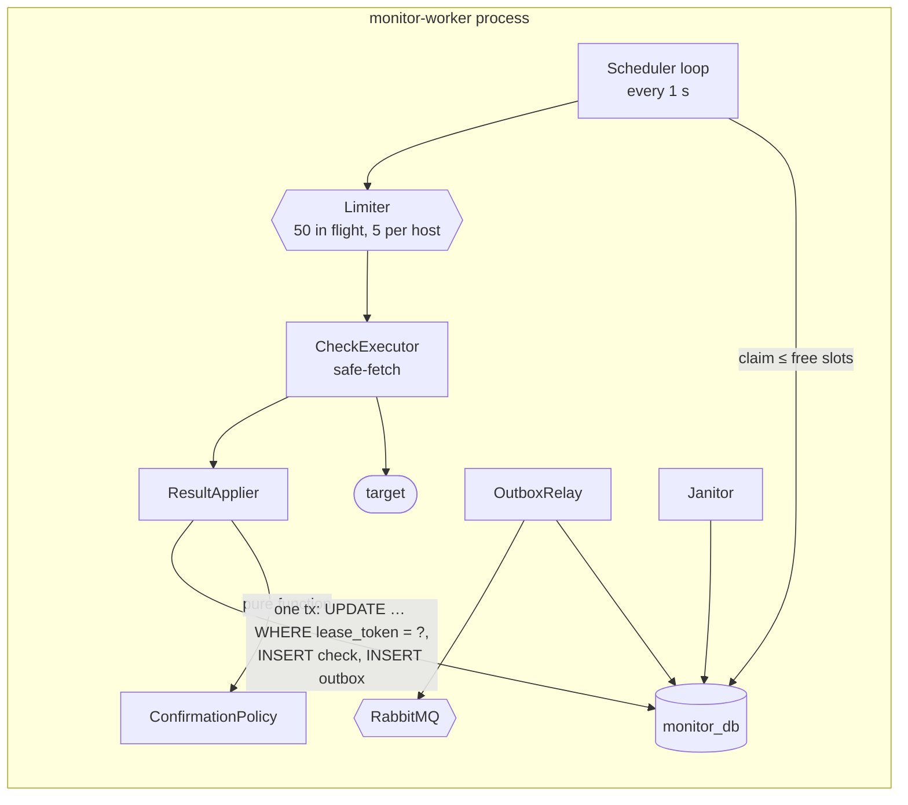

# monitor

**Purpose:** store monitor definitions, check each target on schedule, and decide when a monitor is confirmed up or down. **Bounded context:** Monitoring ([domain model](../02-domain-model.md)).

One service, two process types from one codebase and one database:

| Process | Compose service | `MONITOR_ROLE` | Does |
|---------|-----------------|----------------|------|
| API | `monitor` | `api` | REST CRUD |
| Worker | `monitor-worker` (×N) | `worker` | Claims leases, runs checks, applies results, runs the outbox relay |

Decision records: [ADR-0009](../adr/0009-check-results-and-state-changes.md) (what is published, confirmation), [ADR-0010](../adr/0010-postgres-leases-for-scheduling.md) (coordination), [ADR-0026](../adr/0026-pinger-safety.md) (SSRF, overload), [ADR-0008](../adr/0008-transactional-outbox.md).

## Responsibilities

- CRUD, pause and resume of monitors, scoped to the caller's organization.
- Schedule checks; ensure each due check is run by one worker.
- Execute HTTP checks safely (timeouts, SSRF guard, concurrency cap).
- Apply confirmation rules and maintain the monitor status.
- Publish every check result and every confirmed status change.
- Keep the last 24 hours of checks for the UI.

## Explicitly not responsible for

- **Incidents**, paging or anything about who should be told.
- **Long-term check history, uptime %, latency statistics** (analytics).
- **Deciding whether a status change deserves a human's attention.** It reports the confirmed fact; incident decides what follows.
- **Following redirects or inspecting response bodies** (v1).

## Owned data

`monitor_db`: `monitors` (definition + state + lease), `monitor_checks`, `outbox`. Schema and the three key statements: [monitor-schema](../data/monitor-schema.md).

## Sync APIs

**Exposed** ([monitor.yaml](../contracts/openapi/monitor.yaml)): `GET`/`POST /v1/monitors`; `GET`/`PATCH`/`DELETE /v1/monitors/{id}`; `POST /v1/monitors/{id}/pause`, `/resume`; `GET /v1/monitors/{id}/checks`.

**Consumed:** JWKS from auth (cached). Targets, through `@microsentinel/safe-fetch`. In **Phase 1 only**: `POST http://incident:3000/internal/v1/monitor-signals` (removed in Phase 2).

## Events

**Published** ([catalog](../contracts/event-catalog.md)):

| Event | When | Written by |
|-------|------|-----------|
| `monitor.definition.changed.v1` | Create, edit, pause, resume, delete | API |
| `monitor.check.completed.v1` | Every completed check | Worker |
| `monitor.state.changed.v1` | Confirmed status change; pause; resume | Worker or API |

**Consumed:** none.

## Internal components

| Component | Job |
|-----------|-----|
| `SchedulerLoop` | Every second: `freeSlots = 50 − inFlight`; if > 0, run the claim query; hand each claimed monitor to the limiter |
| `CheckExecutor` | One request with one deadline; classifies the outcome into `SUCCESS` or a `failureReason`; never reads the body |
| `ConfirmationPolicy` | **Pure function**: `(status, counters, thresholds, outcome) → (newStatus, newCounters, statusChanged, nextCheckInSeconds)`. No I/O. The most unit-tested code in the service |
| `ResultApplier` | The completing transaction with the fencing check |
| `MonitorsService` (API) | CRUD with explicit-column updates; pause/resume; outbox rows |
| `OutboxRelay`, `Janitor` | Shared; run in workers only |

## Scaling model

- **API:** stateless; scale by request load. One replica locally.
- **Workers:** scale by number of monitors. Each worker handles up to 50 concurrent checks. Throughput depends on how long targets take: about 500 checks/s when they answer in 100 ms, but only 5 checks/s in the worst case where every target hangs for the full 10 s timeout. Design load is ~17 checks/s, so two workers are ample normally; if many targets hang at once, `monitor.schedule.lag_seconds` grows, and that is the signal to add workers. Add workers with `--scale monitor-worker=N`; no configuration, no rebalancing. Two locally from Phase 3.
- **Partitioning:** none. All workers compete for all due monitors through `SKIP LOCKED`.
- **Worker identity:** `WORKER_ID` defaults to the container hostname; used for `lease_owner` and logs.

## Failure modes

| Dependency down | Effect |
|-----------------|--------|
| PostgreSQL | Workers cannot claim or complete: checks stop. API returns `503`. On recovery, overdue monitors are claimed oldest-first; results of checks that were in flight are discarded by fencing if their lease expired |
| RabbitMQ | Checks continue; results and state changes accumulate in the outbox; published when the broker returns. **No signal is lost**, incidents open late |
| A target is slow or hostile | Bounded by timeout, per-host cap and no-body rule; other targets unaffected |
| One worker dies or is paused | Its leases expire within 60 s; others take over. If it resumes, its stale results are fenced out |
| auth | No effect on workers. API keeps verifying tokens with cached keys |
| Event loop blocked in a worker | Timers fire late: its checks appear slow or time out. Detected through `nodejs.eventloop.delay`; worker reports not-ready |

**When monitor is down:** no checks run, so no new incidents open and existing ones cannot auto-resolve. Nothing else breaks. This is the one outage that makes the product blind, so "checks completed in the last 2 minutes = 0" is the most important alert ([observability](../cross-cutting/observability.md)).

## Observability

| Kind | Items |
|------|-------|
| Metrics | `monitor.checks` by outcome and reason; `monitor.check.duration`; `monitor.schedule.lag_seconds` (now − `next_check_at` at claim); `monitor.checks.in_flight`; `monitor.lease.fenced` (stale completions discarded); `monitor.state_changes` by `to`; `nodejs.eventloop.delay`; outbox metrics |
| Spans | `monitor.check` (root of the outage trace) → `HTTP GET` (client) → `monitor.apply_result` → DB spans. The relay's `ms.events publish` span links the trace onward |
| Log fields | `monitor_id`, `org_id`, `worker_id`, `lease_token`, `outcome`, `failure_reason`, `latency_ms`, `state_version` |

## Patterns applied

[Distributed locks, leases and fencing tokens](../learning/concepts/distributed-locks-leases-fencing.md) · [Node.js event loop and I/O concurrency](../learning/concepts/node-event-loop.md) · [backpressure](../learning/concepts/backpressure.md) · [transactional outbox](../learning/concepts/transactional-outbox.md) · [partitioning and per-key ordering](../learning/concepts/partitioning-and-ordering.md) (`stateVersion`) · [leader election](../learning/concepts/leader-election.md) (deliberately avoided)

## Framework and Nest structure

**NestJS 12** for both roles. The worker is not an HTTP API, but it shares entities, configuration and modules with the API, needs lifecycle hooks for graceful shutdown, and exposes health endpoints, so it boots the same Nest application with different modules enabled.

| Nest element | Use |
|--------------|-----|
| Modules | `MonitorsModule` (API role), `WorkerModule` (worker role), `HealthModule` (both); `AppModule.forRole(role)` is a dynamic module choosing between them. Shared: `MessagingModule`, `AuthGuardModule`, `ObservabilityModule` |
| Guards | `JwtAuthGuard` (global, API role), `RolesGuard` on writes |
| Pipes | Global `ValidationPipe`; `ParseUUIDPipe`; a custom `AcceptedStatusCodesPipe` validating and normalising the range string |
| Interceptors | Logging/timing |
| Exception filter | `ProblemDetailsFilter`; maps unique-violation on name → `409 MONITOR_NAME_TAKEN` |
| Lifecycle | `OnApplicationBootstrap` starts loops; `OnApplicationShutdown` stops claiming, waits up to 35 s for in-flight checks, then releases remaining leases |

Graceful shutdown matters: `docker stop` sends `SIGTERM`; a worker that exits immediately leaves leases to expire (correct, but 60 s of delay per affected monitor).

## Phase introduced

Phase 1 (CRUD, one worker, leases, confirmation; synchronous signal to incident) → Phase 2 (outbox and events) → Phase 3 (several workers, full SSRF guard, per-host cap, event-loop metric).

## Related

Flows: [register-monitor](../flows/register-monitor.md), [outage-to-resolution](../flows/outage-to-resolution.md), [flapping-and-duplicates](../flows/flapping-and-duplicates.md).
