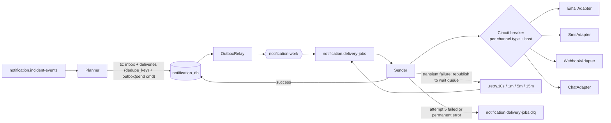

# notification

**Purpose:** deliver pages and incident updates through email, SMS, webhooks and chat webhooks, reliably and without duplicates, and record what happened. **Bounded context:** Notification ([domain model](../02-domain-model.md)).

Decision records: [ADR-0013](../adr/0013-notification-owns-delivery-state.md) (why it is stateful), [ADR-0023](../adr/0023-retry-topology-ttl-dlx.md) (retry and DLQ), [ADR-0028](../adr/0028-local-stand-ins.md) (stand-ins), [ADR-0026](../adr/0026-pinger-safety.md) (SSRF guard for webhooks).

## Responsibilities

- Turn `incident.page.requested.v1` into one delivery per enabled contact method of the paged user.
- Turn incident lifecycle events into one delivery per subscribed organization channel.
- Suppress duplicates with a dedupe key.
- Send with a timeout; retry with increasing delay; give up after 5 attempts and park the failure.
- Cancel pending pages once the incident is acknowledged or resolved.
- Manage contact methods and organization channels; expose the delivery log and manual retry.
- Report each delivery's final outcome as an event.

## Explicitly not responsible for

- **Who gets paged, and when to escalate** (incident). Notification never reads an escalation policy.
- **Incident status.** It reacts to events; it holds no incident model.
- **User identity.** It keeps a minimal replica (email, name).
- **Guaranteeing that a human read the message.** "Sent" means the receiver accepted it.

## Owned data

`notification_db`: `recipients` (replica), `contact_methods`, `org_channels`, `deliveries`, `outbox`, `processed_messages`. Schema: [notification-schema](../data/notification-schema.md).

## Sync APIs

**Exposed** ([notification.yaml](../contracts/openapi/notification.yaml)): `GET`/`POST /v1/contact-methods`, `PATCH`/`DELETE /v1/contact-methods/{id}`; `GET`/`POST /v1/channels`, `PATCH`/`DELETE /v1/channels/{id}`, `POST /v1/channels/{id}/test`; `GET /v1/deliveries`, `POST /v1/deliveries/{id}/retry`.

**Consumed:** JWKS from auth (cached). Outbound sends:

| Channel | Protocol | Local receiver |
|---------|----------|----------------|
| `EMAIL` | SMTP (`nodemailer`) | `mailpit:1025` |
| `SMS` | `POST` JSON to `SMS_GATEWAY_URL` | `dev-stubs:3000/sms/messages` |
| `WEBHOOK` | `POST` JSON with `X-MS-Signature`, `Idempotency-Key` | user URL; in the lab `dev-stubs:3000/webhooks/<inbox>` |
| `CHAT_WEBHOOK` | `POST` `{ "content": … }` | user URL; in the lab `dev-stubs:3000/chat/<inbox>` |

## Events

**Consumed** ([catalog](../contracts/event-catalog.md)):

| Queue | Events | Effect |
|-------|--------|--------|
| `notification.incident-events` | `incident.page.requested.v1` | Plan page deliveries |
| | `incident.opened.v1`, `.acknowledged.v1`, `.escalated.v1`, `.resolved.v1` | Plan organization-channel deliveries; on acknowledged/resolved also cancel pending pages |
| `notification.auth-events` | `auth.user.changed.v1` | Upsert `recipients`; ensure the default `EMAIL` contact method |
| `notification.delivery-jobs` | `notification.delivery.send.v1` (own command) | Send one delivery |

**Published:** `notification.delivery.succeeded.v1`, `notification.delivery.failed.v1`; internally `notification.delivery.send.v1` to `notification.work`.

## Internal components

| Component | Job |
|-----------|-----|
| `Planner` | Event → target list → `INSERT … ON CONFLICT (dedupe_key) DO NOTHING` → send command per new row |
| `Sender` | Lock row, check `PENDING`, bump attempts, send (5 s timeout), record outcome, publish result event |
| `ChannelAdapter` (×4) | One interface: `send(delivery) → { ok } | { retryable, error }`. Renders the message from `payload` |
| `ErrorClassifier` | Timeout, connection error, `429`, `5xx` → retryable. Other `4xx`, invalid address, SSRF block → permanent |
| `CircuitBreaker` (opossum) | Keyed by channel type + destination host. Opens after 5 consecutive failures; half-open after 30 s. While open, sends fail immediately as retryable, without waiting 5 s each |
| `RecipientReplica` | Versioned upsert from `auth.user.changed.v1` |
| `OutboxRelay`, `Janitor` | Shared |

Templates are plain functions per channel and event; no template engine. A page email's subject: `[MicroSentinel] DOWN: Checkout API`.

### Retry schedule

| Attempt | Sent after | Cumulative |
|---------|-----------|-----------|
| 1 | immediately | 0 |
| 2 | 10 s | 10 s |
| 3 | 1 min | 1 min 10 s |
| 4 | 5 min | 6 min 10 s |
| 5 | 15 min | 21 min 10 s |

After attempt 5 fails: status `DEAD`, `notification.delivery.failed.v1`, message dead-lettered to `notification.delivery-jobs.dlq`. Full flow: [notification-retry-and-dlq](../flows/notification-retry-and-dlq.md).

## Scaling model

Stateless processes over one database. Both stages scale with competing consumers: planning is idempotent through the dedupe key; sending is serialised per delivery by the row lock. Prefetch 20 on delivery jobs bounds concurrent sends per replica (a **bulkhead**: slow SMS sends cannot consume more than the prefetch). Circuit-breaker state is per process. Locally: one replica.

## Failure modes

| Dependency down | Effect |
|-----------------|--------|
| A receiver (SMTP, SMS gateway, a webhook host) | That channel's deliveries retry on schedule, then `DEAD`. The breaker opens so other channels are not slowed. Other channels for the same page still go out |
| PostgreSQL | Handlers fail → retry queues. Nothing sent, nothing lost |
| RabbitMQ | Nothing arrives; outcomes wait in the outbox; API works |
| auth | Replica stops updating; sending continues |
| incident | No new events; in-flight deliveries finish |

**When notification is down:** page requests and incident events accumulate in `notification.incident-events`. Incidents still open, escalate (producing more queued pages) and resolve. On restart the backlog is processed in order; pages for incidents that were acknowledged or resolved in the meantime are created and then immediately cancelled by the later event in the same backlog, so stale pages are mostly suppressed. The experiment and its caveats: [service-down-recovery](../flows/service-down-recovery.md).

The unavoidable duplicate window (crash between send and record) is described in [ADR-0013](../adr/0013-notification-owns-delivery-state.md).

## Observability

| Kind | Items |
|------|-------|
| Metrics | `notification.deliveries` by channel and status; `notification.send.duration` by channel; `notification.attempts` histogram; `notification.duplicates_suppressed`; `notification.cancelled`; `notification.circuit.state` by key; DLQ depth; queue lag; `notification.page_to_first_attempt_seconds` |
| Spans | `notification.incident-events process` → `notification.plan`; `notification.delivery-jobs process` → `notification.send` → SMTP/HTTP client span. All in the outage trace |
| Log fields | `delivery_id`, `incident_id`, `page_id`, `channel_type`, `attempt`, `status`, `error`, `dedupe_key`. Targets are logged masked |

## Patterns applied

[Dead-letter queues and poison messages](../learning/concepts/dead-letter-queues.md) · [retries, backoff and jitter](../learning/concepts/retries-backoff-jitter.md) · [circuit breakers and bulkheads](../learning/concepts/circuit-breakers-and-bulkheads.md) · [idempotency](../learning/concepts/idempotency-and-at-least-once.md) · [backpressure](../learning/concepts/backpressure.md) (prefetch) · [event-driven architecture](../learning/concepts/event-driven-architecture.md) (events vs commands)

## Framework and Nest structure

**NestJS 12.**

| Nest element | Use |
|--------------|-----|
| Modules | `ContactMethodsModule`, `ChannelsModule`, `DeliveriesModule` (API + planner + sender), `AdaptersModule`, `RecipientsModule`, `ConsumersModule`, `HealthModule`; shared `MessagingModule`, `AuthGuardModule`, `ObservabilityModule` |
| Providers | Adapters registered under one injection token as a map `ChannelType → ChannelAdapter` (a small strategy pattern through DI) |
| Guards | `JwtAuthGuard` global; `RolesGuard` on channels and delivery retry; an ownership check so users touch only their own contact methods |
| Pipes | Global `ValidationPipe`; a custom validator for E.164 numbers; `SafeUrlPipe` running the SSRF pre-check on channel URLs |
| Interceptors | Logging/timing; a serialisation interceptor that masks targets and never returns `signing_secret` |
| Exception filter | `ProblemDetailsFilter` |

## Phase introduced

Phase 2 (email + webhook, planner/sender, dedupe, DLQ without delays) → Phase 3 (wait-queue retries, SMS and chat, circuit breaker, cancel-on-ack, delivery log UI and redrive).

## Related

Flows: [notification-retry-and-dlq](../flows/notification-retry-and-dlq.md), [outage-to-resolution](../flows/outage-to-resolution.md), [service-down-recovery](../flows/service-down-recovery.md).
